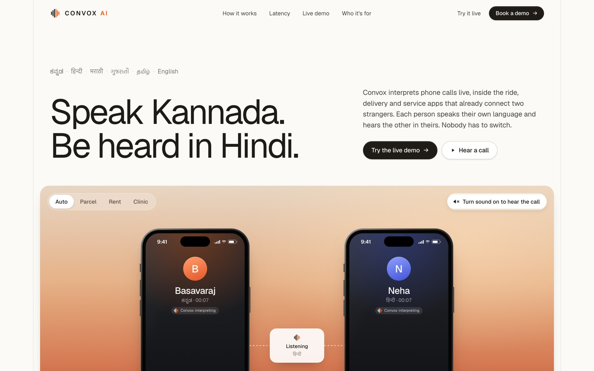
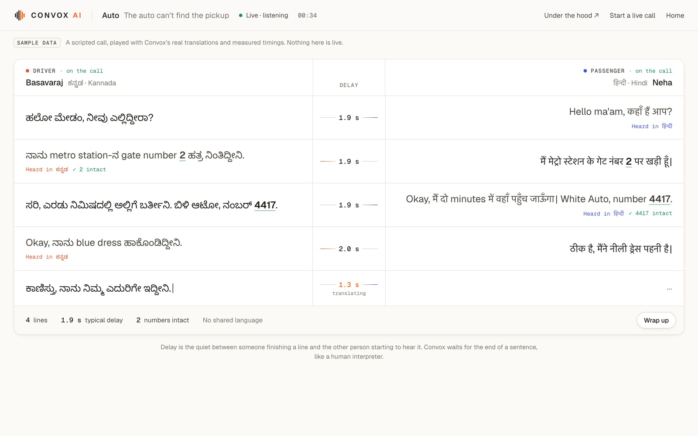

# Convox AI

**A live interpreter for phone calls between two people who don't share a language.**
Each person speaks their own language and hears the other in theirs, about a second and a half after each line ends. Nobody installs anything and nobody has to switch languages.

**[convox.ai](https://convox.ai)** · [Try it live](https://convox.ai/try) · [Watch a sample call](https://convox.ai/demo/preview) · [Book a demo](https://cal.com/rohansx/30min)



## The problem

In Bengaluru, an auto driver who speaks Kannada calls a passenger who speaks Hindi: "where are you?" Neither understands the other, the pickup is missed and the ride is cancelled. The same call fails thousands of times a day across India: couriers at the gate, delivery riders, home-service technicians, clinics and support desks.

Ride, delivery and service apps already connect these two strangers through masked calls on cloud telephony such as Exotel. Convox joins that call on the server and interprets both directions. Nothing changes on either phone. It can switch on only when the two people's languages differ.

## How it works

```text
speaker ── end of utterance ── speech-to-text ── translate ── text-to-speech ──▶ listener
            ~0.3 s               Saaras            Mayura       Bulbul (streams)
```

1. **Listen.** Voice activity detection and end-of-utterance detection wait for the speaker to finish a sentence, the way a human interpreter would.
2. **Interpret.** Sarvam AI transcribes (Saaras), translates (Mayura) and speaks the result in the listener's language (Bulbul), streaming the audio as it's made. Numbers, amounts and codes are checked to make sure they come through intact.
3. **Hand over the floor.** A floor controller decides who's speaking, queues translations, handles one person talking over the other, and is the only code that plays audio to a phone.

**Measured delay:** a median of **1.34 s** of quiet between someone finishing a line and the other person starting to hear it, measured across 65 lines over 9 two-phone calls. Translation is the largest part (about 0.66 s), then end-of-speech detection (0.3 s) and the first audio from text-to-speech (0.2 s). The 90th percentile is 3.9 s.

## The live demo



`/demo` runs a call for an audience using two phones and a laptop:

1. Pick a story: an **auto** driver and passenger (Kannada ⇄ Hindi), a **parcel** rider and customer (Hindi ⇄ Marathi), a **landlord** and tenant (Kannada ⇄ Hindi) or a **clinic** (Gujarati ⇄ English). You can also pick any two languages.
2. Each person scans their own QR code, and each phone shows that person's role and some lines to try.
3. The screen shows each line as it was said and as it was heard, the delay before each line, and the numbers that came through intact.
4. **Wrap up** writes what the two agreed in both languages, using Claude on the speakers' original words, never on the machine translations.

`/demo/{call}/details` is the engineering view for each call: the time each stage took per line, who held the floor, and the event stream.

Languages: Kannada, Hindi, Marathi, Gujarati, Tamil and English.

### Try it yourself

`/try` is public: you're the passenger and the driver is played by Claude, speaking only Kannada. His lines are synthesised and fed into the call like a phone's microphone, so everything you hear has gone through the real speech recognition, translation and voice, with the same timings. Calls last up to 3 minutes, with a few per visitor per day; no recording or transcript is kept.

## Run it locally

Needs Python 3.12 and [uv](https://docs.astral.sh/uv/). Docker is optional; Postgres and Redis are never on the path that carries a call's audio.

```bash
uv sync                     # or: make install
cp .env.example .env        # without vendor keys everything runs on fakes
make test                   # offline tests: no network, no keys
make dev                    # http://127.0.0.1:8000 (one worker: both sides of a call share a process)
```

| URL | What |
|---|---|
| `/` | landing page |
| `/try` | talk to an AI auto driver who speaks only Kannada, through the real pipeline (public, capped) |
| `/demo/preview` | the live demo playing a scripted call (no keys needed) |
| `/demo` | start a live two-phone call (console password) |
| `/join` | two phones without the stage: the language is detected automatically |
| `/ward` | one phone shared by two people |
| `/loopback/new` | one browser tab for each side of a call, for development |
| `/console` | live console: lines, floor state and the time each stage took, over SSE |

To use the real engines, put `SARVAM_API_KEY` in `.env` and set `STT_IMPL`, `MT_IMPL` and `TTS_IMPL` to `real`. Add `ANTHROPIC_API_KEY` for the outcome card. `make smoke` checks the vendors end to end. See [dev setup](docs/engineering/dev-setup.md).

## Architecture

One `CallSession` per call owns:
- **two legs,** one per person, behind one `LegTransport` interface: Exotel, Plivo, a browser over WebRTC, or a fake;
- **two interpreter pipelines,** one per direction;
- **one `FloorController`.**

Inside, audio is always 16 kHz mono PCM16 in 20 ms frames, resampled at the edge of each leg. Every component sits behind a Protocol with a deterministic fake, so the whole pipeline runs and is tested offline (about 1,300 tests).

Start with the [docs index](docs/README.md), the [system overview](docs/architecture/system-overview.md), the [floor controller](docs/tech-spec/floor-controller.md) and the [interpreter pipeline](docs/tech-spec/interpreter-pipeline.md).

```text
convox/
  api/        FastAPI app, landing page and demo routes, console, auth
  audio/      frames, resampling, mixer, wav
  console/    templates and static files: landing page, live demo, console, phone pages
  demo/       demo stories and the Claude outcome summary
  interp/     the pipeline: VAD, end of utterance, MT cache, contracts
  join/       two-phone join flow and QR codes
  legs/       Exotel, Plivo, WebRTC and fake legs
  providers/  Sarvam (Saaras, Mayura, Bulbul), ElevenLabs, Deepgram, fakes
  session/    CallSession, FloorController, registry
  store/      SQLAlchemy models, background turn writer
  telephony/  Exotel and Plivo call APIs
  ward/       one-phone mode
deploy/       compose file and push script for the VPS
tools/        smoke, bench, fixtures, landing and preview generators
docs/         product, architecture, tech spec, engineering, plan
```

## Status

| Area | State |
|---|---|
| Live interpretation between two phones (browser) | Works with the real Sarvam engines; the delay figures above come from these calls |
| Live demo, outcome summary, engineering view | Live at [convox.ai](https://convox.ai) |
| Exotel (real phone numbers) | Built and tested against the documented protocol; waiting on number verification before the first real call |
| Plivo | Built and tested with mocks; waiting on account verification |
| Kannada, Marathi and Gujarati wording | Still needs a native speaker's review |

## Deploying

Production runs on a single VPS behind Traefik, with Let's Encrypt certificates: `./deploy/push.sh` syncs the code, rebuilds and restarts the app. A redeploy drops calls in progress. See [deployment](docs/engineering/deployment.md).

## Contributing

Read the [conventions](docs/engineering/conventions.md) first. `make lint` and `make test` must pass before every commit, and CI runs both.

Speech by [Sarvam AI](https://www.sarvam.ai) · Telephony by [Exotel](https://exotel.com) · Summaries by [Claude](https://www.anthropic.com/claude)
