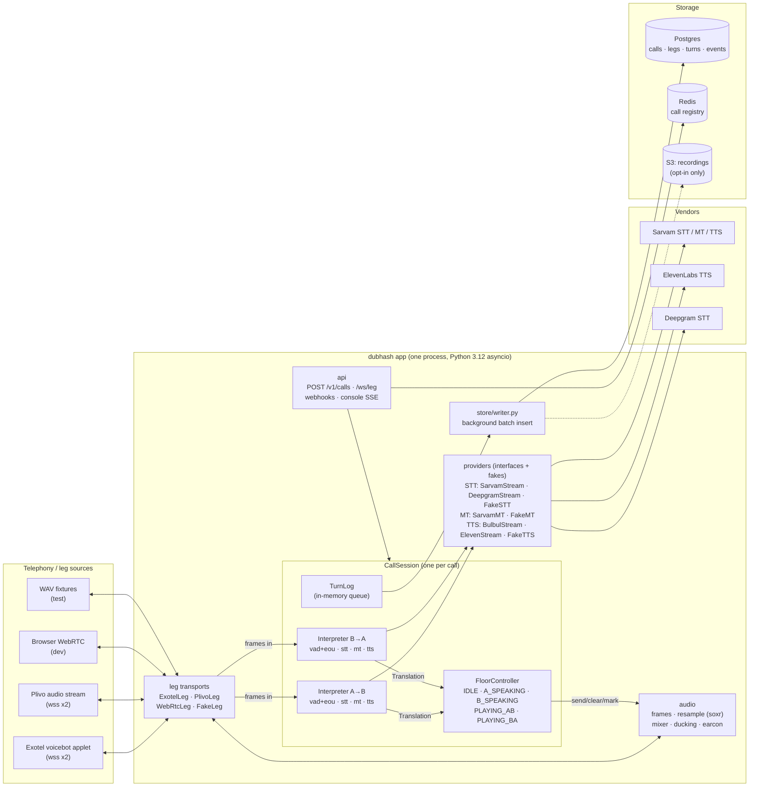
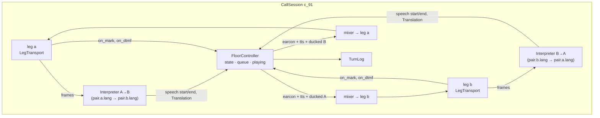
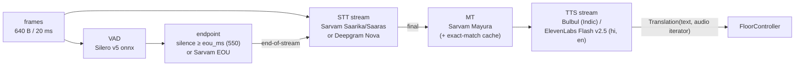
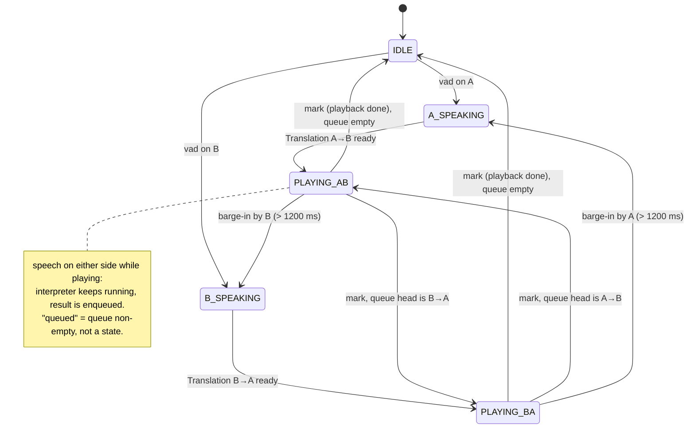
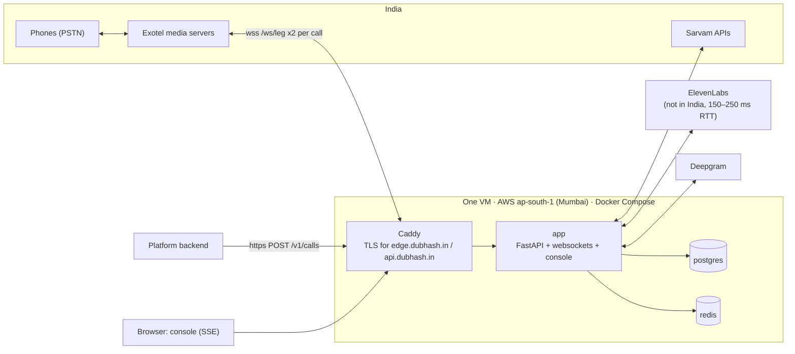

# System overview

This document is the map of the dubhash server: what runs, where state lives, how a call goes from `POST /v1/calls` to the first translated word, and the rules that keep the hot path fast. It is written for the five engineers building v1 and is the place to start before reading any of the detailed specs under [`../tech-spec/`](../tech-spec/). The detailed behaviour of each component lives in its own spec; this page explains how they fit together. The reasons behind each choice are recorded in the [ADRs](adr/README.md).

## What the system is, in one paragraph

dubhash is a server that sits in the middle of a phone call between two humans who speak different Indian languages and interprets both directions live. The CPaaS (Exotel primary, Plivo fallback) places **two separate calls**, one to each person, and each call is attached to a two-way audio websocket that terminates on our server. The CPaaS never connects A to B. dubhash joins the two legs itself: it hears A, translates, and speaks to B, and the other way round. The whole product is the bridge, the turn-taking (floor controller) and the integrations; every speech engine is a vendor behind an interface. See [telephony-integration.md](telephony-integration.md) for why the call has to be built this way.

## Components



Everything on the left of the app box is swappable per environment. Everything on the right is a vendor behind an interface with a fake. Source: tech spec figure 2.1.

| Component | Module | Responsibility | Spec |
|---|---|---|---|
| API | `dubhash/api/` | FastAPI app: `/v1/calls`, `/v1/calls/{id}`, `/ws/leg`, `/webhooks`, `/console` (SSE). Creates `CallSession`s, routes provider websockets to them. | [api.md](../tech-spec/api.md) |
| Leg transports | `dubhash/legs/` | `base.py` (`LegTransport`), `exotel.py`, `plivo.py`, `webrtc.py`, `fake.py`. Hide every provider difference behind one protocol. | [leg-transports.md](../tech-spec/leg-transports.md) |
| Audio | `dubhash/audio/` | `frames.py` (20 ms PCM16 @ 16 kHz), `resample.py` (soxr), `mixer.py` (duck + earcon), `wav.py`. | [audio.md](../tech-spec/audio.md) |
| CallSession | `dubhash/session/` | Owns 2 legs, 2 interpreter pipelines, 1 `FloorController`, the turn log. | below |
| FloorController | `dubhash/session/` | The only code allowed to call `send()`, `clear()`, `mark()` on a leg. Queue, backchannel rule, barge-in, DTMF. | [floor-controller.md](../tech-spec/floor-controller.md) |
| Interpreter | `dubhash/interp/` | `vad.py`, `endpoint.py`, `stt.py`, `mt.py`, `tts.py`, `pipeline.py`. One per direction. | [interpreter-pipeline.md](../tech-spec/interpreter-pipeline.md) |
| Providers | `dubhash/providers/` | `sarvam_stt.py`, `sarvam_mt.py`, `sarvam_tts.py`, `eleven_tts.py`, `deepgram_stt.py`, `fakes.py`. | [interpreter-pipeline.md](../tech-spec/interpreter-pipeline.md) |
| Store | `dubhash/store/` | `models.py` (SQLAlchemy), `writer.py` (async batch insert). | [data-model.md](../tech-spec/data-model.md) |
| Config | `dubhash/config/` | `pairs.yaml` (per language pair: stt, mt, tts voice, `eou_ms`), `settings.py`. | [configuration.md](../tech-spec/configuration.md) |
| Console | `dubhash/console/` | Templates + SSE. Server-rendered HTML, htmx, no SPA. | [console.md](../tech-spec/console.md) |
| Tools | `tools/` | `loopback.py` (two browser legs), `bench.py` (latency harness), `label.py` (rater UI). | [testing-strategy.md](../engineering/testing-strategy.md) |

Full tree: [repo-structure.md](../engineering/repo-structure.md).

## One process per call

A call's two legs must land on **the same process**, because they share one `FloorController` and one `CallSession`. There is no distributed state in the hot path.

- The API creates the `CallSession` and records it in the in-process session table (and in the Redis call registry for cross-node lookup).
- Each leg's provider websocket carries the call id and side in its URL: `wss://edge.dubhash.in/ws/leg?call=c_91&side=a&sample-rate=16000`. The `/ws/leg` handler looks up `call` and attaches the transport to side `a` or `b` of that session.
- One asyncio task owns a call. The session dies when both legs close.
- v1 runs on a single VM ([ADR 0010](adr/0010-single-vm-mumbai.md)), so "same process" is automatic. Redis exists so that a second node can find which process owns a call id later; it is not read per frame. See [ADR 0009](adr/0009-in-process-call-state.md).

## CallSession



| Owns | Count | Notes |
|---|---|---|
| `LegTransport` | 2 (`a`, `b`) | attached when the provider websocket connects; interpreting starts when **both** have sent `start` |
| `Interpreter` | 2 (A→B, B→A) | input side runs continuously and independently of playback |
| `FloorController` | 1 | one asyncio task per call; owns state, queue, and all `send/clear/mark` calls |
| `TurnLog` | 1 | in-memory queue drained by the background writer |

Lifecycle: `POST /v1/calls` → `CallSession.create()` → dial both legs → both websockets `start` → opening line → interpret → either side hangs up or `POST /v1/calls/{id}/hangup` → both legs close → session ends, `calls` row finalised with `duration_s`, `interpreted_s`, `turns`, `p50_first_audio_ms`, `p95_first_audio_ms`, `escape_used`.

If one leg fails to answer within 25 s, the other hears "doosri taraf se jawab nahi aaya" and is hung up ([telephony-integration.md](telephony-integration.md#outbound-two-leg-setup)).

## The two interpreter pipelines

Two mirrored pipelines, one per direction. Each one is:



- STT runs **during** speech, so only the final is on the critical path. MT and TTS are the serial part. TTS audio streams to the listener's leg as it arrives.
- Utterances under 600 ms with 2 words or fewer are tagged `backchannel` and not translated.
- Voice is chosen from `pairs.yaml` by target language and detected speaker gender (pitch heuristic). v1 uses **a gender-matched natural voice**, not a clone ([ADR 0012](adr/0012-no-voice-cloning-v1.md)).
- Interpreters never talk to transports. They hand finished `Translation` objects (text + async audio iterator) to the controller.

Latency after the speaker stops: EOU wait (start 550 ms) + about 1.2 s (STT final + MT + TTS first byte + playout) = about **1.4 to 1.8 s** to the first translated word. Targets: **p50 under 1.5 s, p95 under 2.0 s, measured on real PSTN, not loopback.** Detail in [interpreter-pipeline.md](../tech-spec/interpreter-pipeline.md) and [latency-engineering.md](../engineering/latency-engineering.md).

## Floor controller, in one diagram

The code states are `IDLE`, `A_SPEAKING`, `B_SPEAKING`, `PLAYING_AB`, `PLAYING_BA`. "Queued" is a **condition** (queue non-empty while playing), not an enum state.



Full rules, invariants and DTMF behaviour: [floor-controller.md](../tech-spec/floor-controller.md).

## Providers behind interfaces, with fakes

The rule for the build: **every component is behind an interface with a fake.** The pipeline must run end to end with `FakeLeg` (wav in, wav out) on day 2, so STT, MT, TTS and the controller can be built and measured before any telephony credit exists.

| Interface | Real implementations | Fake | Selected by |
|---|---|---|---|
| `LegTransport` | `ExotelLeg`, `PlivoLeg`, `WebRtcLeg` (dev) | `FakeLeg` (plays a wav in real time or faster, captures outbound to wav) | `provider` in `POST /v1/calls`; dev/test harness |
| STT | `SarvamStream` (Saarika/Saaras websocket), `DeepgramStream` (Nova, English/Hinglish fallback) | `FakeSTT` | `pairs.yaml` per leg (`stt:`) |
| MT | `SarvamMT` (Mayura) | `FakeMT` | `pairs.yaml` |
| TTS | `BulbulStream` (Indic targets: kn, ta, mr, te, ml, bn, gu, pa, od), `ElevenStream` (Flash v2.5: hi, en targets) | `FakeTTS` | `pairs.yaml` per target language (`tts:`, `voice_m`, `voice_f`) |

Pipecat's service classes (Silero VAD, Exotel serializer, Sarvam/ElevenLabs clients) may be borrowed as libraries where they save time; Pipecat's pipeline is not used ([ADR 0002](adr/0002-own-topology-not-pipecat.md)).

## Storage

| Store | What | Written by | Read by |
|---|---|---|---|
| Postgres | `calls`, `legs`, `turns`, `events` (dtmf, barge_in, gap, provider_error, bypass) | `store/writer.py`, async batch insert from the in-memory turn queue | `GET /v1/calls/{id}`, `GET /v1/calls/{id}/turns`, nightly p50/p95 per stage per pair |
| Redis | call registry (call id → owning node) and cross-node lookup | API on create / session on close | `/ws/leg` attach on another node (not needed on one VM) |
| S3 | recordings | only when opted in | — |

Privacy defaults: text is stored only if the call was created with `record: true` or the platform opted in; otherwise `src_text`/`tgt_text` are nulled after latency metrics are computed. **Audio is never stored by default.** See [data-model.md](../tech-spec/data-model.md) and [security-privacy.md](../tech-spec/security-privacy.md).

## Hot path rules

The hot path is everything between a frame arriving on one leg and the mixed frame leaving on the other.

1. **No Postgres or Redis in the hot path.** Turn rows go into an in-memory queue; a background task batch-inserts them.
2. **No distributed state.** Both legs of a call are on one process; one asyncio task owns the call.
3. **Only the `FloorController` calls `send()`, `clear()`, `mark()`.** Interpreters hand over `Translation` objects.
4. **Audio is 16 kHz, PCM16 mono, 20 ms frames (640 bytes) everywhere inside.** Resample (soxr) only at the transport edge, and only if the provider will not do 16k ([ADR 0004](adr/0004-audio-16k-pcm16-20ms.md)).
5. **CPU work in numpy / onnx.** Resample, mixer, VAD. A Rust port of the hot path only if a CPU profile says so ([ADR 0001](adr/0001-python-asyncio.md)).
6. **Never block the event loop.** Vendor I/O is async websockets; warm STT/TTS sockets are kept per leg (per leg-direction for TTS) instead of reconnecting per utterance.
7. **Never drop a translation.** Every `Translation` is played to completion or marked `clipped` with the ms played.
8. **Never exceed int16 in the mixer.** Clipping is checked and flagged on the turn.
9. **Outbound to the provider is chunked at 100 ms** (3,200 bytes at 16k, a multiple of 320). The mixer writes 20 ms frames; the transport chunks.

## Call setup through first translated turn

Platform integration, Exotel provider, hi→kn. Timings are the targets above.

```mermaid
sequenceDiagram
  autonumber
  participant P as Platform backend
  participant API as dubhash api
  participant S as CallSession c_91
  participant R as Redis
  participant EX as Exotel
  participant A as Phone A (hi)
  participant B as Phone B (kn)
  participant V as Vendors (Sarvam / ElevenLabs)

  P->>API: POST /v1/calls {a, b, provider: exotel, mode: interpret, ...}
  API->>S: CallSession.create()
  API->>R: register c_91 → this node
  par leg a
    S->>EX: POST /v1/Accounts/{sid}/Calls/connect From=A CallerId=exophone Url=applet-flow(side=a)
  and leg b
    S->>EX: POST /v1/Accounts/{sid}/Calls/connect From=B CallerId=exophone Url=applet-flow(side=b)
  end
  API-->>P: 201 {call_id: c_91, status: ringing}
  EX->>A: ring
  EX->>B: ring
  A-->>EX: answer
  EX->>API: WS /ws/leg?call=c_91&side=a&sample-rate=16000
  EX->>API: connected, start {stream_sid, call_sid, from, to, media_format}
  API->>S: attach ExotelLeg a (confirm sample rate from media_format)
  B-->>EX: answer
  EX->>API: WS /ws/leg?call=c_91&side=b&sample-rate=16000
  EX->>API: connected, start
  API->>S: attach ExotelLeg b
  EX->>API: POST /webhooks/exotel (answered)
  Note over S: both legs sent start → interpreting begins<br/>(25 s no-answer rule otherwise)
  S->>A: opening line (hi)
  S->>B: opening line (kn)
  A->>EX: "bhaiya main gate ke bahar hoon, kaunsa building?"
  EX->>S: media (base64 PCM) → 640-byte frames
  S->>V: Sarvam STT stream (partials during speech)
  Note over S: VAD silence ≥ 550 ms → EOU (or Sarvam EOU earlier)
  S->>V: end-of-stream → STT final
  S->>V: Sarvam translate hi-IN → kn-IN
  S->>V: TTS stream (Bulbul, kn, gender-matched voice)
  V-->>S: first audio chunk (ttfb)
  Note over S: FloorController IDLE → PLAYING_AB
  S->>EX: leg b media: earcon (120 ms) + tts at 0 dB + A ducked −14 dB, 100 ms chunks, then mark
  EX->>B: plays translation (~1.4–1.8 s after A stopped)
  EX-->>S: mark (playback done)
  Note over S: PLAYING_AB → IDLE; Turn row queued for writer
```

## Deployment topology



- One VM in ap-south-1, Docker Compose with four services: `app`, `postgres`, `redis`, `caddy` (TLS). The console is served by the same app on the same box.
- Mumbai because Exotel's media servers and Sarvam are in India; every 100 ms of RTT shows up in the latency budget. ElevenLabs is not in India (150 to 250 ms RTT from Mumbai), which is why Bulbul is primary for Indic targets.
- Exotel may need the VM's IP allowlisted (auth is Basic auth header or IP allowlist).
- No Kubernetes in v1: nothing to orchestrate yet. See [ADR 0010](adr/0010-single-vm-mumbai.md) and [deployment.md](../engineering/deployment.md).

The sources use `edge.dubhash.in` for leg websockets and `api.dubhash.in` for the platform API. On one VM both terminate at Caddy. Final DNS layout: TBD — see [open questions](../plan/open-questions.md).

## Environments

| Environment | Legs | Providers | Purpose |
|---|---|---|---|
| test | `FakeLeg` x2 from `tests/fixtures/*.wav` | fakes or real | unit, `test_pipeline.py`, `test_floor.py`, `tools/bench.py` |
| dev / loopback | `WebRtcLeg` x2 (two browser tabs) | real | daily correctness; fallback demo if telephony credits fail |
| PSTN | `ExotelLeg` / `PlivoLeg` | real | the only place latency numbers for the deck come from |

## Non-goals for v1

Voice cloning. Simultaneous (overlapping) interpretation. More than two legs. Recording by default. Any language whose STT we have not measured on PSTN. A React console. Kubernetes.

## Related

- [telephony-integration.md](telephony-integration.md)
- [ADR index](adr/README.md)
- [interpreter-pipeline.md](../tech-spec/interpreter-pipeline.md)
- [floor-controller.md](../tech-spec/floor-controller.md)
- [leg-transports.md](../tech-spec/leg-transports.md)
- [audio.md](../tech-spec/audio.md)
- [api.md](../tech-spec/api.md)
- [data-model.md](../tech-spec/data-model.md)
- [configuration.md](../tech-spec/configuration.md)
- [latency-engineering.md](../engineering/latency-engineering.md)
- [deployment.md](../engineering/deployment.md)
- [repo-structure.md](../engineering/repo-structure.md)
- [open-questions.md](../plan/open-questions.md)
