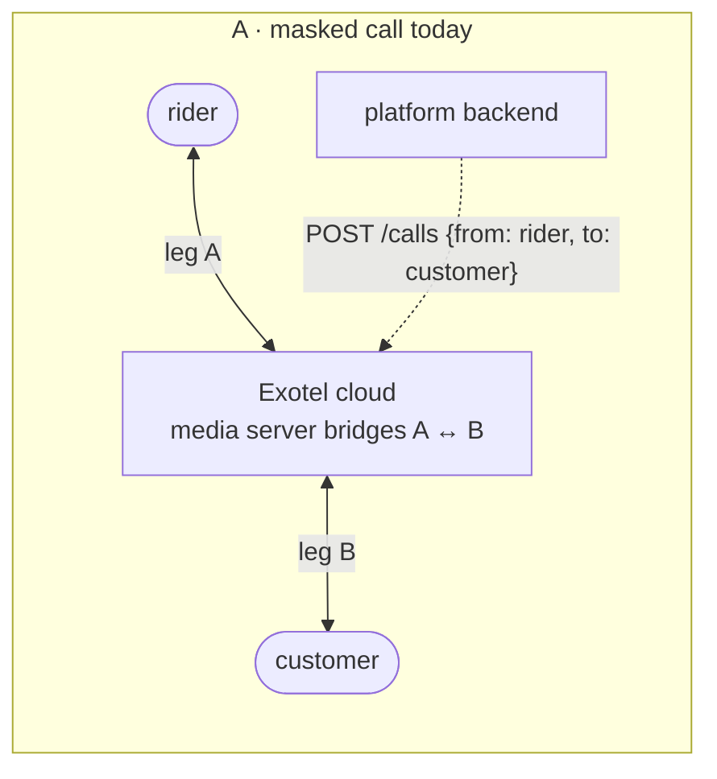
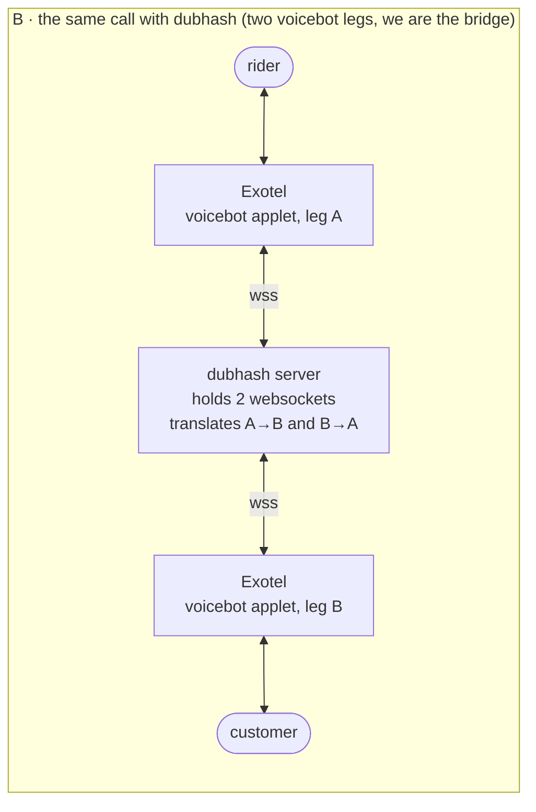
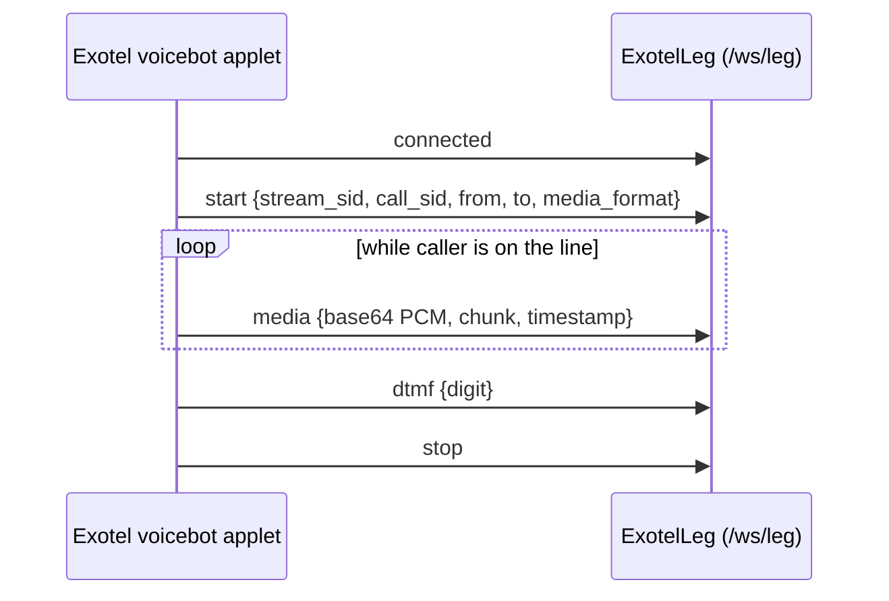
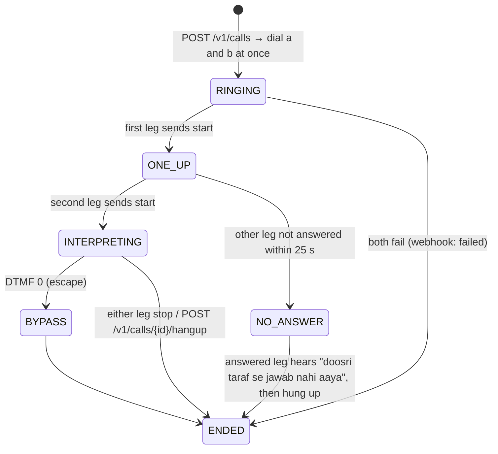

# Telephony integration

This document explains how dubhash gets inside a phone call, which is the part the whole product depends on and the part that is least obvious. It covers why a direct call cannot be touched, how number masking already routes gig-platform calls through a CPaaS, the two-voicebot-leg trick that makes dubhash the bridge, the Exotel voicebot applet message protocol, the Plivo equivalent, outbound two-leg setup with the 25 s no-answer rule, the consumer dial-in IVR flow, and what a platform changes to integrate. Implementation detail of each transport class is in [leg-transports.md](../tech-spec/leg-transports.md).

## A direct call cannot be touched

When Ramesh dials Priya, the audio goes phone → tower → Airtel or Jio switches → Priya's phone. Nothing in that path is ours. The only way to be inside a call is to make the call pass through a server we control.

In India the legal, scalable way to do that is a **CPaaS**: Exotel, Plivo, Ozonetel. They own virtual numbers, carrier interconnects and a media server. When a call touches one of their numbers it terminates in their cloud, and from there their API decides what happens: ring another phone and bridge, play audio, record, or stream the audio to us.

Carriers (Jio, Airtel) could ship interpretation network-side; they have not, and their incentive is minutes, not comprehension. dubhash goes through the CPaaS instead.

## Gig platforms already do this: number masking

When a Swiggy rider taps "call customer", his phone does not dial the customer. The app calls Swiggy's backend, which calls Exotel's API: dial the rider (leg A), dial the customer (leg B), connect them, show both a virtual number. Exotel's media server sits between the two legs. That is why the caller ID is a 0806-something number and why neither party learns the other's real number.

Every one of these calls already passes through a CPaaS cloud. **dubhash does not create an interception point. It asks to sit in one that exists.** The phones, the numbers and the masking are unchanged.

## The two-voicebot-leg trick

Exotel's call flow is a chain of "applets":

| Applet | Direction | Use to dubhash |
|---|---|---|
| Stream applet | one-way: Exotel forks audio to us; we cannot speak | not usable |
| **Voicebot applet** | two-way: Exotel opens a websocket to our server, sends the caller's audio, and plays what we send back | the whole interception story |

One voicebot applet gives a two-way channel with **one** human. So dubhash does not ask Exotel to connect A to B. It asks for **two calls**, each with a voicebot applet pointed at its own websocket, and joins them itself. Exotel thinks it is running two separate voice bots. dubhash is the only thing joining them, so it hears and speaks on both sides. This applet is how Bolna and Pipecat connect to Exotel today; Plivo ships an equivalent.





The platform backend changes one line: it calls dubhash instead of Exotel. dubhash calls Exotel.

## Exotel voicebot applet: message protocol

### Leg URL

Each leg's voicebot applet points at:

```
wss://edge.dubhash.in/ws/leg?call=c_91&side=a&sample-rate=16000
```

Exotel allows 3 custom params; `call` and `side` are two of them. The `/ws/leg` handler uses `call` to find the `CallSession` and `side` (`a` | `b`) to attach the leg ([system-overview.md](system-overview.md#one-process-per-call)).

### Inbound (Exotel → dubhash)



| Event | Fields (as stated in the sources) | ExotelLeg action |
|---|---|---|
| `connected` | — | open the leg |
| `start` | `stream_sid`, `call_sid`, `from`, `to`, `media_format` | confirm sample rate from `media_format`; store `stream_sid`, `call_sid` on the `legs` row; signal session "leg started" |
| `media` | base64 PCM, `chunk`, `timestamp` | decode base64, slice into 640-byte frames (20 ms PCM16 @ 16k), push to the frame queue |
| `dtmf` | digit | `on_dtmf` callback → `FloorController.on_dtmf` |
| `stop` | — | close leg, record `close_reason` |

Audio is raw 16-bit PCM, mono, base64. The overview says **8 kHz by default or 16 kHz on request**; the spec calls Exotel's documentation ambiguous, so treat this as unconfirmed until tested (next section).

### Outbound (dubhash → Exotel)

| Message | Meaning | Who sends it |
|---|---|---|
| `media` | audio to play to this caller. Buffer `send()` bytes and flush as **100 ms** media events (**3,200 bytes at 16k, must be a multiple of 320**). Smaller chunks make `clear` more responsive; stay at 100 ms. | transport, on `FloorController` → mixer output |
| `clear` | drop queued, not-yet-played audio (barge-in) | `FloorController.on_barge_in` |
| `mark` | ask Exotel to tell us when audio sent before this point has played | `FloorController` after each translation; Exotel echoes the mark back and `on_mark` fires |

### Sample rate: test first

Confirm the sample rate from the `start` message's `media_format`. If Exotel sends 8k regardless of `sample-rate=16000`, resample (soxr) in both directions and log it. The documentation is ambiguous on this and it is **the first thing to test** with the first sponsor minute. It decides whether a resampler sits on the hot path. See [open questions](../plan/open-questions.md) (Exotel 16 kHz) and [ADR 0004](adr/0004-audio-16k-pcm16-20ms.md).

### Auth

Basic auth header or IP allowlist. Ask Exotel to allowlist the VM's IP ([deployment.md](../engineering/deployment.md)).

## Plivo equivalent

Plivo is the fallback provider, self-serve once the Udyam registration is verified. `PlivoLeg` implements the same `LegTransport`; everything above the transport sees no difference.

| Concern | Exotel | Plivo |
|---|---|---|
| Stream setup | Voicebot applet in a call flow (applet flow URL) | Audio stream element in the answer XML: `bidirectional=true`, `audioTrack=inbound` |
| Format | PCM16 mono base64, `sample-rate=16000` requested | `contentType=audio/x-l16;rate=16000` if accepted, else `audio/x-mulaw;rate=8000` and decode/resample |
| Inbound events | `connected`, `start`, `media`, `dtmf`, `stop` | same shape: `start` / `media` / `dtmf` / `stop` |
| Play audio | `media` | `playAudio` |
| Barge-in | `clear` | `clearAudio` |
| Playback marks | `mark` | `checkpoint` |
| Place a call | `POST /v1/Accounts/{sid}/Calls/connect` | `POST /v1/Account/{id}/Call/` |

Whether Plivo's India region supports `audio/x-l16;rate=16000` on bidirectional streams, or mulaw 8k only, is open: TBD — see [open questions](../plan/open-questions.md).

Twilio was rejected: India numbers and quality are worse, and it is not a sponsor ([ADR 0003](adr/0003-telephony-exotel-primary-plivo-fallback.md)).

## Outbound two-leg setup

```
# POST /v1/calls → CallSession.create() → for each side:
#   exotel: POST /v1/Accounts/{sid}/Calls/connect  From=<number>  CallerId=<exophone>  Url=<applet-flow-url>
#           the flow has one Voicebot applet pointing at wss://edge.dubhash.in/ws/leg?call=c_91&side=a
#   plivo:  POST /v1/Account/{id}/Call/  to=<number>  from=<plivo number>  answer_url=<xml with Stream element>
# both legs ring at once. the session starts interpreting when both websockets have sent `start`.
# if one leg fails to answer within 25 s, the other hears "doosri taraf se jawab nahi aaya" and is hung up.
```



These are call-lifecycle stages for the session, not `FloorController` states. Exact `calls.status` values beyond `ringing`: TBD — see [open questions](../plan/open-questions.md).

Notes:

- Both legs show the platform's `caller_id` (the masked number), so masking is unchanged.
- `mode: "bridge"` places the same two legs but runs the controller as a plain mixer from the start (same as DTMF 0 bypass): each leg's frames forwarded to the other at 0 dB, interpreters stopped.
- Call status callbacks (answered, completed, failed) arrive at `POST /webhooks/exotel` and `POST /webhooks/plivo`.

## Dial-in IVR flow (consumer)

A consumer dials one public dubhash number, enters the number to reach, and says one sentence so dubhash detects their language. dubhash dials the other side and bridges. No app.

```
# dial-in flow (consumer): exotel applet chain on the public number
#   Gather(digits=10) → Passthru(https://…/dialin/target) → our server creates the session, dials leg b,
#   and returns the flow that puts leg a on the Voicebot applet. language for leg a: auto-detect on first utterance
#   via Sarvam language id, fall back to a DTMF menu.
```

```mermaid
sequenceDiagram
  autonumber
  participant C as Caller (leg a)
  participant EX as Exotel (public number)
  participant API as dubhash /dialin/target
  participant S as CallSession
  participant T as Target (leg b)
  C->>EX: dials public dubhash number
  EX->>C: Gather(digits=10)
  C->>EX: enters 10-digit target number
  EX->>API: Passthru with digits
  API->>S: create session
  S->>EX: dial leg b (Calls/connect, voicebot applet side=b)
  API-->>EX: flow that puts leg a on the Voicebot applet (side=a)
  EX->>API: WS /ws/leg?call=…&side=a
  EX->>T: ring
  T-->>EX: answer → WS /ws/leg?call=…&side=b
  C->>S: first utterance
  S->>S: Sarvam language id on leg a (fallback: DTMF menu)
  Note over S: interpreting begins; leg b language: TBD — see open questions
```

How leg b's language is determined in the dial-in flow is not stated in the sources: TBD — see [open questions](../plan/open-questions.md). Pricing for the consumer number (free for the first 10 minutes a month, then UPI per minute) is in [business-model.md](../product/business-model.md). The dial-in IVR is first on the cut list ([risks.md](../plan/risks.md)).

## Platform integration: before and after

```
# before: platform backend bridges via exotel directly
POST https://api.exotel.com/v1/Accounts/{sid}/Calls/connect
  From=+91RIDER  To=+91CUSTOMER  CallerId=+9180XXXXXXX

# after: one line changes
POST https://api.dubhash.in/v1/calls
  { "a": {"number": "+91RIDER",    "lang": "hi-IN"},
    "b": {"number": "+91CUSTOMER", "lang": "kn-IN"},
    "provider": "exotel",
    "caller_id": "+9180XXXXXXX",
    "mode": "interpret",            # or "bridge" to pass through
    "escape_dtmf": "0",
    "webhook": "https://platform/.../call-events",
    "record": false }
→ 201 { "call_id": "c_91", "status": "ringing" }

# dubhash then calls exotel twice, each with a voicebot applet:
#   leg a → wss://edge.dubhash.in/ws/leg?call=c_91&side=a&sample-rate=16000
#   leg b → wss://edge.dubhash.in/ws/leg?call=c_91&side=b&sample-rate=16000
```

The platform invokes dubhash only when the two profiles' languages differ, and is billed per interpreted minute. What it gets back:

| Event | Payload |
|---|---|
| `call.started` | both legs up, languages confirmed (profile or auto-detected from first utterance) |
| `turn` (per utterance) | side, source text, translated text, latency to first audio, whether it was clipped by barge-in |
| `call.ended` | duration, interpreted minutes, turns, p50/p95 latency, escape used (y/n), both-side transcript if the platform opted in |

Plus `GET /v1/calls/{id}/turns`: the per-turn log a platform's support team uses to see exactly what each side heard when a dispute comes in. The DTMF 0 escape hatch and this audit log are what get dubhash through a platform's trust review. Full API: [api.md](../tech-spec/api.md).

## Related

- [system-overview.md](system-overview.md)
- [leg-transports.md](../tech-spec/leg-transports.md)
- [api.md](../tech-spec/api.md)
- [audio.md](../tech-spec/audio.md)
- [floor-controller.md](../tech-spec/floor-controller.md)
- [security-privacy.md](../tech-spec/security-privacy.md)
- [ADR 0003: telephony](adr/0003-telephony-exotel-primary-plivo-fallback.md)
- [ADR 0004: audio format](adr/0004-audio-16k-pcm16-20ms.md)
- [deployment.md](../engineering/deployment.md)
- [open-questions.md](../plan/open-questions.md)
- [risks.md](../plan/risks.md)
