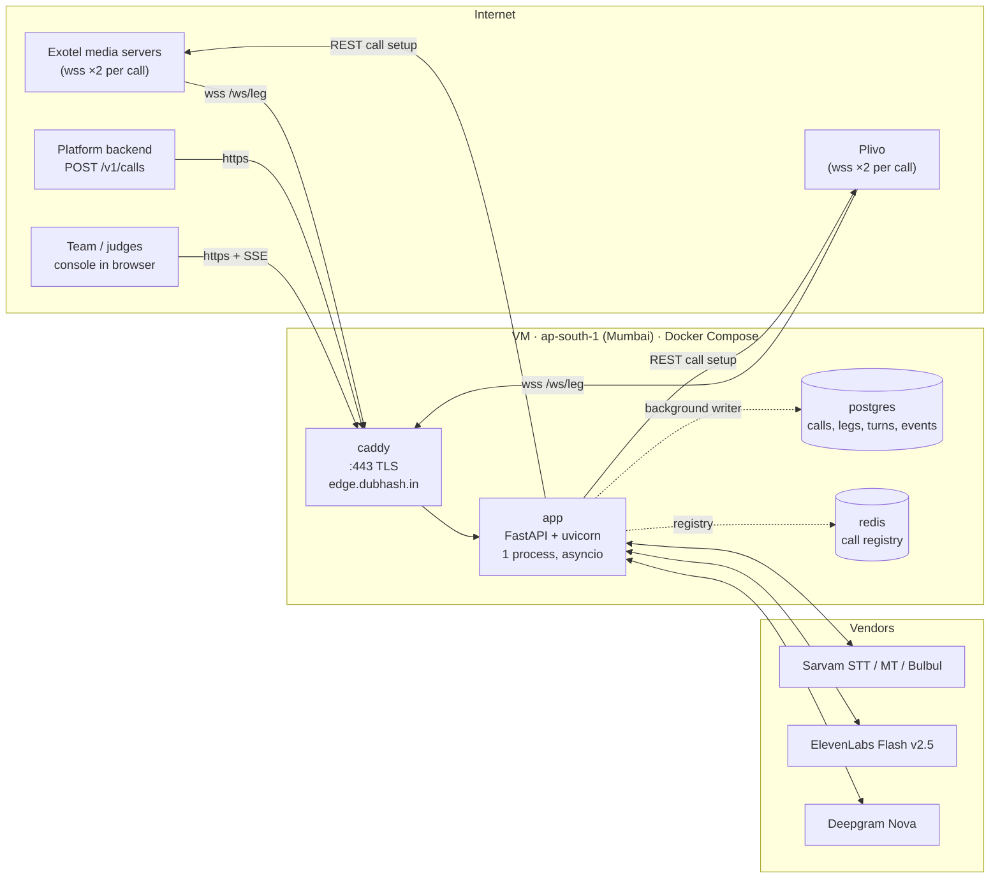
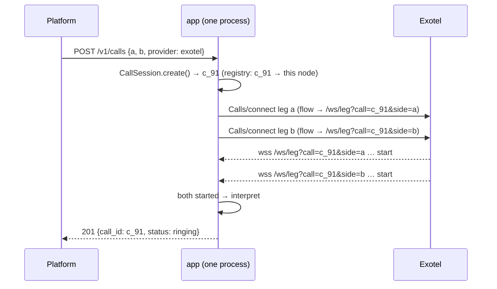

# Deployment

This document describes how dubhash runs in production for the buildathon. It covers: one VM in AWS ap-south-1 (Mumbai) running Docker Compose with four services, TLS via Caddy, the hard rule that both legs of a call land on the same process, provider allowlisting, data handling, observability, and how we would scale later. The compose file and Caddyfile don't exist yet. Snippets marked *proposed* are what the Day 1 scaffolding should produce.

## Why one VM in Mumbai

- Exotel's media servers are in India, and every 100 ms of RTT shows up in the latency budget. Sarvam is in India too. ElevenLabs is not (150 to 250 ms RTT from Mumbai), which is one reason Bulbul is primary for Indic targets.
- Kubernetes lost because there is nothing to orchestrate yet. It is a v1 non-goal.
- The console runs on the same box.
- India-region hosting is also part of the DPDP answer (see [security and privacy](../tech-spec/security-privacy.md)).

## Topology



## Services

| Service | Image | Role | Persistent volume |
|---|---|---|---|
| `app` | built from repo (Python 3.12) | FastAPI + websockets; API, leg websockets, interpreters, controller, console | none |
| `postgres` | official Postgres | `calls`, `legs`, `turns`, `events` | `pgdata` |
| `redis` | official Redis | call registry and cross-node lookup | optional |
| `caddy` | official Caddy | TLS termination (automatic certificates), reverse proxy incl. websocket upgrade and SSE | `caddy_data` (certs) |

Proposed `docker-compose.yml` shape:

```yaml
services:
  app:
    build: .
    env_file: .env
    command: uvicorn dubhash.api.app:app --host 0.0.0.0 --port 8000 --workers 1
    depends_on: [postgres, redis]
    restart: unless-stopped
  postgres:
    image: postgres:16
    environment: { POSTGRES_USER: dubhash, POSTGRES_PASSWORD: ${PG_PASSWORD}, POSTGRES_DB: dubhash }
    volumes: [pgdata:/var/lib/postgresql/data]
    restart: unless-stopped
  redis:
    image: redis:7
    restart: unless-stopped
  caddy:
    image: caddy:2
    ports: ["80:80", "443:443"]
    volumes: [./Caddyfile:/etc/caddy/Caddyfile, caddy_data:/data]
    depends_on: [app]
    restart: unless-stopped
volumes: { pgdata: {}, caddy_data: {} }
```

Proposed `Caddyfile`:

```text
edge.dubhash.in, api.dubhash.in {
    reverse_proxy app:8000 {
        flush_interval -1        # do not buffer SSE
    }
}
```

The overview uses `api.dubhash.in` for the platform API and `edge.dubhash.in` for leg websockets. Both are served by the same Caddy site pointing at the same `app`; one hostname would also work. Final DNS layout and domain ownership: TBD, see [open questions](../plan/open-questions.md) (PQ10).

Only ports 80 and 443 are exposed. Postgres and Redis listen on the compose network only.

## Rule: both legs on the same process

A call's two legs share one `CallSession` and one `FloorController`, in memory. They **must** land on the same OS process.

- Each leg's websocket URL carries the call id: `wss://edge.dubhash.in/ws/leg?call=c_91&side=a&sample-rate=16000`. Exotel allows 3 custom params, and `call` and `side` are two of them.
- `api/` looks up the `CallSession` by `call` in an in-process dict and attaches the leg to side `a` or `b`.
- **Run uvicorn with `--workers 1`.** Multiple workers in one container would send the two legs to different processes and break the call. Do not add workers to "scale". See *Scaling later*.
- The session starts interpreting once both websockets have sent `start`. If one leg doesn't answer within 25 s, the other hears "doosri taraf se jawab nahi aaya" and is hung up.
- There is no distributed state in the hot path. Redis holds only the registry: call id → node, for cross-node lookup later.



(`201` returns as soon as the session is created. Leg connections arrive afterwards. The ordering above is simplified.)

## Provider access and allowlisting

| Item | What to do |
|---|---|
| Exotel → us | Websocket auth is either a Basic auth header or an IP allowlist. Ask Exotel to allowlist the VM. Give the VM an Elastic IP so the address survives restarts. |
| Us → Exotel | REST call setup (`POST /v1/Accounts/{sid}/Calls/connect`) with account credentials from `.env`. |
| Inbound restriction on `/ws/leg` | Proposed: also restrict `/ws/leg` and `/webhooks/*` to the providers' published IP ranges, or check the Basic auth header. Ranges are TBD, see [open questions](../plan/open-questions.md). |
| Plivo | Bidirectional audio stream via the `answer_url` XML. Same rule: authenticate the websocket and the webhooks. |
| Platform API | `POST /v1/calls` needs an API key per platform. The scheme is TBD, see [api](../tech-spec/api.md). |
| Console | Behind auth (basic auth in Caddy is fine for the buildathon); it shows live transcripts. |

## Data handling on the box

- Text is stored only if the call was created with `record: true` or the platform opted in. Otherwise `src_text`/`tgt_text` are nulled after latency metrics are computed.
- Audio is never stored by default. The architecture diagram has an opt-in S3 bucket for recordings. That bucket is not part of the Compose stack, and wiring it up is TBD.
- Postgres backups for the buildathon: a nightly `pg_dump` to the VM disk is enough (proposed).

## Deploying (proposed)

```bash
ssh dubhash-vm
cd /srv/dubhash && git pull origin main
docker compose build app && docker compose up -d
docker compose logs -f app
```

A redeploy restarts `app` and **drops live calls**. Never deploy during a demo or a scheduled PSTN test. From CP2 (feature freeze) on, deploy only fixes from the fix list.

## Observability

| Signal | Where | Notes |
|---|---|---|
| Structured JSON logs | `docker compose logs app` (stdout) | every line carries `call_id` and `side` where relevant; naming in [conventions](conventions.md) |
| Per-turn latency | `turns` table | source of the published numbers |
| Per-call summary | `calls` row: `p50_first_audio_ms`, `p95_first_audio_ms`, `turns`, `escape_used`, `interpreted_s` | |
| Discrete events | `events(call_id, ts, kind, payload)`, kinds `dtmf`, `barge_in`, `gap`, `provider_error`, `bypass` | |
| Live view | `/console` (SSE from the controller's event stream) | the demo surface |
| Nightly report | p50/p95 per stage per pair | a script over `turns` (proposed: `tools/report.py`) |
| Host health | CPU, memory, disk | proposed: a `/healthz` endpoint plus a simple uptime check; Prometheus/Grafana is not needed for the buildathon |

CPU profiling (py-spy or similar) on a live call decides whether the Rust hot-path port is ever worth doing.

## Scaling later

Not needed for the buildathon. Notes so we don't paint ourselves into a corner:

- Scale out by **nodes, not workers**. Each node is an independent app process.
- At `POST /v1/calls`, pick a node and write `call_id → node` to Redis. Give providers a node-specific leg URL (e.g. a per-node hostname) so both legs reach that node. Alternatively, route on `call` at a proxy that reads the registry. Which one is TBD.
- Postgres stays single-primary. Writes are already batched off the hot path.
- Kubernetes only once there is something to orchestrate.

## Related

- [System overview](../architecture/system-overview.md)
- [Telephony integration](../architecture/telephony-integration.md)
- [Leg transports](../tech-spec/leg-transports.md)
- [Security and privacy](../tech-spec/security-privacy.md)
- [Data model](../tech-spec/data-model.md)
- [Dev setup](dev-setup.md)
- [Latency engineering](latency-engineering.md)
