# Latency engineering

This document covers where dubhash's latency comes from, how we cut it, and how we measure it. The product succeeds only if the pause between one person finishing and the other hearing the translation feels like interpretation, not failure. The doc gives the stage-by-stage budget, every technique in scope (marked v1 or v2), the rule that published numbers come from real PSTN calls, and the exact timestamps every turn must log.

## Targets

| Metric | Definition | Target (v1) |
|---|---|---|
| first-audio latency | speaker stops → listener hears the first translated word, on real PSTN legs | **p50 < 1.5 s, p95 < 2.0 s** |
| speech start → first heard (L9) | speaker **starts** the utterance → listener first hears its translation. This is what the user feels: unchunked it is the utterance's length plus first-audio (a 5 s sentence: about 6.4 s) | no target yet; report p50/p95 |
| ear-voice span (L9) | mean lag between the speaker saying a part and the listener hearing its translation, per chunk (`t_play_start − chunk t_speech_start`), weighted by each chunk's speech | no target yet; report p50/p95 |

All three are reported per utterance (an utterance = every turn of one `(side, utterance_id)`; with chunking one row per chunk) by `store/timeline.utterance_metrics`: the recorder's `summary.json`, `tools/call_report.py` ("WHAT THE LISTENER FELT"), `tools/bench.py` (`felt`) and `tools/live_loopback.py` (`start`, `evs`, measured on the listener's recording). First audio per utterance is speech end → its **last** chunk heard, so it means what it meant before L9.

Expected: first translated word heard = EOU wait (550 ms to start) + about 1.2 s (STT final + MT + TTS first byte + playout). That is **about 1.4 to 1.8 s**. The p95 target on hi⇄kn is the Day 6 (Mon 26 Oct) milestone in the [10-day plan](../plan/buildathon-10-day-plan.md).

## Budget (after the speaker stops)

| Stage | Typical | Notes | Logged as |
|---|---|---|---|
| end-of-utterance detection | 400 to 700 ms (start `eou_ms` = 550) | Silero silence threshold, plus Sarvam's streaming end-of-utterance signal if it exists. The biggest single lever: too short clips sentences, too long feels dead. | `t_eou` |
| STT final | ~300 ms | streaming partials run during speech, so only the final is on the critical path | `t_stt_final` |
| translate | ~200 ms | Sarvam Mayura, sentence level; short sentences are faster and better | `t_mt` |
| TTS first byte | ~300 ms | Bulbul for Indic targets, ElevenLabs Flash v2.5 for hi/en; streamed to the leg as it arrives | `t_tts_ttfb` |
| provider playout | ~200 ms | 100 ms media chunks; `mark` events signal completion | `t_play_start` (send), playout itself invisible server-side |
| **first translated word heard** | **≈1.4 to 1.8 s** | target p95 < 2.0 s; comparable to a human consecutive interpreter | derived |

```mermaid
gantt
    title One utterance, after the speaker stops (typical)
    dateFormat x
    axisFormat %L ms
    section critical path
    EOU wait (eou_ms 550)     :eou, 0, 550
    STT final                 :stt, after eou, 300
    translate                 :mt, after stt, 200
    TTS first byte            :tts, after mt, 300
    provider playout          :play, after tts, 200
```

Per the spec's figure 4.1, the post-EOU part is about 1.2 s to first word. STT runs during speech, MT and TTS are the serial part, and TTS audio streams to the leg as it arrives.

## Techniques

| Technique | What it buys | When | Owner |
|---|---|---|---|
| **warm STT sockets per leg** | Built: every provider socket (STT per source side, TTS per target side, the MT HTTPS connection) is prewarmed when the call is created and again when both legs are attached (`session/providers.prewarm`, L7). Sarvam websocket connect + auth costs 150 to 300 ms. Keep one open per leg and send a reset between utterances instead of reconnecting. Whether the reset works is open question 4; a keepalive is likely needed (the Pipecat SarvamSTT issue reports streams dying after 60 s of silence). | v1 | P2 |
| **warm TTS sockets** | ElevenLabs and Bulbul streaming both benefit from a persistent connection. Keep one per leg-direction. | v1 | P3 |
| **stream TTS to transport** | the first chunk goes to the leg before synthesis finishes; saves 300 to 800 ms on long sentences | v1 | P3 / Rohan |
| **earcon** | not a latency cut, but perceived latency drops more than any real cut. Silence should never exceed about 700 ms without a signal. The spec's latency table puts it at EOU (heard about 100 ms after EOU fires); the mix stage and the overview put it at translation start. Which one is TBD, see [audio.md](../tech-spec/audio.md#unresolved-mixer-details) and [open questions](../plan/open-questions.md). | v1 | Rohan |
| **ducked original** | the listener hears the real speaker at −14 dB, so the delay reads as interpretation | v1 | Rohan |
| **opening line** | sets the rhythm and prompts short sentences, but it is also dead time before the first translation. `opening_line: short` (the two language names and "speak", ~2 s; `/join` and loopback), `full` (one disclosure sentence, ~3.5 s, plus ~3 s with `record: true`; PSTN) or `off`. A translation that starts for a leg still hearing its opening cuts it (L7: speaking at once used to wait 2-3 s behind a 7 s opening) | v1 | Rohan / P5 |
| **noise-floor gate** | a frame is speech only if Silero says so and it is 6 dB over an adaptive noise floor (`NoiseFloorGate`), so a TV, other voices or AGC pumping the room noise up do not hold EOU off; `max_utterance_ms` (7000) ends a never-ending utterance at the next dip between words (L7) | v1 | P2 |
| **MT keep-alive** | httpx dropped the idle Sarvam connection after 5 s, so most turns paid a new TLS handshake; kept 60 s now (about 20 ms live, L7) | v1 | P2 |
| **no websocket compression** | permessage-deflate is off (`--ws-per-message-deflate false`): PCM does not compress and every 20 ms frame paid a deflate step both ways | v1 | Rohan |
| **per-pair EOU tuning** | 550 ms is a guess. On the bench set, measure false-EOU rate (sentence split mid-way) against latency, per language. Tamil speakers pause differently from Hindi speakers. Result goes in `eou_ms` in `pairs.yaml`. | v1 | P2 |
| **translation cache** | greetings, confirmations and numbers repeat. An exact-match cache per pair skips MT entirely (~200 ms). | v1 | P2 |
| **Mumbai colocation** | app in ap-south-1; Sarvam and Exotel are in India. ElevenLabs is not: its RTT from Mumbai is 150 to 250 ms, which is why Bulbul is primary for Indic targets. | v1 | Rohan |
| **Exotel chunk size** | flush outbound as 100 ms media events (3,200 bytes at 16k, a multiple of 320). Smaller chunks make `clear` more responsive; stay at 100 ms unless tuning on PSTN says otherwise. | v1 | P3 |
| **avoid resampling when possible** | keep the pipeline at 16 kHz. If Exotel ignores `sample-rate=16000` (open question 1), soxr sits on the hot path in both directions. | v1 | P3 |
| **chunked (clause-level) interpretation** | Built (L9, `interp/chunker.py`, per-pair `chunking` / `chunk_pause_ms` 300 / `chunk_min_ms` 1200, **off by default**). Partials were too unstable to start on (L1a), so a chunk is cut on an STT *final*: at a comma pause ≥ `chunk_pause_ms` after ≥ `chunk_min_ms` of speech the early final is committed (≥ 4 words, not ending in a number or an unclosed quantity), translated and played while the speaker continues; the rest goes on in a fresh stream with no replay. It moves MT/TTS for all but the last clause out of the critical path: speech start → first heard on a 5 s, 3-clause utterance drops from ~6.1 s to ~2.8 s (bench, fakes). The last chunk is still after EOU, so first-audio is unchanged. Verb-final hi/mr/gu chunked before the verb is the quality risk; see [L9](../plan/open-questions.md#answer-log). | v1 (opt-in) | P2 |
| **LLM low-confidence repair** | quality, not latency; adds latency, so it is off the v1 path | **v2** | — |
| **Rust hot path** | only if CPU profiling shows the interpreter (not vendors) is the bottleneck; a Rust mixer is a two-day swap | later, profile-driven | Rohan |

## Measure on PSTN, not loopback

> The loopback harness is for correctness. The latency numbers in the deck must come from two real phones through Exotel or Plivo, because 8 kHz codec audio changes STT latency and accuracy, and provider playout buffering is invisible in loopback. (tech spec)

Rules:

1. Any latency number in the deck, the README or the demo comes from the `turns` table of real PSTN calls, with the call ids recorded.
2. Bench and loopback numbers are labelled "bench" or "loopback" wherever they appear, and are only used to compare changes against each other.
3. Tune `eou_ms`, `duck_db` and chunk size on PSTN (Day 6), not on browser audio.

## Real phones (the `/join` stage demo)

A phone adds what loopback cannot see: the browser's output latency (tens of ms, 150 ms and more on Bluetooth), the mic's own processing (echo cancellation, noise suppression and AGC, all on), the tunnel, and a room where the other person and the other phone can be heard. The phone page (`console/static/join_phone.js`, `join_worklet.js`) sends each 20 ms mic frame the moment it is full and plays received audio from the next render quantum (no jitter buffer). It also reports, on the leg's own websocket:

| Message | When |
|---|---|
| `{"type":"telemetry","kind":"play_start","tag","client_ms","audio_ctx_ms"}` | first sample of a translation (or the opening, tag `opening`) heard; `client_ms` is epoch ms through `AudioContext.getOutputTimestamp()`, so device output latency is included |
| `... "kind":"play_end" ...` | playout reached the translation's mark (`cleared: true` when a clear cut it) |
| `{"type":"telemetry","kind":"mic_level","rms","client_ms"}` | every 500 ms, mic RMS before the half-duplex gate (`gated: true` while the page was playing) |
| `{"type":"telemetry","kind":"pong","server_ms","client_ms"}` | answers the server's `{"type":"ping","server_ms"}` (every 2 s, the session clock) |

The server logs each one as `leg.telemetry` (pongs with `rtt_ms`). Map `client_ms` to the session clock with the pongs (offset = `client_ms - server_ms - rtt_ms / 2`), then **heard latency = play_start (session ms) - the turn's `t_speech_end`**. Before L7 the stage demo's opening line (with the record sentence) ran ~7 s and held the first translation; see [L7](../plan/open-questions.md#answer-log).

## Timestamps to log

Every turn records the following, in ms, on one monotonic clock per call (call-relative ms anchored at `calls.started_at`; per-leg `FrameClock` times are converted to it, see [data model](../tech-spec/data-model.md#turns)). Wall-clock time goes only on `calls.started_at`.

| Field | Set when | Where |
|---|---|---|
| `t_speech_start` | VAD first marks speech (prob > 0.5) for this utterance | `turns` |
| `t_speech_end` | last speech frame before EOU | `turns` |
| `t_eou` | endpoint fires (silence ≥ `eou_ms`, or Sarvam's EOU/final if earlier) | `turns` |
| `t_stt_final` | final transcript received | `turns` |
| `t_mt` | translation returned (or cache hit) | `turns` |
| `t_tts_ttfb` | first TTS audio chunk received | `turns` |
| `t_tts_done` | last TTS chunk received | stage table in the spec; **not in the `turns` schema** (see below) |
| `t_play_start` | controller calls `send()` with the first audio of this Translation (earcon or TTS) | `turns` |
| `t_play_end` | `mark` callback for this Translation fires (played) or `clear` (clipped) | `turns` |
| `clipped_ms` | ms played before barge-in clear, null if completed | `turns` |
| `utterance_id`, `chunk` | L9: the utterance (per direction) a turn belongs to and its chunk index (0 unchunked) | `turns` |
| `t_utt_start` | L9: the utterance's first speech frame (a chunk's own `t_speech_start` is later) | `turns` |

Derived per turn (computed by the writer or a nightly job):

| Derived | Formula |
|---|---|
| EOU wait | `t_eou − t_speech_end` |
| STT final latency | `t_stt_final − t_eou` |
| MT latency | `t_mt − t_stt_final` |
| TTS first byte | `t_tts_ttfb − t_mt` |
| queue wait | `t_play_start − t_tts_ttfb` (non-zero when the floor was busy) |
| **server first-audio** | `t_play_start − t_speech_end` |
| **speech start → first heard** (per utterance) | `min(t_play_start) − t_utt_start` over its turns |
| **ear-voice span** (per utterance) | `Σ wᵢ (t_play_startᵢ − t_speech_startᵢ) / Σ wᵢ`, `wᵢ = t_speech_endᵢ − t_speech_startᵢ` |

Server first-audio does not include provider playout buffering (~200 ms), which is invisible server-side. For deck numbers, either add a calibrated playout offset, or measure heard latency directly by recording both legs (with consent) and aligning the audio. Which method we publish is TBD, see [open questions](../plan/open-questions.md). Per-call `p50_first_audio_ms` / `p95_first_audio_ms` go on the `calls` row. Nightly p50/p95 is computed per stage per pair.

Queue wait is real latency the listener experiences, but it comes from conversation overlap, not the pipeline. Report first-audio both with and without queued turns.

## Related

- [Evaluation and metrics](evaluation-and-metrics.md)
- [Testing strategy](testing-strategy.md)
- [Interpreter pipeline](../tech-spec/interpreter-pipeline.md)
- [Audio](../tech-spec/audio.md)
- [Data model](../tech-spec/data-model.md)
- [Configuration](../tech-spec/configuration.md)
- [Open questions](../plan/open-questions.md)
