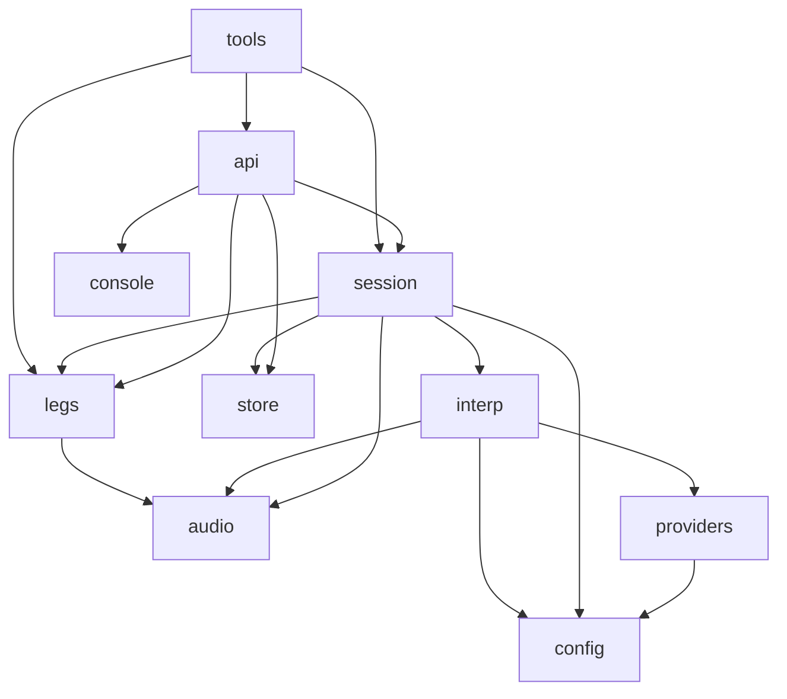

# Repository structure

This document describes how the dubhash codebase is laid out: which module owns which responsibility, where each interface (Protocol) lives, where its fakes live, and who owns each module. The layout comes from the tech spec's module list. Nothing exists yet because the repo is empty with no commits, so treat this as the target layout for Day 1 of the [10-day plan](../plan/buildathon-10-day-plan.md). If you want to add a top-level module, change this doc in the same PR.

## Layout from the tech spec

The spec gives this tree, kept here exactly as written:

```text
dubhash/
  api/          fastapi app: /v1/calls, /v1/calls/{id}, /ws/leg, /webhooks, /console (sse)
  session/      CallSession, FloorController, TurnLog
  interp/       Interpreter pipeline: vad.py, endpoint.py, stt.py, mt.py, tts.py, pipeline.py
  audio/        frames.py (20ms PCM16 @16k), resample.py (soxr), mixer.py (duck + earcon), wav.py
  legs/         base.py (LegTransport), exotel.py, plivo.py, webrtc.py, fake.py
  providers/    sarvam_stt.py, sarvam_mt.py, sarvam_tts.py, eleven_tts.py, deepgram_stt.py, fakes.py
  store/        models.py (sqlalchemy), writer.py (async batch insert)
  config/       pairs.yaml (per language pair: stt, mt, tts voice, eou_ms), settings.py
  console/      templates + sse
  tools/        loopback.py (two browser legs), bench.py (latency harness), label.py (rater ui)
  tests/        fixtures/*.wav, test_pipeline.py, test_floor.py, test_mixer.py
```

### Proposed concrete repo tree

The spec doesn't say where packaging files go. This is our proposal: the spec's modules sit inside an importable `dubhash/` package, and `tools/` and `tests/` sit at the repo root so they never get imported by the app. Everything else matches the spec.

```text
/                              repo root (git)
├── pyproject.toml             python 3.12, deps, ruff/pytest config        (proposed)
├── docker-compose.yml         app, postgres, redis, caddy                   (proposed)
├── Caddyfile                  TLS for edge.dubhash.in                       (proposed)
├── .env.example               every env var, no secrets                    (proposed)
├── docs/                      this documentation
├── dubhash/
│   ├── api/                   app.py, calls.py, legs_ws.py, webhooks.py, console.py
│   ├── session/               call_session.py, floor.py, turn_log.py
│   ├── interp/                vad.py, endpoint.py, stt.py, mt.py, tts.py, pipeline.py
│   ├── audio/                 frames.py, resample.py, mixer.py, wav.py
│   ├── legs/                  base.py, exotel.py, plivo.py, webrtc.py, fake.py
│   ├── providers/             sarvam_stt.py, sarvam_mt.py, sarvam_tts.py,
│   │                          eleven_tts.py, deepgram_stt.py, fakes.py
│   ├── store/                 models.py, writer.py
│   ├── config/                pairs.yaml, settings.py
│   └── console/               templates/, static/ (htmx), sse.py
├── tools/                     loopback.py, bench.py, label.py
└── tests/
    ├── fixtures/              *.wav (phone-quality utterances, noise variants)
    ├── test_pipeline.py
    ├── test_floor.py
    └── test_mixer.py
```

File names inside `api/`, `session/` and `console/` beyond what the spec lists are suggestions. Rename them if you like, but keep the module boundaries.

## Module responsibilities

| Module | Responsibility | Key types / files | Owner |
|---|---|---|---|
| `api/` | FastAPI app. `POST /v1/calls`, `GET /v1/calls/{id}`, `GET /v1/calls/{id}/turns`, `POST /v1/calls/{id}/hangup`, `WS /ws/leg?call=…&side=…`, `POST /webhooks/exotel`, `POST /webhooks/plivo`, `GET /console` with SSE at `/console/events?call=…`. Creates `CallSession`s and attaches legs to them by call id. | routers only, no business logic | P3 (proposed: call setup, `/ws/leg`, webhooks, dial-in), P4 (console routes); session attach-by-call-id is Rohan's |
| `session/` | One `CallSession` per call. It owns 2 legs, 2 Interpreter pipelines, 1 `FloorController` and the turn log, and it dies when both legs close. `FloorController` holds the state (`IDLE`, `A_SPEAKING`, `B_SPEAKING`, `PLAYING_AB`, `PLAYING_BA`), the queue, barge-in and DTMF handling. `TurnLog` builds Turn rows and pushes them onto the in-memory write queue. | `CallSession`, `FloorController`, `TurnLog` | Rohan |
| `interp/` | One Interpreter per direction (A→B, B→A). Order: VAD, then endpoint (EOU, backchannel tagging), then STT stream, translate, TTS stream. It emits `Translation` objects (text plus an async audio iterator) to the controller. It never touches a transport. Gender detection (pitch heuristic) lives here and feeds voice selection (detector owner proposed P2, PQ20). | `vad.py` (Silero v5 onnx), `endpoint.py`, `stt.py`/`mt.py`/`tts.py` (interfaces + per-utterance logic), `pipeline.py` (`Interpreter`, `Translation`) | P2 (vad/endpoint/stt/mt), P3 (tts), Rohan (pipeline wiring) |
| `audio/` | The hot path for frame handling. `frames.py`: 20 ms PCM16 mono @16 kHz (640 bytes) plus `FrameClock`. `resample.py`: 8k ⇄ 16k via soxr. `mixer.py`: earcon (120 ms) + TTS at 0 dB, speaker's original frames at −14 dB during the TTS window, never exceed int16. `wav.py`: fixture I/O. | numpy only, no I/O, no awaits on the network | Rohan (frames, mixer); P2 proposed for `resample.py` |
| `legs/` | `LegTransport` implementations. Exotel and Plivo differ only inside their class (about 120 lines per provider). `WebRtcLeg` is for dev and the fallback demo. `FakeLeg` plays a wav as inbound audio and captures outbound to a wav. | `base.py` (`LegTransport` Protocol), `exotel.py`, `plivo.py`, `webrtc.py`, `fake.py` | P3 |
| `providers/` | Vendor clients behind the STT/MT/TTS interfaces. Pipecat service classes may be borrowed here as libraries, but Pipecat's pipeline is not used. | `SarvamStream`, `DeepgramStream`, `SarvamMT`, `BulbulStream`, `ElevenStream`, plus `FakeSTT`, `FakeMT`, `FakeTTS` in `fakes.py` | P2 (Sarvam STT/MT, Deepgram), P3 (Bulbul, ElevenLabs) |
| `store/` | SQLAlchemy models for `calls`, `legs`, `turns`, `events`. `writer.py` is a background task that drains an in-memory queue and batch-inserts. It is the only module that talks to Postgres. | `models.py`, `writer.py` | P4 (proposed, PQ9) |
| `config/` | `pairs.yaml`: per language pair, the stt, mt, tts provider, voices (`voice_m`, `voice_f`), `eou_ms`, `backchannel_max_ms`, `barge_in_min_ms`, `duck_db`. `settings.py`: env-var settings (keys, DB/Redis URLs, public host). | see [configuration](../tech-spec/configuration.md) | P2 (pair tuning), Rohan (settings) |
| `console/` | Server-rendered HTML + SSE (htmx). Shows the active calls list. Per call: two columns (A, B), each turn as src → tgt with stage latencies inline, state badge, queue depth, DTMF/barge-in markers. Ward mode page. No SPA. | templates, `sse.py` | P4 |
| `tools/` | `loopback.py`: two browser legs, the dev and fallback-demo harness. `bench.py`: two FakeLegs, scripted utterances, per-stage p50/p95, WER, turn log. `label.py`: rater UI, kept / partly / lost. | CLI scripts | P3 (loopback), P2 (bench), P5 (label) |
| `tests/` | Unit and pipeline tests plus wav fixtures. | `test_pipeline.py`, `test_floor.py`, `test_mixer.py` | everyone; P5 owns chaos tests |

Ownership follows the spec's split. The source of truth is [roles and ownership](../plan/roles-and-ownership.md).

## Where each interface lives

Every component sits behind an interface, and every interface has a fake (see [conventions](conventions.md)).

| Interface | Defined in | Real implementations | Fake |
|---|---|---|---|
| `LegTransport` | `dubhash/legs/base.py` | `ExotelLeg` (`exotel.py`), `PlivoLeg` (`plivo.py`), `WebRtcLeg` (`webrtc.py`) | `FakeLeg` (`legs/fake.py`) |
| STT stream | `dubhash/interp/stt.py` | `SarvamStream` (`providers/sarvam_stt.py`), `DeepgramStream` (`providers/deepgram_stt.py`) | `FakeSTT` (`providers/fakes.py`) |
| MT | `dubhash/interp/mt.py` | `SarvamMT` (`providers/sarvam_mt.py`) | `FakeMT` (`providers/fakes.py`) |
| TTS stream | `dubhash/interp/tts.py` | `BulbulStream` (`providers/sarvam_tts.py`), `ElevenStream` (`providers/eleven_tts.py`) | `FakeTTS` (`providers/fakes.py`) |
| VAD | `dubhash/interp/vad.py` | Silero VAD v5 (onnx) | scripted speech/silence segments (proposed, in `providers/fakes.py`) |
| `Translation` (value type) | `dubhash/interp/pipeline.py` (proposed) | text + async audio iterator | built directly in tests |
| Turn write queue | `dubhash/store/writer.py` | async batch insert to Postgres | in-memory list (tests) |

The `LegTransport` Protocol, quoted from the spec:

```python
class LegTransport(Protocol):
    leg_id: str                                   # "a" | "b"
    async def frames(self) -> AsyncIterator[bytes]: ...   # 640-byte PCM16@16k frames, as they arrive
    async def send(self, pcm16_16k: bytes) -> None: ...   # queued for playout; chunked by provider rules
    async def clear(self) -> None: ...                    # drop queued, not-yet-played audio (barge-in)
    async def mark(self, tag: str) -> None: ...           # ask for a callback when audio before this point has played
    def on_mark(self, cb: Callable[[str], None]) -> None: ...
    def on_dtmf(self, cb: Callable[[str], None]) -> None: ...
    async def close(self) -> None: ...
```

The exact method signatures of the STT, MT and TTS Protocols are not in the spec. Whoever owns each one writes the Protocol on Day 1, with this shape: STT takes frames in and gives partials plus a final out; MT takes text in and gives text out; TTS takes text plus a voice in and gives an async iterator of PCM16@16k chunks out. See [interpreter pipeline](../tech-spec/interpreter-pipeline.md). TBD, see [open questions](../plan/open-questions.md).

## Dependency rules



- `audio/` imports nothing from the app. It is pure numpy/soxr.
- `interp/` never imports `legs/`. Interpreters hand `Translation`s to the controller and nothing else.
- Only `session/floor.py` calls `send()`, `clear()` or `mark()` on a leg.
- Only `store/` imports SQLAlchemy or a Postgres driver. Only the call registry code (proposed: `session/registry.py`) imports Redis.
- `providers/` depends on `config/` for voices and language codes, never on `session/`.

## Related

- [System overview](../architecture/system-overview.md)
- [Interpreter pipeline](../tech-spec/interpreter-pipeline.md)
- [Floor controller](../tech-spec/floor-controller.md)
- [Leg transports](../tech-spec/leg-transports.md)
- [Configuration](../tech-spec/configuration.md)
- [Conventions](conventions.md)
- [Dev setup](dev-setup.md)
- [Roles and ownership](../plan/roles-and-ownership.md)
