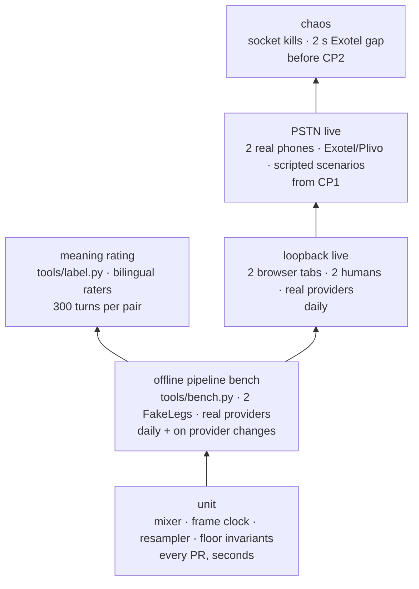

# Testing strategy

This document defines how we know dubhash works at each layer. The layers are: unit tests, an offline pipeline bench on FakeLegs with real providers, human meaning rating, live loopback in the browser, scripted live calls over real PSTN, and chaos tests. It also states the rule the schedule depends on: the pipeline runs end to end on fakes by Day 2 (Thu 22 Oct). That way STT, translate, TTS and the controller can be built and measured before any telephony credit exists.

## The Day 2 rule

> Every component is behind an interface with a fake. The pipeline must run end to end with FakeLeg (wav in, wav out) on day 2 so that STT, translate, TTS and the controller can be built and measured before any telephony credit exists. (tech spec)

In practice:

- By the end of Day 1, `FakeLeg`, `FakeSTT`, `FakeMT`, `FakeTTS` and a scripted VAD source exist. Two FakeLegs pass audio through the mixer to a wav.
- By the end of Day 2: wav in, translated wav out, one direction, latency printed per stage. Real Sarvam STT, Sarvam translate and Bulbul/ElevenLabs TTS sit behind their interfaces.
- No PR may break the all-fakes pipeline run. It is the first CI job.

## Test pyramid

## 1. Unit tests

Fast, deterministic, no network. They run on every PR.

| Test file | What it covers | Pass criteria |
|---|---|---|
| `tests/test_mixer.py` | ducking math, earcon insertion | original at −14 dB (`duck_db`) during the TTS window, TTS at 0 dB, earcon 120 ms; output never exceeds int16 (no clipping) for worst-case loud inputs |
| `tests/test_frames.py` (proposed) | `FrameClock` | 640-byte frames, monotonically increasing leg-relative ms, gaps detected and reported |
| `tests/test_resample.py` (proposed) | soxr 8k ⇄ 16k | round trip preserves length (±1 frame) and energy within tolerance; frame boundaries stay 640 bytes at 16k |
| `tests/test_floor.py` | `FloorController` invariants with a scripted event sequence | all invariants below hold for every sequence |
| `tests/test_endpoint.py` (proposed) | EOU rules | EOU only when silence ≥ `eou_ms` AND utterance ≥ 300 ms; utterances < 600 ms with ≤ 2 words are tagged backchannel |

### Floor controller invariants (`test_floor.py`)

These are the spec's invariants. Each needs at least one scripted sequence that would break it if the code were wrong.

1. At most one Translation is playing at any time, on exactly one leg.
2. Every Translation handed to the controller is either played to completion or marked `clipped` with the ms played. None is silently dropped.
3. A backchannel (speech < `backchannel_max_ms`) never changes state and never clears audio.
4. Order is preserved per direction. Cross-direction order is arrival order.
5. Bypass mode (DTMF 0) turns the controller into a plain mixer: each leg's frames go to the other at 0 dB, and the interpreters stop.

Required scripted scenarios:

| Scenario | Expected |
|---|---|
| speaking-while-playing: A speaks while B→A plays | A's translation is enqueued and played to B after B→A's `mark`; A hears all of B→A |
| backchannel during playback (400 ms "haan") | no state change, no `clear()` |
| real barge-in (listener speaks > `barge_in_min_ms` = 1200 ms) | `clear(listener leg)`, playing item marked clipped with ms played, state → `X_SPEAKING` |
| 4 s both-silent with a non-empty queue | force play |
| 10 s silence | "aap line par hain?" prompt |
| DTMF `1` | replay last translation to that side |
| DTMF `0` | bypass mode |

Strongly recommended: a property-based test (e.g. Hypothesis) that generates random event interleavings and asserts invariants 1, 2 and 4. Proposed, not in the spec.

## 2. Offline pipeline bench (`tools/bench.py`)

Two FakeLegs play wav utterances through the **real providers**, with the real controller and mixer. Telephony is the only thing faked.

- **Corpus:** recorded by the team, 30 utterances per language, at phone quality, with background noise variants. Owned by P5, stored under `tests/fixtures/` (or a bucket if it is too large for git; TBD). See [evaluation and metrics](evaluation-and-metrics.md).
- **Reports:** per-stage p50/p95 (`t_eou`, `t_stt_final`, `t_mt`, `t_tts_ttfb`, `t_tts_done`), WER against reference transcripts, false-EOU rate per `eou_ms` setting.
- **Writes:** the turn log, which `tools/label.py` reads.
- **When:** daily, and on any change to `providers/`, `interp/endpoint.py` or `config/pairs.yaml`.
- **Modes:** real time (for latency) or faster than real time (for correctness runs on fakes).

`test_pipeline.py` is the CI-sized version. It runs all fakes on a few fixtures and asserts that output wavs exist, the turn count is right, and nothing was dropped.

## 3. Meaning rating (`tools/label.py`)

A bilingual rater sees each src/tgt pair and marks it **kept / partly / lost**. Entity checks (numbers, addresses, names, times) are rated in the same pass. 300 turns per pair before the number goes in the deck. Pairs: hi⇄kn, hi⇄ta, mr⇄hi. Owned by P5. Targets are in [evaluation and metrics](evaluation-and-metrics.md).

## 4. Loopback live (`tools/loopback.py`)

Two browser tabs, two humans, real providers, no telephony. Run it **daily** from Day 3 (when `WebRtcLeg` lands) onward. It is for correctness and feel only: floor control, barge-in, backchannels, ducking. **Never quote its latency numbers** (see [latency engineering](latency-engineering.md)).

## 5. PSTN live, scripted scenarios

Two real phones through Exotel or Plivo, starting at CP1 (two real phones, both directions, no drops).

| Scenario | Script | Success = |
|---|---|---|
| find the building | rider (hi) asks a customer (kn/ta) for building, block, floor | rider can state block and floor at the end |
| confirm a dose | clinician states a medicine, dose and timing; patient repeats | dose and timing match exactly |
| agree a time | two parties settle on a meeting time | both state the same time |

- Record both legs only with consent. Compute task completion against a plain bridge between speakers who don't share a language (target > 85% vs < 40% baseline).
- Log every run's call id. The `turns` table gives latency per turn, and that is where the deck's p50/p95 comes from.
- Each pair gets at least one full run before CP2 (feature freeze). The exact count is TBD, see [open questions](../plan/open-questions.md).

## 6. Chaos tests

Owned by P5, run before CP2.

| Fault | How to inject | Must hold |
|---|---|---|
| provider socket killed mid-utterance (STT, MT or TTS) | fake provider that closes its socket at a random frame; or kill the real socket in the bench | the interpreter reconnects; the controller does not deadlock; the in-flight Translation is played or marked clipped, never silently lost |
| Exotel gap of 2 s | FakeLeg stops yielding frames for 2 s, then resumes | the mixer does not play garbage; the gap is logged as an `events` row of kind `gap` |
| one leg never answers | second leg never sends `start` | after 25 s the answered leg hears "doosri taraf se jawab nahi aaya" and is hung up |
| one leg drops mid-call | close one FakeLeg | session tears down cleanly; turn rows flushed; no orphan tasks |
| Postgres/Redis down | stop the containers | calls keep working; the writer retries/buffers; the hot path is unaffected |

## CI (proposed)

| Job | Runs | Blocks merge |
|---|---|---|
| lint (`ruff`) | every PR | yes |
| unit + all-fakes pipeline (`pytest`) | every PR | yes |
| bench with real providers | nightly on `main`, needs keys | no; posts p50/p95 per stage per pair |

## Related

- [Evaluation and metrics](evaluation-and-metrics.md)
- [Latency engineering](latency-engineering.md)
- [Floor controller](../tech-spec/floor-controller.md)
- [Interpreter pipeline](../tech-spec/interpreter-pipeline.md)
- [Conventions](conventions.md)
- [10-day plan](../plan/buildathon-10-day-plan.md)
- [Demo script](../plan/demo-script.md)
