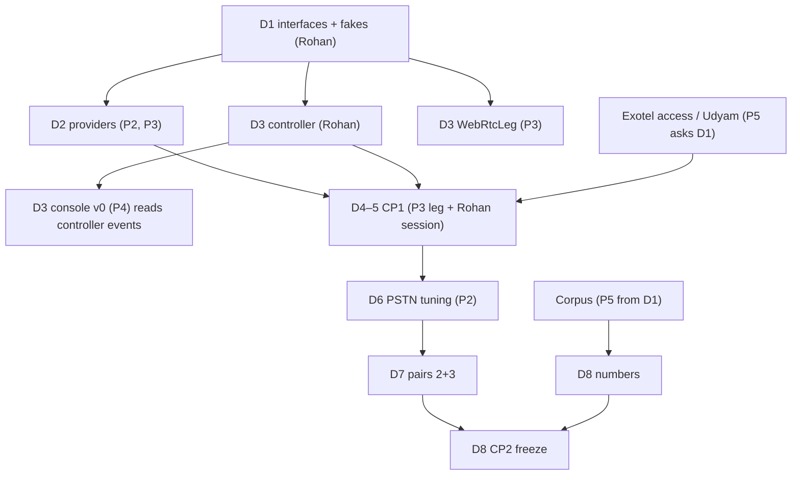

# Buildathon 10-Day Plan

This is the Phase 0 schedule. The tech spec's 13-day build order is compressed here into 10 build days, from Day 1 (Wed 21 Oct 2026) to Day 10 (Fri 30 Oct 2026). 31 Oct is for submitting, plus a buffer. The repo is empty today, with no commits. The doc gives the daily milestones with owners and proof-of-done, the parallel track for each person, the two checkpoints (CP1 and CP2), the cut list in order, the never-cut list, the 31 Oct definition of done, and a clear account of what was merged or cut compared with the original 13-day plan. Ownership follows [roles-and-ownership.md](roles-and-ownership.md).

> **Calendar note.** 21 Oct 2026 is a **Wednesday**, so the 10 build days are Wed 21 to Fri 30 Oct, and Day 4 and Day 5 fall on the weekend (Sat 24, Sun 25). Vendor support (Exotel, Plivo, Sarvam) may be slow at the weekend, which is why vendor asks go out on Day 1 and CP1 has a Day 5 fallback.

## The rule for the 10 days

Every component sits behind an interface and has a fake. The pipeline must run end to end with `FakeLeg` (wav in, wav out) by the end of **Day 2**, so that STT, translate, TTS and the controller can be built and measured before any telephony credit exists. Nothing waits on Exotel.

```mermaid
flowchart LR
    D1["D1 Wed 21<br/>skeleton + fakes<br/>vendor asks sent"] --> D2["D2 Thu 22<br/>wav→translated wav<br/>open Qs settled"]
    D2 --> D3["D3 Fri 23<br/>controller both ways<br/>WebRTC + console v0"]
    D3 --> D4["D4 Sat 24<br/>first telephony leg<br/>CP1 target"]
    D4 --> D5["D5 Sun 25<br/>CP1 latest<br/>2nd leg, turns in db"]
    D5 --> D6["D6 Mon 26<br/>PSTN tuning<br/>p95 under 2.0 s hi⇄kn"]
    D6 --> D7["D7 Tue 27<br/>pairs 2+3, gender voice<br/>DTMF, ward + dial-in"]
    D7 --> D8["D8 Wed 28<br/>numbers + chaos<br/>CP2 freeze"]
    D8 --> D9["D9 Thu 29<br/>polish, rehearse<br/>fix list only"]
    D9 --> D10["D10 Fri 30<br/>video, README<br/>form ready"]
    D10 --> S["Sat 31<br/>submit + buffer"]
    style D4 fill:#fde,stroke:#a33
    style D5 fill:#fde,stroke:#a33
    style D8 fill:#fde,stroke:#a33
```

## Day-by-day

| Day | Date | Milestone | Owner(s) | Proof of done |
|---|---|---|---|---|
| 1 | Wed 21 Oct | Repo created and first commit. Module layout from [repo-structure](../engineering/repo-structure.md). Protocols: `LegTransport`, STT/MT/TTS provider interfaces, fakes (`FakeSTT`, `FakeMT`, `FakeTTS`). `FrameClock` and frames (20 ms, 640 B PCM16 @ 16 kHz). Mixer (duck + earcon). `FakeLeg`. Docker Compose skeleton (app, Postgres, Redis, Caddy). Vendor spikes start: Sarvam STT/MT (P2), Bulbul/ElevenLabs TTS (P3). **Udyam registration filed. Exotel sponsor ask sent on the Bolna Slack. Plivo account started.** Corpus script written and recording begins. | Rohan (skeleton, interfaces, mixer, FakeLeg); P2 and P3 (vendor spikes); P5 (vendor asks, corpus script); P4 (console and template scaffold, Compose) | Two `FakeLeg`s pass audio through the mixer to a wav; CI runs `pytest`; Exotel ask link and Udyam reference posted in team channel |
| 2 | Thu 22 Oct | Sarvam streaming STT, Sarvam translate and Bulbul/ElevenLabs streaming TTS behind interfaces. Silero VAD v5 and endpoint (EOU at 550 ms, utterance ≥ 300 ms, backchannel tag). **All six open technical questions answered or given a decided default** (see [open-questions](open-questions.md)). `FloorController` skeleton and `test_floor.py` invariants written (red allowed). | P2 (VAD, endpoint, STT, MT); P3 (TTS); Rohan (controller skeleton, test spec); P5 (TTS listening test with P3) | wav in, translated wav out, one direction, with latency printed per stage. Answers to open questions recorded in `pairs.yaml` and the open-questions doc |
| 3 | Fri 23 Oct | `FloorController` complete: queue, backchannel, barge-in, marks, tick (4 s / 10 s), both directions. **In parallel:** `WebRtcLeg` and its signalling page (P3), console v0 with SSE from the controller event stream (P4). `tools/bench.py` v0 (P2). | Rohan (controller); P3 (WebRtcLeg); P4 (console v0); P2 (bench v0) | `test_floor.py` green; two `FakeLeg`s hold a scripted conversation; **two laptops, two humans, hi⇄kn** over WebRTC with live transcripts in the console |
| 4 | Sat 24 Oct | First real telephony leg: `ExotelLeg` if access has landed, otherwise `PlivoLeg` on the Udyam-verified account. Outbound two-leg setup (`POST /v1/calls` → both legs ring, interpreting starts when both have sent `start`, 25 s no-answer rule). VM up in ap-south-1 with Caddy TLS on `edge.convox.in`. **CP1 target.** | P3 (leg, outbound setup); Rohan (session wiring, VM); P2 (STT on 8k/16k real audio) | **CP1: two real phones, both directions, no drops** |
| 5 | Sun 25 Oct | **CP1 hard deadline (morning).** Second provider leg (Exotel or Plivo, whichever wasn't first), selected by config. Webhooks `/webhooks/exotel` and `/webhooks/plivo`. `store/` writer: turn rows go to Postgres from the in-memory queue by a background task. Warm STT/TTS sockets start. Ward mode page started (P4). | P3 (second leg, webhooks); P4 (store writer, ward page); P2 (warm STT socket); Rohan (provider swap by config, CP1 fixes) | Provider swap by config; turns in db; `GET /v1/calls/{id}/turns` returns the stage call |
| 6 | Mon 26 Oct | Per-pair tuning on PSTN: EOU, duck level, chunk size (stay at 100 ms). Warm sockets finished. Translation cache (exact match per pair). Voice selection by detected gender (pitch heuristic). | P2 (EOU tuning, cache); P3 (warm TTS, voice selection); Rohan (duck level, mixer on real audio); P5 (PSTN scripted scenarios, records both legs with consent) | **p95 first-audio under 2.0 s on hi⇄kn on real PSTN** (from `turns` rows) |
| 7 | Tue 27 Oct | Second and third pairs (hi⇄ta, mr⇄hi) in `pairs.yaml` and tested on PSTN. DTMF 1 (replay) and 0 (bypass). Dial-in IVR flow (`Gather(digits=10)` → `Passthru` → session → Voicebot applet; language auto-detect with DTMF menu fallback). Ward mode working on one phone. | P2 (pairs 2+3 STT/MT); P3 (dial-in, TTS voices for ta/mr); Rohan (DTMF in controller); P4 (ward mode) | Three pairs demoable; DTMF 0 drops to plain bridge; ward exchange on one phone |
| 8 | Wed 28 Oct | Bench corpus run through real providers. Rater tool and first meaning numbers. Chaos tests (kill a provider socket mid-utterance; 2 s Exotel gap). Dial-in finished. **CP2: feature freeze at end of day.** Cut decisions made by this point. | P5 (corpus, rater, chaos); P2 (bench numbers); P3 (dial-in); everyone (freeze) | Numbers for the deck (per-stage p50/p95, WER, first meaning ratings); chaos tests pass; tag `cp2` |
| 9 | Thu 29 Oct | Console polish (it has to look finished). Demo rehearsal with a native Kannada or Tamil speaker. Fix list only, no features. Demo video recorded. | P4 (console polish); Rohan (rehearsal, pitch); P5 (video capture); P2 and P3 (fix list) | 3-minute run-through clean twice; raw video captured |
| 10 | Fri 30 Oct | Video edited, README, submission form filled (answer from [demo-script](demo-script.md#application-form-answer-corrected)). Final rehearsal. Release tag. | P5 (video, form); Rohan (README review, final rehearsal); all (fix list) | Video by 30 Oct (P5 done-means); form ready to submit; tag `v0.1-buildathon` |
| — | Sat 31 Oct | **Submit early in the day.** Rest of day is buffer. | P5 (submission); Rohan (sign-off) | Submission confirmation |

## Parallel tracks per person

| Person | D1 | D2 | D3 | D4 | D5 | D6 | D7 | D8 | D9 | D10 |
|---|---|---|---|---|---|---|---|---|---|---|
| **Rohan** | Repo, interfaces, fakes, FrameClock, mixer, FakeLeg | Controller skeleton, `test_floor.py` | Controller complete, both directions | Session wiring, VM, CP1 | Provider swap by config, CP1 fixes | Duck level, mixer on PSTN | DTMF 1/0, bypass | Freeze, cut calls | Rehearsal, pitch | README, final rehearsal |
| **P2 audio/ML** | Sarvam STT/MT spike | VAD, endpoint, STT, MT; open Qs 2, 4 | `bench.py` v0 | STT on real 8k/16k | Warm STT socket | Per-pair EOU tuning, translation cache | hi⇄ta, mr⇄hi | Bench numbers | Fix list | Fix list |
| **P3 backend/legs/TTS** | Bulbul/Eleven spike | TTS streaming; open Qs 1, 3, 6 | WebRtcLeg + signalling | First telephony leg, outbound setup | Second leg, webhooks | Warm TTS, gender voice | Dial-in IVR, ta/mr voices | Dial-in done | Fix list | Fix list |
| **P4 frontend** | Console scaffold, Compose | Console layout on fake events | Console v0 SSE | Console on real calls | `store/` writer, ward page | Turns view, latency inline | Ward mode on one phone | Console fixes | Console polish | Fix list |
| **P5 product/eval** | Vendor asks, corpus script, start recording | TTS listening test, corpus | Corpus (30 utterances/lang) | Rater tool `label.py` | Failed-call recording (with consent) | PSTN scripted scenarios | Chaos test scripts | Rater numbers, chaos | Video capture | Video edit, form |

The dependencies across tracks that can block someone else:

## Checkpoints

| Checkpoint | When | Pass condition | If it fails |
|---|---|---|---|
| **CP1** | Target end of D4 (Sat 24 Oct); hard deadline D5 morning (Sun 25 Oct) | Two real phones, both directions, no drops | Swap to the other provider (Plivo, or Exotel). If neither works by end of D5, run the rest of the build on `WebRtcLeg`, keep pushing on telephony in parallel (P3 full time), and prepare the WebRTC fallback demo with the applet config on screen. See [demo-script](demo-script.md#fallback-plans). Start cutting from the top of the cut list immediately. |
| **CP2** | End of D8 (Wed 28 Oct) | Feature freeze. Everything not working is cut, in cut-list order. Numbers for the deck exist. | Cut the next item on the list. After CP2 only fixes get merged. |

## Cut list (in order)

Cut from the top. Each cut has a trigger date, so the decision is made on schedule and not argued about.

| Order | Cut | Fallback | Trigger to cut |
|---|---|---|---|
| 1 | Dial-in IVR | Demo from the console instead (`POST /v1/calls` from a console button) | Not working end to end by D8 noon |
| 2 | Ward mode | Show it in the deck | Not working on one phone by D8 noon |
| 3 | Third language pair (mr⇄hi) | Demo hi⇄kn and hi⇄ta only | Not passing PSTN run by D8 |
| 4 | Ducking | Plain earcon only | Ducking causes clipping or artefacts on PSTN at CP2 |

**Deferrals caused by compression.** These are not cuts from the overview's list, but they are scoped down because of the 10-day schedule:

- The second telephony provider leg (D5) is best-effort if the first leg is solid. Only one provider needs to be working at CP2.
- The meaning-preservation number needs 300 rated turns per pair before it goes in the deck. If a pair has fewer by D8, its number goes in labelled "preliminary, n = …", or is left out of the deck. We do not claim pairs we have not measured.
- Chaos tests are cut down to the two named cases (a provider socket killed mid-utterance, and a 2 s Exotel gap).

## Never cut

- Two real phones through Exotel (or Plivo if Exotel access slipped), in **both directions**.
- The floor controller.
- The per-turn log.

## Definition of done for 31 Oct

The overview's definition of done is: *a stranger gives us their number and their language; we call them and a teammate; they have a two-minute conversation with someone who does not speak their language, and at the end both can say what was agreed.* That scene happens on stage at the 20 Nov finale. For 31 Oct, done means:

1. That scene has been run at least once with a person outside the team (a friend, on a real phone) in one of the rehearsed pairs, and both sides could say what was agreed.
2. Exit criteria E0.1 to E0.6 from [phases.md](phases.md#exit-criteria-all-required-by-31-oct) are met.
3. The submission is in. That includes the demo video, the README, and the form answer, corrected per decision 2 (a gender-matched natural voice, not the speaker's voice).

## What changed vs the original 13-day plan

| Original day (13-day plan) | What happens now | Change |
|---|---|---|
| 1: repo, interfaces, fakes, FrameClock, mixer, FakeLeg, Udyam, Exotel ask | D1, plus vendor spikes start the same day | **Merged** with the start of orig D2 |
| 2: STT + MT + TTS behind interfaces, VAD + endpoint | D2, plus controller skeleton and all open questions answered | Same day; controller work pulled forward |
| 3: FloorController both directions | D3 | **Merged** with orig D4 |
| 4: WebRtcLeg + signalling, console v0 | D3, run in parallel by P3 and P4 | **Merged** into D3 (different owners) |
| 5: PlivoLeg/ExotelLeg, outbound two-leg, CP1 | D4 (target) / D5 (latest) | **CP1 moved one day earlier**; now on a weekend |
| 6: second leg, webhooks, turn log in Postgres | D5 | Second leg becomes best-effort |
| 7: per-pair PSTN tuning, warm sockets, translation cache | D6 (warm sockets start D5) | Shifted one day earlier |
| 8: pairs 2+3, gender voice, DTMF 1 and 0 | D7 (gender voice moved to D6) | Shifted |
| 9: dial-in IVR, ward mode | D7 to D8; ward started D5 by P4 | **Merged** with orig D8; run in parallel from earlier |
| 10: bench corpus, rater, first meaning numbers, chaos, CP2 | D8; corpus recording starts D1 and rater tool D4 | **CP2 moved from D10 to D8**; corpus work spread across the build |
| 11: console polish, rehearsal, fix list | D9 | Shifted; video capture added |
| 12: video, README, submission form | D10 (submit early on 31 Oct) | Shifted |
| 13: buffer | Rest of 31 Oct | **Cut** from a full day to about half a day |

In short, three days were found by: (a) running work in parallel where the owners differ (WebRTC and console alongside the controller; ward and dial-in alongside PSTN tuning), (b) starting P5's corpus and rater work on Day 1 instead of Day 10, and (c) shrinking the buffer. Nothing on the never-cut list was dropped. The extra risk is in [risks.md](risks.md) (R-SCHED, R-REPO).

## Related

- [phases.md](phases.md)
- [roles-and-ownership.md](roles-and-ownership.md)
- [risks.md](risks.md)
- [open-questions.md](open-questions.md)
- [demo-script.md](demo-script.md)
- [../engineering/repo-structure.md](../engineering/repo-structure.md)
- [../engineering/dev-setup.md](../engineering/dev-setup.md)
- [../engineering/testing-strategy.md](../engineering/testing-strategy.md)
- [../engineering/latency-engineering.md](../engineering/latency-engineering.md)
- [../tech-spec/floor-controller.md](../tech-spec/floor-controller.md)
- [../tech-spec/leg-transports.md](../tech-spec/leg-transports.md)
