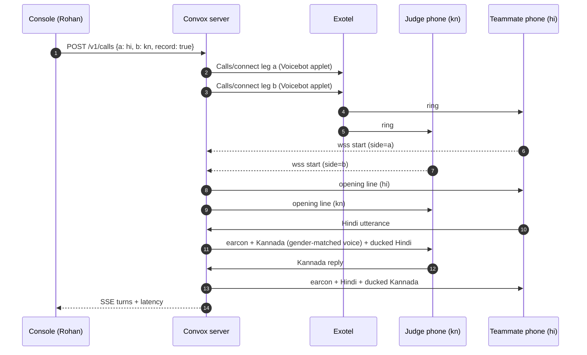

# Demo Script

This is the buildathon demo plan. It has the pre-work checklist that must be green before anyone goes on stage, the 3-minute on-stage script with timings and who does what, fallback plans for when Exotel (or anything else) fails, and the draft application form answer. The answer is corrected so that it does not claim v1 sounds like the speaker: v1 uses a **gender-matched natural voice**, and cloning is v2. The same script is used for the submission video (by 30 Oct) and for the live finale (20 Nov 2026, Bengaluru). P5 owns this doc and Rohan presents.

## Pre-work checklist

| ✓ | Item | Owner | Due |
|---|---|---|---|
| ☐ | Exotel account with the **voicebot applet** enabled; asked on the Bolna Slack (Exotel is a sponsor) | P5 → P3 | Ask D1; enabled by D4 |
| ☐ | Plivo audio streaming as the fallback (Udyam-verified account, bidirectional stream tested) | P3 | D5 |
| ☐ | Two-leg server live on the ap-south-1 VM: Exotel websocket handling, Silero VAD, Sarvam streaming STT and translate, Bulbul/ElevenLabs streaming TTS, mixer with ducking, floor controller | Rohan, P2, P3 | CP1 (D4/D5) |
| ☐ | Ward mode as a simple web app on one phone | P4 | D7 |
| ☐ | Dial-in number working end to end (or cut, in which case step 5's closing line changes; see below) | P3 | D8 |
| ☐ | Console shows the stage call live: two columns, src → tgt, per-stage latency, state badge, queue depth, DTMF and barge-in markers | P4 | D9 |
| ☐ | Language pairs rehearsed: hi⇄kn, hi⇄ta, mr⇄hi, with a team member or friend who natively speaks Kannada or Tamil on the other phone | P5 | D9 |
| ☐ | 10-second recording (with consent) of a real rider and customer failing to communicate | P5 | D7 |
| ☐ | Stage calls created with `record: true` so the per-turn log keeps text for step 5 | Rohan | D8 |
| ☐ | Speaker gender for both stage legs set explicitly (no pitch-heuristic surprise on stage) | P3 | D9 |
| ☐ | Slides: problem, Exotel applet config screenshot, the one-line platform API, per-pair numbers (only measured pairs) | Rohan, P5 | D9 |
| ☐ | Backup video of a clean run, cued and ready offline | P5 | D10 |
| ☐ | Venue check (finale): phone signal for both phones, phones on speakers without feedback, laptop network for the console | Rohan, P5 | Finale morning |
| ☐ | 3-minute run-through clean twice | All | D9 |

## On stage (3 minutes)

| # | Time | Duration | What happens | Who | Screen |
|---|---|---|---|---|---|
| 1 | 0:00–0:20 | 20 s | **The problem.** Play 10 seconds of the real recording of a rider and a customer failing to communicate. "Everyone in this hall has had this call." | Rohan (P5 plays audio) | Waveform plus captions |
| 2 | 0:20–1:30 | 70 s | **Live call.** Our server rings a judge's phone and a teammate's phone (`POST /v1/calls` from the console). The judge speaks Kannada (or Tamil, if that's what they speak), the teammate speaks Hindi, and the hall hears both phones on the speakers. Three or four turns. The opening line plays first. First translated word should arrive in under 1.5 s. | Rohan narrates; teammate on phone B; judge on phone A | Console, live |
| 3 | 1:30–2:00 | 30 s | **Ward mode.** One phone, two people, one exchange (e.g. mr⇄hi: a discharge instruction and a question back), with both texts on screen. | P4 drives, two teammates | Phone mirrored |
| 4 | 2:00–2:30 | 30 s | **One integration away.** The Exotel applet config and the one-line platform API on screen. "Every masked call on Swiggy already passes through this cloud. This is one applet away." | Rohan | Slides |
| 5 | 2:30–3:00 | 30 s | **The proof.** The per-turn log for the call we just made: what each side said and heard, and latency per turn. Close on the dial-in number and invite the hall to try it. | Rohan | Console turns view, then dial-in number |

Notes for the presenter:

- Ask the judge which language they speak **before** dialling, and offer only pairs in `config/pairs.yaml` (hi⇄kn, hi⇄ta, mr⇄hi). Do not improvise an unmeasured pair.
- Prompt short sentences: "chhote vaakya boliye" is part of the opening line.
- If a translation is clipped by a barge-in, point at the `clipped` marker in the console. It shows the controller working.
- If dial-in was cut (cut item 1), step 5 closes on the console instead: "this is what a platform's trust team sees after every call."
- If ward mode was cut (cut item 2), step 3 becomes 30 s of slides on the ward use case, and the extra time goes to the live call.

## Stage demo (no telephony)

Two people use their own phones' browsers. Nothing is dialled, so this works whatever Exotel decides. The laptop on the projector shows two QR codes, each person scans one, and the call is interpreted through the same CallSession, floor controller and mixer as a phone call. Only the leg is different (`WebRtcLeg`, websocket PCM).

**Setup (once, 30 minutes before the slot)**

1. Run the app on the VM or the laptop, and expose it over **https**. Phones block the microphone on plain http (only localhost is exempt). Set `PUBLIC_BASE_URL` to the https host (the cloudflared tunnel or the VM's domain). The QR codes always encode `PUBLIC_BASE_URL`, not the address the laptop used, so the laptop can stay on `localhost`.
2. On the laptop, open `https://<host>/demo` (console password) and pick a story: **Rent** (landlord ಕನ್ನಡ ⇄ tenant हिन्दी), **Delivery** (customer मराठी ⇄ rider हिन्दी) or **Clinic** (patient ગુજરાતી ⇄ doctor English). "Or any two languages" offers every pair `config/pairs.yaml` resolves. The stage shows the story and one QR code per role.
3. Each person scans the code for their role and taps **Tap to start** (iOS and Android unlock the microphone only from a tap). Their phone shows who they are and three lines to try in their language, so nobody freezes. When both are on, the codes give way to the call: one column per person, everything in it in their language, and between them the quiet before each line is heard, counted live. Press **Wrap up the call** (or hang up) for the outcome card: what they agreed, in both languages (one Claude call; numbers only without `ANTHROPIC_API_KEY`). **Under the hood ↗** opens the engineering dashboard (`/demo/<call>/details`) in a new tab for judges who ask how it works.
4. Phones: volume up, screen on (the page asks for a wake lock where the browser supports it), not on silent. Hold the phone like a walkie-talkie, about 20 cm away. The two people stand 1–2 m apart, or wear earphones (see "Co-located phones" below).
5. The join links work for 2 hours, and only for that call and that side. When either phone leaves (red **Leave call**, a reload or a locked screen), the call ends for both. Press **Start again** on the laptop, which makes new codes, and scan again.

**What to say (step 2 of the 3-minute script, 70 s)**

- "Two phones, two languages, no app: scan and talk." Ask the two people to scan while you say it (about 10 s).
- "She speaks Marathi, he speaks Hindi (or English). Each one hears the other in their own language, about two seconds later, after a short tone." Prompt short sentences.
- While they talk, point at the laptop: each turn appears in both columns with its latency, and the badge shows who holds the floor.
- Close: "On a phone call this is the same server. Only the leg changes: Exotel streams the call audio to us instead of a browser."

**Measured (live, scripted phones through the token sockets, 21 Oct, open question L4):** first-audio p50/p95 **1634 / 1730 ms** for मराठी ⇄ English, and **2283 / 2424 ms** for मराठी ⇄ हिन्दी. MT makes the difference (705 ms against 1375 ms at p50). **If the Hindi speaker also speaks English, use मराठी ⇄ English on stage.**

**Fallback order for the live call**

1. PSTN through Exotel (the main script above).
2. PSTN through Plivo.
3. **This stage demo** on the venue Wi-Fi or a phone hotspot.
4. The same stage demo with **both phones' pages opened on the laptop** if a phone refuses the mic: open each QR's URL (printed under the code) in two browser tabs with a headset.
5. The backup video.

**Co-located phones (cross-talk).** Both phones are in one room, so each mic also hears the other person. The server drops that (it keeps the louder, earlier voice and ignores a copy at least 6 dB quieter on the other mic, [floor controller § 7](../tech-spec/floor-controller.md#7-cross-talk-and-echo)), and it no longer replays the speaker's original under the translation on these calls, so nobody hears the same sentence twice. It still works best if the two people **stand 1–2 m apart, each speaking into their own phone at about 20 cm**, or **wear earphones** (then neither mic hears the other phone's speaker at all). Do not hold the phones side by side. If a sentence is ever lost, it is because both spoke at once at a similar distance from one phone: repeat it. Simulate it before the slot with `tools/live_loopback.py --join --a-lang mr-IN --b-lang hi-IN --room-db -12`: the "server turns" line must equal the script lines.

Known limits: phones do not barge in. While a phone plays a translation it sends silence (so its own speaker is not heard as speech), and `?duplex=1` on the phone URL turns that off. iOS can route audio quietly while the mic is open, so turn the volume all the way up. The loopback socket still accepts connections with no token (dev tools use that). Only a token that is present is checked.

## Fallback plans

Decide on the fallback before going on stage, using the live-check result from 30 minutes before the slot. Do not decide mid-demo.

| Failure | Detect | Fallback | Script change |
|---|---|---|---|
| **Exotel voicebot access never landed, or Exotel down on the day** | No applet by D4, or live-check call fails | **Plivo audio streaming** legs (same `LegTransport`, provider switched in config / `"provider": "plivo"`) | None on stage; step 4 still shows the Exotel applet config ("this is the Exotel flow; today's call ran on Plivo, same interface") |
| **Both Exotel and Plivo unavailable** | Live-check fails on both | **Stage demo** (`/join`, see [Stage demo (no telephony)](#stage-demo-no-telephony)): two phones scan QR codes and join a browser-leg call, with the Exotel applet config on screen | Step 2 says "browser legs today; on PSTN this is the Exotel number". Show PSTN latency numbers from the turn log of earlier real calls |
| **One vendor (STT, MT or TTS) down or rate-limited** | Provider errors in console | Switch the provider in `pairs.yaml` (Deepgram for an en/Hinglish leg; ElevenLabs ⇄ Bulbul for the target) and restart | None |
| **Judge's language not supported** | Asked before dialling | Teammate with Kannada or Tamil takes phone A; judge listens on the speakers | "We only demo pairs we have measured." |
| **Call connects but quality is bad (8k, noise)** | First turn misheard | Continue for 2 turns, then DTMF 1 to replay; if still bad, switch to the backup video | Mention honestly: "8 kHz phone audio; this is why we publish numbers on real PSTN" |
| **Everything fails** | — | **Backup video** of a clean run, plus the console turns view from that recorded call | Narrate over the video |
| **VM down** | Health check fails | Bring up the scripted Compose on the spare VM image; if not possible, go to the backup video | — |

## Application form answer (corrected)

*What are you building, and where does voice AI come in?*

> Convox is a live interpreter inside the phone call. A delivery rider from Bihar calls a customer in Bengaluru. The rider speaks Hindi, and the customer hears Kannada about a second and a half later, in a gender-matched natural voice, with the rider's own voice audible underneath. The reply comes back the same way. It works by sitting where gig platforms' masked calls already pass, in the CPaaS cloud, using Exotel's two-way voice streaming on each leg, Sarvam for Indic speech recognition and translation, and Sarvam Bulbul and ElevenLabs for the voice. The product is the bridge, the turn-taking controller that keeps two humans and an interpreter from talking over each other, and the integrations: a one-line API for platforms, a ward mode on a single phone for hospitals, and a dial-in number for anyone. For the buildathon we are running it live on stage between a judge's phone and ours, through an Exotel number, in the Indian language pairs we have measured (Hindi with Kannada, Tamil or Marathi).

Changes from the overview's draft, and why:

| Original | Corrected | Reason |
|---|---|---|
| "in a voice like the rider's" | "in a gender-matched natural voice, with the rider's own voice audible underneath" | v1 uses a fixed voice per target language and detected gender; cloning is v2 behind explicit consent (decision 2). The ducked original carries the "real person" signal |
| "ElevenLabs for the voice" | "Sarvam Bulbul and ElevenLabs for the voice" | Bulbul is primary for Indic targets; ElevenLabs Flash v2.5 for Hindi/English targets (decision 1) |
| "in whichever Indian language the judge speaks" | "in the Indian language pairs we have measured (Hindi with Kannada, Tamil or Marathi)" | Overview risk mitigation: do not claim pairs we have not measured; v1 non-goal: any language whose STT we have not measured on PSTN |
| "a second and a half later" | "about a second and a half later" | Expected first-word latency is about 1.4–1.8 s; target p50 under 1.5 s |

## Related

- [buildathon-10-day-plan.md](buildathon-10-day-plan.md)
- [risks.md](risks.md)
- [open-questions.md](open-questions.md)
- [phases.md](phases.md)
- [../product/overview.md](../product/overview.md)
- [../architecture/telephony-integration.md](../architecture/telephony-integration.md)
- [../tech-spec/console.md](../tech-spec/console.md)
- [../tech-spec/api.md](../tech-spec/api.md)
- [../engineering/evaluation-and-metrics.md](../engineering/evaluation-and-metrics.md)
