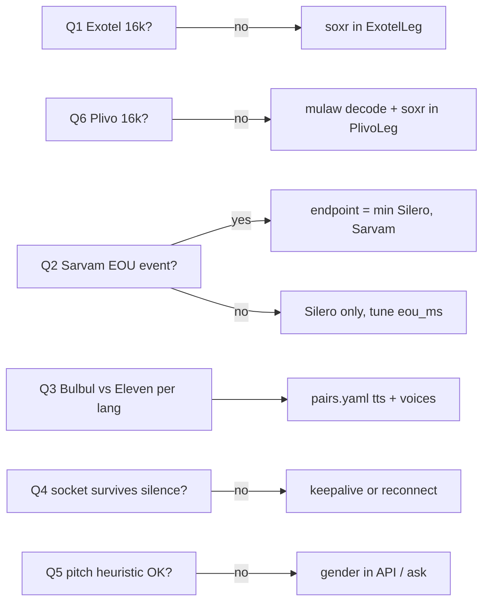

# Open Questions

This doc lists every question the docs leave unanswered. First come the six open technical questions from the tech spec, which must be settled by **Day 2 (Thu 22 Oct 2026)**. For each one it gives how to test it, the owner, the default to use if no answer arrives in time, and what the answer changes in the code or config. After those come product, process and legal questions raised by the overview and the spec. Other docs that say "TBD — see open questions" point here. When a question is answered, record the answer, the date and the evidence (log line, measurement, or listening-test sheet) in its row, and update the doc that depended on it.

## Technical questions (settle by Day 2, Thu 22 Oct)

Q1 and Q6 need a live telephony account. If neither Exotel nor Plivo access exists by Day 2, the **default** column applies and the question is re-tested on the first real minute. Nothing waits on these answers, because the fake-first rule means the pipeline is built either way.

| # | Question | How to test | Owner | Default if unanswered on Day 2 | What the answer changes |
|---|---|---|---|---|---|
| Q1 | **Exotel 16 kHz.** Does the voicebot applet really deliver 16 kHz when asked (`sample-rate=16000`), or 8 kHz with the param ignored? | First sponsor minute: one leg to the `/ws/leg` endpoint; log `start.media_format`; check the payload byte rate against `chunk`/`timestamp` deltas; listen to a capture | P3 | Assume 8 kHz may arrive: keep soxr 8k ⇄ 16k resampling in `ExotelLeg`, switched by the `start` message, and log it | Whether a resampler sits on the hot path; outbound chunk size (100 ms = 3,200 bytes at 16k, a multiple of 320); STT input quality and EOU tuning base |
| Q2 | **Sarvam streaming EOU.** Does Sarvam streaming STT emit an end-of-utterance or final-on-silence event we can use, or is Silero the only endpoint signal? | `bench.py` with corpus wavs: log every Sarvam stream event with timestamps against the Silero silence onset; compare which fires first and how often Sarvam's event splits sentences | P2 | Silero only: EOU = silence ≥ `eou_ms` (550) AND utterance ≥ 300 ms | The EOU latency floor; whether `endpoint.py` takes the earlier of two signals; per-pair `eou_ms` starting values |
| Q3 | **TTS per language.** For each of kn, ta and mr: Bulbul vs ElevenLabs Flash on naturalness and first-byte latency from Mumbai | 30-minute listening test: the same 10 translated sentences per language on both engines, blind-rated by a native speaker; measure `t_tts_ttfb` from the ap-south-1 VM (or the nearest box until the VM exists) | P3 (P5 runs the listening sheet) | Bulbul for kn, ta, mr (the tech spec default for Indic targets); ElevenLabs for hi/en | `tts`, `voice_m`, `voice_f` per side in `config/pairs.yaml` |
| Q4 | **STT socket lifetime.** Can a Sarvam stream stay open across utterances with a reset, or must it reconnect? (A Pipecat issue reports SarvamSTT dying after 60 s of silence, which suggests a keepalive is needed) | Open one stream, send three utterances separated by 5 s, 30 s and 70 s of silence (or silence frames), with and without a keepalive; record closes and errors | P2 | Reconnect per utterance, plus pre-connect on speech start; add a keepalive if it is found | The warm STT socket design (v1 latency technique, 150–300 ms saved); reconnect logic; chaos test cases |
| Q5 | **Gender detection.** Is a pitch heuristic on the first 2 s good enough for v1? Alternative: the platform passes gender in the API and the consumer flow asks | Run the detector over the corpus (all speakers, all languages, phone quality with noise) and count misclassifications | P2 (detector), Rohan (decision) | Use the pitch heuristic, plus an optional per-leg gender field in `POST /v1/calls` used when present; set it explicitly for stage calls | The voice selection path in `interp/tts.py`; an optional API field (see [api](../tech-spec/api.md)); dial-in flow prompt |
| Q6 | **Plivo 16 kHz.** Does the India region support `audio/x-l16;rate=16000` on bidirectional streams, or only `audio/x-mulaw;rate=8000`? | On the Udyam-verified account: open a stream element with `bidirectional=true`, `audioTrack=inbound`, `contentType=audio/x-l16;rate=16000`; check whether it is accepted and what `start` reports | P3 | Mulaw 8k: decode and resample in `PlivoLeg` | `PlivoLeg` decode path; whether Plivo is a quality-equivalent fallback or a degraded one |

## Product, process and legal questions

These were raised by the overview and spec but are not answered in either. Deadlines are suggestions tied to the [10-day plan](buildathon-10-day-plan.md).

| # | Question | Why it matters | Owner | Needed by |
|---|---|---|---|---|
| PQ1 | Who is the native Kannada or Tamil speaker for rehearsal and the stage phone? | Demo needs one; R-NATIVE | P5 | D3 (Fri 23 Oct) |
| PQ2 | Who are the bilingual raters for hi⇄kn, hi⇄ta and mr⇄hi, and can they rate 300 turns per pair? | Meaning-preservation number for the deck; R-EVAL | P5 | D4 (Sat 24 Oct) |
| PQ3 | Where does the "real recording (with consent) of a rider and a customer failing to communicate" come from? Who gives consent? | Opening 20 s of the stage demo | P5 | D7 (Tue 27 Oct) |
| PQ4 | Which language pairs do we offer a judge on stage? The overview says "whatever they have", but v1 only supports measured pairs | Avoid claiming unmeasured pairs on stage | Rohan | D8 (CP2) |
| PQ5 | Exact wording of the opening disclosure line in each supported language (the overview gives the Hindi and Kannada versions) and whether it counts as DPDP notice | Consent risk R-DPDP | P5, Rohan | D7 |
| PQ6 | Data residency: ElevenLabs (hi/en TTS, and cloning in v2) is not India-hosted, yet the DPDP mitigation says "India-region hosting". Is sending translated text to ElevenLabs acceptable, or does Hindi need Bulbul too? | Trust review in Phase 2; latency too (150–250 ms RTT) | Rohan | Phase 1 (before any pilot) |
| PQ7 | Bulbul pricing per character/minute. The overview's ₹1.5–2.5/min TTS line assumed ElevenLabs for everything | Unit economics in [business-model](../product/business-model.md) | P5 | Phase 1 |
| PQ8 | Sponsor credits: how many Exotel, Sarvam, ElevenLabs and Deepgram minutes/credits do we get for the buildathon and the finale? | R-CREDITS | P5 | D2 |
| PQ9 | Who owns `api/` (call setup, webhooks), `store/` and deployment? The spec does not assign them; [roles](roles-and-ownership.md) proposes P3, P4 and Rohan | Avoid orphaned modules | Rohan | D1 |
| PQ10 | Do we own `dubhash.in` and `edge.dubhash.in`? DNS and TLS are needed for the Exotel websocket URL | CP1 | Rohan | D3 |
| PQ11 | Dial-in language detection: is Sarvam language ID fast and accurate enough on one sentence, or do we lead with the DTMF menu? | Dial-in UX (cut item 1) | P3 | D7 |
| PQ12 | Dial-in free tier (first 10 min/month free, then ₹2/min via UPI): how is abuse prevented, and is UPI billing in scope before Phase 1? | Phase 1 launch | P5 | Phase 1 |
| PQ13 | What form does the Phase 1 platform design partner take (LOI, unpaid pilot, paid pilot)? Bengaluru gig or logistics platform: which one? | Phase 1 exit criterion E1.7 | Rohan | Dec 2026 |
| PQ14 | Which hospital and doctor run the ward mode pilot (Mumbai or Pune)? What does "save to chart" integrate with? | Phase 1 E1.5 | Rohan, P4 | Nov 2026 |
| PQ15 | When does entity read-back for numbers and doses ship? It is a risk mitigation but not scheduled | Medical/money mistranslation R-MISTRANS | P2 | Phase 1 planning |
| PQ16 | API language codes: the overview uses `"hi"`/`"kn"`, the spec uses `"hi-IN"`/`"kn-IN"`. Which is canonical in `POST /v1/calls`? **Docs default: BCP-47 with region (`hi-IN`), as in [api](../tech-spec/api.md).** Confirm, or decide to also accept short codes | Platform integration contract | P3 | D4 |
| PQ17 | Websocket path: the overview shows `wss://edge.dubhash.in/leg?…`, the spec `wss://edge.dubhash.in/ws/leg?…`. **Docs default: `/ws/leg`.** Still open: Exotel allows 3 custom params; `call` and `side` are two, and does `sample-rate` count as the third? | Exotel applet config | P3 | D4 |
| PQ18 | For stage calls, is the call created with `record: true` so the console and the per-turn log show text afterwards? (Without it, `src_text`/`tgt_text` are nulled after metrics) | Demo step 5 shows the per-turn log | Rohan | D8 |
| PQ19 | Does CP1 / the never-cut item / the stage demo require **Exotel** specifically, or is Plivo acceptable? The overview's never-cut list says "two real phones through Exotel"; the spec's build order lets CP1 pass on Plivo if Exotel access has not arrived. Docs currently say "Exotel (Plivo if Exotel access slipped)" | CP1 pass condition, demo story with the sponsor | Rohan | D4 |
| PQ20 | Who owns the pitch-based gender detector? Decision 6 lists "pitch" in Rohan's lane, which may mean the on-stage pitch; [roles](roles-and-ownership.md) proposes P2. Docs currently say P2 (proposed) | Avoid an orphaned detector | Rohan | D1 |

## Spec gaps (TBD items referenced from other docs)

Neither PDF answers these. Each row names the doc that holds the current proposed default. Settle them in that doc, then log the answer below.

| # | Gap | Proposed default (where) | Owner | Needed by |
|---|---|---|---|---|
| G1 | **Earcon timing.** The spec's latency table says "earcon at EOU" (heard about 100 ms after EOU); the mix stage and overview say it plays at translation start, which can add 120 ms before the first word | none yet ([audio](../tech-spec/audio.md#unresolved-mixer-details)) | Rohan | D3 |
| G2 | **Which original is ducked.** Live speaker frames during the TTS window, or the buffered utterance replayed under the translation? Does the listener hear the speaker live while they speak? | none yet ([audio](../tech-spec/audio.md#unresolved-mixer-details)) | Rohan | D3 |
| G3 | **Floor controller transitions the spec leaves implicit:** `on_translation` when the source still holds the floor, exit from `X_SPEAKING` on a discarded utterance, barge-in timer only for the listener, speaking-while-playing past 1.2 s | reading in [floor controller §2.1](../tech-spec/floor-controller.md#21-interpretation-where-the-spec-is-terse) | Rohan | D2 |
| G4 | Utterances under 300 ms: dropped as noise, or merged into the next utterance? | discarded, `X_SPEAKING → IDLE` ([floor controller](../tech-spec/floor-controller.md)) | P2 | D2 |
| G5 | `escape_dtmf` is configurable in the API but the spec's controller hard-codes `"0"`; can bypass be undone during a call? | read from the call; no undo ([floor controller](../tech-spec/floor-controller.md#rule-6-dtmf-1-replay-0-bypass)) | Rohan | D7 |
| G6 | Translation cache size bound, eviction, and how a cache hit is marked in `turns` (no column) | in-memory per pair, bound TBD ([interpreter pipeline](../tech-spec/interpreter-pipeline.md#translation-cache)) | P2 | D6 |
| G7 | `t_tts_done` is in the spec's stage table but not in the `turns` schema | bench-only for now ([latency engineering](../engineering/latency-engineering.md#timestamps-to-log)) | P2 | D5 |
| G8 | **Heard first-audio.** Provider playout buffering (~200 ms) is invisible server-side. Publish server first-audio plus a calibrated offset, or align recordings of both legs? | TBD ([latency engineering](../engineering/latency-engineering.md#timestamps-to-log)) | P5, P2 | D6 |
| G9 | Turn timestamps: wall clock or call-relative ms? | call-relative ms anchored at `calls.started_at` ([data model](../tech-spec/data-model.md#turns)) | Rohan | D1 |
| G10 | Exotel outbound `media`/`clear`/`mark` JSON shape; TTS provider output sample rates; Exotel `media_format` parse format | take from vendor docs or the Pipecat serializer ([leg transports](../tech-spec/leg-transports.md)) | P3 | D4 |
| G11 | Auth for Plivo's websocket, `WebRtcLeg`, provider webhooks, the platform API and the console (only Exotel WS auth is in the spec) | proposals in [api](../tech-spec/api.md#authentication) and [security](../tech-spec/security-privacy.md#authentication-and-network) | P3 | D5 |
| G12 | Full `calls.status` enum (only `ringing` is defined) | `ringing / in_progress / completed / failed` ([api](../tech-spec/api.md#call-status-values)) | P3 | D4 |
| G13 | Outbound platform webhook payloads and delivery (the overview names `call.started`, `turn`, `call.ended`; the spec gives only the `webhook` field). Are texts sent when `record: false`? | proposals in [api](../tech-spec/api.md#outbound-webhook-events-dubhash--platform) | P3 | D5 |
| G14 | Retention: how a platform opts in (account flag vs per call), how long retained text is kept, whether `record: true` also covers audio, and phone-number handling | `record` = text only; audio needs its own opt-in ([data model](../tech-spec/data-model.md#text-retention)) | Rohan | Phase 1 |
| G15 | Is the opt-in S3 recordings bucket in v1? The spec's component figure has it; the deploy stack (app, Postgres, Redis, Caddy) does not | not in the v1 Compose stack ([deployment](../engineering/deployment.md#data-handling-on-the-box)) | Rohan | D5 |
| G16 | Deepgram hosting region (caller audio leaves India on the English/Hinglish fallback?); vendor data-retention and no-training settings | TBD ([security](../tech-spec/security-privacy.md#data-residency)) | P5 | Phase 1 |
| G17 | Opening line: it does not say an automated service processes the call or how to turn it off; DPDP counsel review | proposed extra sentence in [security](../tech-spec/security-privacy.md#opening-line) | P5, Rohan | D7 |
| G18 | Dial-in: how leg b's language is chosen; the Passthru request/response contract | TBD ([telephony integration](../architecture/telephony-integration.md#dial-in-ivr-flow-consumer)) | P3 | D7 |
| G19 | Ward mode signalling route and how "save to chart" reaches a hospital record system | TBD ([api](../tech-spec/api.md#ward-mode), [console](../tech-spec/console.md)) | P4 | D7 / Phase 1 |
| G20 | Default voice before gender is detected (first utterance under 2 s); optional per-leg gender field in `POST /v1/calls` | see Q5 ([configuration](../tech-spec/configuration.md#voice-selection-v1)) | P3 | D6 |
| G21 | Controller `tick` period; localised "aap line par hain?" text per language | TBD ([floor controller](../tech-spec/floor-controller.md)) | Rohan | D3 |
| G22 | Max concurrent calls per node; VM size; backups; monitoring | set from CPU profiling ([configuration](../tech-spec/configuration.md), [ADR 0010](../architecture/adr/0010-single-vm-mumbai.md)) | Rohan | D8 |
| G23 | Eval: corpus storage if too large for git; split of the 300 rated turns between bench and live calls; number of PSTN runs per pair before CP2 | report the split with the number ([evaluation](../engineering/evaluation-and-metrics.md)) | P5 | D6 |
| G24 | Missing cost lines: Deepgram, v2 LLM repair, hosting; platform sell price ₹5–8 vs ₹6–8 in two overview tables | TBD ([business model](../product/business-model.md)) | P5 | Phase 1 |

## Answer log

| # | Answer | Date | Evidence |
|---|---|---|---|
| Q1 | TBD | | |
| Q2 | Partly answered. Sarvam's realtime STT emits `vad.speech_end` about **1021 ms** after speech stops, slower than our Silero EOU at 550 ms. Keep Silero as the primary endpoint and treat Sarvam's signal as a backup. STT final arrives about **290 ms** after end-of-stream. | 21 Oct | `make smoke --eou`, bulbul kn sentences, from Bengaluru |
| Q3 | Partly answered. Bulbul kn TTS first byte is 215–367 ms (total 0.8–0.9 s). ElevenLabs is not measured yet (no key). The listening test is still open. | 21 Oct | `make smoke` |
| Q4 | Not measured. Run `tools/smoke.py --idle 5,30,70`. | | |
| Q5 | TBD | | |
| Q6 | TBD | | |
| L1 (new) | **Translation latency is the bottleneck.** Sarvam hi→kn takes **about 1.2 s** at p50, whatever the model or mode (`mayura:v1` modern-colloquial and formal, `sarvam-translate:v1`). en→kn takes about 630 ms and network RTT is about 60 ms, so hi→kn is probably two hops inside Sarvam. Claude streaming was also tried: `claude-haiku-4-5` gave first token at 933 ms and finished at 1.7 s; `claude-opus-5-5` at low effort finished at 2.0 s. Neither is faster. The direct pair works (no English pivot fallback needed). Mayura modern-colloquial keeps English loanwords in Latin script ("gate number 2"), and Bulbul reads them fine. Estimated first-audio is 550 EOU + 290 STT + 1200 MT + 250 TTS + 200 playout = **about 2.5 s**, above the 2.0 s p95 target. Mitigations being built: speculative MT on stable STT partials during the EOU wait, and a trial of Sarvam speech→English plus en→kn. **Pivot trial (live, 10 Bulbul-voiced Hindi sentences, real-time paced, warm sockets, 2 runs):** Sarvam's realtime STT has `mode=translate` (Hindi speech → English final; partials stay Hindi). Its final arrives as fast as a transcript (277 vs 287 ms p50). Route B (STT-translate → en→kn) STT+MT = **962 ms p50 / 1107 ms p95** against route A (hi STT → hi→kn) **1630 / 1872 ms**, which saves about 670 ms at p50 (`saaras:v4` run: 988/1031 against 1667/1882). hi→en (707 ms) + en→kn (716 ms) ≈ hi→kn (1357 ms), which supports the internal-pivot guess. Estimated first-audio with B is about **2.0 s p50 / 2.1 s p95**: at the p95 target, but not the 1.5 s p50 target. Quality: B's English kept every name and number in the set, and B was more faithful than A on 3 of 10 sentences (A misheard one OTP sentence and swapped a pronoun). B's Kannada is more code-mixed. A native Kannada rating is still needed. Opt-in pair `hi-kn-pivot` (`stt: sarvam-translate`, `mt_src: en-IN`). Details in providers/README.md "Pivot trial (L1)". | 21 Oct | `/private/tmp` probe scripts, 6 calls each, warm client; `tools/pivot_probe.py` (live) |
| L1a (new) | **Speculative MT on STT partials does not help with Sarvam STT.** Built (`interp/speculate.py`, `spec_mt` / `spec_after_ms` per pair, bench `--spec/--no-spec`), now **off by default**. Fakes with the live budget (MT 1200, STT final 290, TTS ttfb 250, no playout): first-audio p50 **2320 → 1660 ms** (`spec_after_ms` 0/100/200/300/400 → 1480/1560/1660/1760/1860). Live hi→kn (Sarvam STT + Mayura + Bulbul, 8 Bulbul-hi utterances): hit rate **1/8**, 33 speculative MT calls for 8 utterances, first-audio p50 2451 / p95 3445 ms with speculation vs 2408 / 2552 ms without. Cause: Sarvam realtime partials lag the final. With `stream_type=fast` they are fragments ("जी जी", "आपका"); with `balanced` they trail the speech by ~0.7 s and are still incomplete when the final lands ~850 ms after speech ends. Next: an early final (send `speech_end`/`flush` at ~200 ms silence and speculate on that), or an STT with faster partials. | 21 Oct | `tools/bench.py --pair hi-kn-bulbul`, partial-timing probe, 3 utterances each |
| L2 (new) | **End-to-end live loopback: the first full call through the real app** (real CallSession, WebRtcLeg, floor and mixer; Sarvam STT/MT and Bulbul TTS; two scripted websocket tabs playing a 6-line rider/customer call in real time, Bulbul-voiced, Kannada lines unreviewed). **Heard first-audio** (end of the speaker's last voiced frame to the first translated voice frame, on the client's 20 ms tick clock, so a lower bound for a real tab): pivot `hi-kn` **2280 p50 / 3260 p95** (12 turns, 2 calls; A→B alone 2080 / 3260), `hi-kn-direct` **2480 / 3300** (6 turns; A→B over 5 turns 2540 p50). The earcon starts 120–300 ms before the voice. The server's own first-audio (`t_play_start - t_speech_end`) is 2122 / 3092 (pivot) and 2294 / 3107 (direct). **Stages, p50 of the last two calls:** EOU 560, STT final 260, MT 1116 (pivot) / 1263 (direct), TTS first byte 180, floor queue 0–2, server play start to earcon heard 1–19 ms. **MT is still the bottleneck and makes the p95:** single calls of 2.0–2.5 s (en→kn 2045, kn→hi 2506) against a usual 0.7–1.3 s. On A→B the pivot saved about 460 ms at p50 against direct here (2080 vs 2540). Silero ended speech 1–62 ms after the real end on Bulbul audio. Every line became exactly one turn, all marks were acked, with no clears and no clips, and teardown completed every call. **Fixed on the way:** (1) Bulbul clips start with 100–320 ms of near-digital silence, heard as a gap after the earcon; the mixer now trims it (gap median 160 → 20 ms). (2) The opening line was synthesised whole before it was sent, so callers heard 1.8–2.8 s of dead air; it is now streamed, and first sound arrives in 0.4–0.7 s. (3) The 10 s line check counted from call creation and through the opening line, so it fired over the rider's first sentence; it now counts from activation and from the end of the opening. **Still open:** the opening line is not marked, so the floor does not know a leg is still hearing it (the Kannada opening is 8–9 s, the Hindi one 7.5 s). MT quality: "ಮೆಟ್ಟಿಲುಗಳು ಎಡಗಡೆ ಇವೆ" (the stairs are on the left) lost "left" on both routes. Outputs mix scripts ("elevator काम नहीं कर रहा है"). A native Kannada review is still pending. | 21 Oct | `tools/live_loopback.py`; calls c_o73lj45sba, c_ngecj7mppt (hi-kn), c_jtuobzg2ag, c_dufgnxvpoj (hi-kn-direct); c_lvi65vzdpk before the fixes (2340 / 3320) |
| D1 (decision) | 21 Oct: **Bulbul speaks Hindi** (ElevenLabs off the default path; free tier blocks library voices), and **`hi-kn` defaults to the pivot route** (Sarvam speech→English, then en→kn). The direct route is kept as `hi-kn-direct`. A native Kannada speaker's check of the outputs is still pending. | 21 Oct | ADR 0008 amendment, `config/pairs.yaml`, `tests/test_pair_defaults.py` |
| L3 (new) | **An early STT final takes about 350 ms off first-audio, and no words are lost.** Built in `interp/pipeline.py`, with `early_final_ms` per pair (0 = off) and bench `--early-final-ms`. After `early_final_ms` of silence inside an utterance, the STT stream is ended (`speech_end`), and the final, MT and TTS first byte run during the rest of the 550 ms EOU wait. If speech resumes before EOU, the early result is discarded and its MT/TTS are cancelled. The old `end()` finishes in the background, so its socket returns to the warm pool. A new stream then gets the whole buffered utterance (pre-roll + speech + gap) and continues live. Delivery is still at EOU, never earlier, so the floor's turn-taking is unchanged: playback starts at max(EOU, TTS ready). The backchannel rule applies to the early final. Timings gain `t_early_final`, `early_final_used` and `early_final_restarts`. While an early final is pending, speculation does not start. **Fakes** (`hi-kn`, MT 700, STT final 290, TTS ttfb 250, lockstep, n=3): first-audio p50 with `early_final_ms` 0/150/200/300 = **1820/1420/1460/1560 ms**. **Live** `hi-kn` A side (Sarvam speech→English + en→kn + Bulbul, 10 Bulbul-hi sentences × 2 runs per setting, real time, n=20): first-audio p50/p95 = **1727/1882 ms off vs 1377/1634 ms at 200**. One 1.9 s MT spike in the "on" runs gave a max of 2561 ms. The final arrived about 100 ms *before* EOU at p50. MT and TTS were never finished before EOU, so the EOU hold cost nothing. **Restarts:** 20 of 40 early finals (50%) were discarded on comma pauses (Bulbul pauses 240–480 ms at commas). Every utterance's delivered final still came from an early final. The 20/20 English finals were **identical** to the off runs. Kannada B side, 2 smoke clips: 2252 → 1863 ms p50, 0 restarts, same transcripts. Cost: one extra STT stream per mid-sentence pause, plus a cancelled MT call when the final lands before the speaker resumes (only on pauses longer than ~460 ms). **On for `hi-kn` at 200.** Other pairs stay off until measured. Human speech pauses differ from Bulbul's, so the restart rate on real calls is still unknown. | 21 Oct | `tools/bench.py --stt real --mt real --tts real --early-final-ms 0/200`, `out/early/live_ef*.json`, `tests/test_early_final.py` |
| L4 (new) | **Marathi pairs: the English pivot on both sides of `mr-hi` saves about 1 s, and `mr-en` skips MT on the Marathi side.** Live loopback (`tools/live_loopback.py`, real app, Sarvam STT/MT, Bulbul; scripts `delivery-mr-hi`: Marathi customer and Hindi rider, 7 lines; `clinic-mr-en`: Marathi patient and English doctor, 7 lines; **the Marathi lines need a native speaker's review**). Heard first-audio p50 / p95 per direction: **`mr-hi` as it was** (plain STT, mr↔hi MT, now `mr-hi-direct`; 4 calls, n=16/12): mr→hi **2480 / 3240**, hi→mr **2500 / 2580**; MT 1305–1376 ms p50, about two English hops as with hi→kn (L1). **Pivot + `early_final_ms: 200`** (both sides `sarvam-translate`, `mt_src: en-IN`; 4 calls, n=16/12): mr→hi **1500 / 1940**, hi→mr **1540 / 1720**; stages EOU 560, STT 0 (the final lands inside the EOU wait), MT 576–614, TTS 180, queue 0. Pivot alone (1 call): 1820 / 1900 and 1900 / 1900; early final alone (1 call): 2040 / 2260 and 2460 / 3220. **`mr-en`** (new; 3 calls, n=12/9): mr→en **820 / 1160** (STT gives English, MT skipped: EOU 560 + TTS 96), en→mr **1520 / 1880** (Sarvam STT `en-IN`, en→mr MT 608). Fakes (bench, MT 600, STT final 260, TTS ttfb 180): `mr-en` 640 (mr→en) vs 1240 (en→mr). **Numbers and names:** the pivot kept "flat 302", "OTP 4729" and "6" in every run; the direct route turned "सहा वाजता" into "six बजे" in all 4 calls (flagged by the tool's number check). `mr-en` kept 302, 4729, "6 PM" and "Shivaji Nagar". **Quality notes:** both routes heard the Bulbul-Hindi "विंग" as "रिंग"/"ring"; both make the male rider female in Marathi ("उभी आहे", MT has no speaker gender); the pivot turned "ऊपर आता हूँ" into "I'll be up" → "उठेन" (I'll get up); Sarvam en-IN STT heard "Take this tablet" as "Eat this tablet" (the Marathi output "घ्या" is still right). Outputs are code-mixed ("Flat 302 से call कर रही हूँ"). **Decision:** `mr-hi` defaults to the pivot + early final; `mr-hi-direct` keeps the old route. `find_pair` now accepts either orientation (a swapped `PairConfig`), so `en-IN`/`hi-IN` on side A also work. **Opening line** cut to one sentence: Bulbul 3.2 s (en), 3.4–3.7 (mr), 3.7 (hi), 4.3 (kn) instead of 7–9 s; loopback calls use `record: true`, which adds the 3 s "text is saved" sentence. It is now sent through the floor and marked; interpreting starts at activation, and the floor holds a leg's translations until its opening mark returns (or the opening's length + 1.5 s). One of 16 openings (Marathi side, c_d4i24x26lw) never arrived from Bulbul within the 10 s prompt timeout: logged, hold released, the call carried on, and the line check played at 16.9 s. | 21 Oct | `tools/live_loopback.py --script delivery-mr-hi --pair mr-hi / mr-hi-direct`, `--script clinic-mr-en`; calls c_4rut5oznwm, c_wcswehiqde, c_5krw2ewpyh, c_f726nv6yyu (pivot), c_57a6w47myc, c_fryz6pat7m, c_d4i24x26lw, c_5vghwic74w (direct), c_sh5swtgpsq, c_7ibexx6g3d, c_ursbwhxtqr (mr-en); `tests/test_pairs_orientation.py`, `tests/session/test_floor_prompt.py` |
| L5 (new) | **Stage demo over QR-joined phones (`/join`, no telephony) works end to end with real vendors.** Two scripted websocket clients played the phones: the call was started from the host page, and each client connected with the join token from its QR URL (`tools/live_loopback.py --join`). Same CallSession, floor and mixer as L2. Six-line delivery call (Bulbul-voiced; Marathi lines unreviewed). **मराठी ⇄ English (`mr-en`, new, direct):** server first-audio **1634 p50 / 1730 p95 ms** and heard first-audio 1800 / 1900 (n=6). Stages p50: EOU 560, STT 196, MT 705, TTS 179. **मराठी ⇄ हिन्दी (`mr-hi`):** 2283 / 2424 server, heard 2500 / 2540 (n=6), MT 1375 p50, so mr↔hi has the same internal-pivot cost as hi→kn (L1). Every line became one turn, with no clears and every mark acked. Numbers and names survived (OTP 4729 both ways). Hindi output put the male rider's line in the feminine ("आ जाऊँगी"), and outputs mix scripts ("stairs left-ला"). Not measured yet: real phones (browser jitter, iOS output routing), and `early_final_ms` on these pairs (off). | 21 Oct | `tools/live_loopback.py --join`; calls c_ybqu22hnho (mr-en), c_3u64n3qul5 (mr-hi) |
| L6 (new) | **Gujarati pairs on the Marathi pattern: `gu-hi` pivots both sides through English (about 1 s faster than direct), and `gu-en` skips MT on the Gujarati side.** Live loopback (`tools/live_loopback.py`, real app, Sarvam STT/MT, Bulbul; scripts `delivery-gu-hi`: Gujarati customer and Hindi rider, 7 lines; `clinic-gu-en`: Gujarati patient and English doctor, 7 lines; **the Gujarati lines, the opening line and the phone strings need a native speaker's review**). Heard first-audio p50 / p95 per direction, over whole turns (split utterances and the turn queued behind one left out, see below): **`gu-hi`** (pivot + `early_final_ms: 200`; 2 calls, n=5/4): gu→hi **1500 / 1640**, hi→gu **1460 / 1700**; stages p50 EOU 560, STT 0 (the final lands inside the EOU wait), MT 569–582, TTS 170–173, queue 0. **`gu-hi-direct`** (plain STT, gu↔hi MT; 1 call, n=3/3): gu→hi **2400 / 2540**, hi→gu **2600 / 4860** (the p95 is a 2.3 s floor-queue wait); STT 169–257, MT 1331–1384, so gu↔hi has the same two-hop cost as hi→kn and mr↔hi (L1, L4). **`gu-en`** (2 calls, n=8/6): gu→en **800 / 980** (STT gives English, MT skipped: EOU 560 + TTS 79), en→gu **1480 / 1580** (Sarvam STT `en-IN`, en→gu MT 572). Every call completed and every line became one or two turns. **Split turns:** Bulbul-gu pauses between the two sentences of "બી વિંગ, ત્રીજો માળ. લિફ્ટ બંધ છે…" (and Bulbul-hi on "धन्यवाद मैडम, शाम को…") exceeded `eou_ms`, so each became two turns (2 of 7 per gu-hi call, 1 of 7 direct). The tool then starts the next line while the second half is still playing, and the floor holds that translation (queue 2.3–2.9 s, one heard 4500 ms). That is tool pacing; real speakers wait. **Numbers:** `gu-en` kept 302, 4729, "6 PM" and "Navrangpura" in both calls. `gu-hi` kept 302, 2 and 6 every time, but **lost the OTP on both routes**: the Gujarati line "ઓટીપી 4729 છે." came back as "TP 47296" (pivot) and "ઓટીપી ચાર સાત બે નવ છ" → "OTP 4 7 2 9 6" (direct). Bulbul reads the digits as words and "છે" (is) right after them is heard as "છ" (six), so the STT appends a 6. The pivot also dropped the "O" of "OTP". This is a real Gujarati hazard for spoken digits followed by "છે"; the number check flagged it every time. On the direct route the Gujarati STT wrote "6 વાગ્યે" as the word "છ" and MT gave "six बजे" (6 lost, as Marathi direct in L4), and MT rewrote "another parcel will arrive" as "I will come to collect the second parcel". **Quality notes:** the pivot kept "દાદર" (stairs) as the place name "Dadar" (direct said "stairs"); Bulbul-Hindi "विंग" is heard as "ring" on both routes (as L4); the male rider is made female in Gujarati ("ઊભી છું"); outputs are code-mixed ("building-ના gate પર"). **Voices:** `bulbul:gu-male-1` / `gu-female-1` resolve to Bulbul v3 shubh / ishita and both return `gu-IN` audio. **Opening line** (one sentence, Bulbul gu): 3.6–3.9 s (shubh), 4.3–4.9 s (ishita); the Gujarati "text is saved" sentence is 3.9–4.1 s, about 1 s longer than the others, so the Gujarati side's `record: true` opening ran 7.9–9.2 s against 5.8–6.8 s on the Hindi/English side. **Decision:** `gu-hi` defaults to the pivot + early final, `gu-hi-direct` keeps the plain route, `gu-en` as `mr-en`; ward presets gu⇄hi and gu⇄en; the /join picker labels Gujarati ગુજરાતી. | 21 Oct | `tools/live_loopback.py --script delivery-gu-hi` (c_c4ts5x7kib, c_6q5ezkn5ox), `--pair gu-hi-direct` (c_pde6k7fb2p), `--script clinic-gu-en` (c_mwnkbkbqv6, c_bickuztcpa); `tests/test_pair_defaults.py`, `tests/test_pairs_orientation.py` |
| L7 (new) | **Real-phone latency ("5 s from speaking to hearing it" on the QR stage demo): the opening line was the cause we could reproduce; it held the first translation for 2-3 s.** On `/join` every call was `record: true`, so each phone heard the one-sentence opening plus the "text is saved" sentence: **6.9-7.6 s** of Bulbul per side (live), during which the phone page also gates its own mic (half duplex), and the floor held any translation for a leg until that leg's opening mark came back. **Fixes:** (1) `opening_line: short | full | off` per call (settings `loopback_opening_line` = `short` for `/loopback` and `/join`, `pstn_opening_line` = `full` for `POST /v1/calls`; a loopback request may pass `opening_line`). The short line is the two language names and "speak" ("मराठी ते हिंदी. बोला.", "हिंदी से मराठी. बोलिए."), 2.1-2.3 s of audio live, never with the record sentence (TODO PQ5: native review). (2) A translation that starts for a leg still hearing its opening **cuts** it: no more prompt audio is sent, its mark is dropped, the leg is cleared before the translation's first frame (`floor.prompt_cut` event). **Live, `tools/live_loopback.py --join` mr-hi (real app, Sarvam STT/MT, Bulbul; scripted clients, heard on the 20 ms client tick clock, a lower bound for a phone):** speak at once during the opening (`--speak-at-start --skip 4`, first line "ओटीपी 4729 आहे."): heard **4120 / 3660 / 4560 ms before** (server first-audio p50 ~4290, n=6, floor queue 2151-3208 ms) against **1360 / 1360 / 1460 after** (server 1241-1347, queue 0-1). Full script after waiting the opening out: 1500 / 1600 before, 1460 p50 after (n=7 each; one after-turn queued 2.2 s behind a split Hindi turn, the L6 tool-pacing effect). **Noise:** `--noise-snr 15` (pink noise on both mics during and between the lines): 1480 / 1600 before, 1380 / 1520 after, EOU 553-573 ms either way: Silero rejects stationary noise, so pink noise was not a cause. Babble, a TV or AGC pumping is what keeps Silero above 0.5; for that the VAD is now behind `NoiseFloorGate` (speech only if also 6 dB over an adaptive floor of the room; fake-VAD babble tests at 10-20 dB SNR: EOU 550 ms after the speech instead of never) and utterances end at the next dip after `max_utterance_ms` (7000). Early final (200) and EOU (550) unchanged on pink noise at 10-20 dB (Silero tests). **Smaller:** STT/TTS/MT sockets are prewarmed at call creation and again at activation (they were never prewarmed; with early final the STT open overlaps the speech, so the gain is small); Sarvam MT keeps its HTTPS connection 60 s instead of httpx's 5 s (MT after 8 s pauses 667 -> 649 ms p50, n=6: about 20 ms); websocket permessage-deflate is off in `make dev`, the Dockerfile and the live tools (no measurable change: it is CPU per frame, not a buffer). The phone page already played audio from the first render quantum (no jitter buffer) and already asked for echo cancellation, noise suppression and AGC. **Telemetry for the next phone test:** the page sends `{"type":"telemetry","kind":"play_start"|"play_end","tag","client_ms","audio_ctx_ms"}` (first sample heard, via `getOutputTimestamp`, so device output latency is in), `mic_level` {`rms`, `client_ms`} every 500 ms and `pong` {`server_ms`, `client_ms`}; the server pings every 2 s with the session clock and logs each message as `leg.telemetry` (`rtt_ms` on pongs), so heard latency = play_start mapped to the session clock minus the turn's `t_speech_end`. **Not fixed here (other branches):** the receiving phone hearing the original under the translation (the ducked original, `audio/mixer.py`) and two phones in one room hearing each other (crosstalk: a phone's mic picks up the other phone's playback and the other person, which makes ghost turns that queue ahead of the real reply). Not measured: a real phone's output latency and Bluetooth, the cloudflared hop. | 21 Oct | `tools/live_loopback.py --join --a-lang mr-IN --b-lang hi-IN [--speak-at-start --skip 4 --n 3 | --noise-snr 15]`; before (1af1f19): c_6dvbybqifq, c_rpjbm5e4pd, c_3qi6s6loru, c_ujijsylu3m, c_s5laj7ctx4, c_hiwekeqzwe, c_7hhyci34dn, c_v3d5i34thn; after: c_64w4p4ahwq, c_tau4k3wflf, c_d6547myrrf, c_t46hfg6uwm, c_qr6bjucgje; `tests/test_noise_floor.py`, `tests/test_max_utterance.py`, `tests/test_early_final_noisy.py`, `tests/session/test_floor_prompt.py`, `tests/join/test_phone_js.py` |
| L8 (new) | **Language ID for `lang: "auto"`: decide from the first 2.0 s with Sarvam's REST STT (`language_code=unknown`) on `saaras:v3` and `saaras:v4` in parallel; never from 1.0 s; the realtime socket's own detection is not good enough.** Corpus (`tools/langid_probe.py`): 10 short, hard, parallel sentences per supported language (OTP, lift, flat, parcel, "cash on delivery"; hi/mr/gu near-identical), Bulbul shubh + ishita, 120 clips of 0.76-2.8 s (85 under 2 s) plus 60 joined pairs of 2.2-5.2 s, each clean 16 kHz and PSTN (8 kHz G.711 mu-law round trip); candidates = the six. Synthetic voices: real callers will differ. **Top-1, PSTN, short / long:** v3 first 1.0 s **78% / 80%**, first 2.0 s **92.5% / 95%**, whole **91% / 100%**; v4 80% / 82%, 95% / 97%, 96% / 100%. **mr↔hi: 0 confusions** either way at every window, channel and model; **gu→hi: 1** (1.0 s only, "હા, બરાબર છે"); errors are almost all **en-IN on loanword-led lines** ("Flat number 302", "Cash on delivery ₹400"). v3's confidence is calibrated (no Indic guess ≥ 0.7 wrong on PSTN; wrong en-IN up to 0.65 PSTN, 0.93 wideband); v4 says 0.99 when wrong. **Engine default** (`SarvamLID`, `decide()`): both models agree → accept (agreed en-IN needs v3 ≥ 0.9), else v3 ≥ 0.7 (en-IN 0.95), else None. At 2.0 s it accepted **87% / 88% (PSTN)** and **89% / 92% (clean)** with **0 wrong of 360**; whole utterance 86% / 95% PSTN, 0 wrong; at 1.0 s it accepted 35 wrong. Latency (slower of the two calls) p50 **230 ms**, p95 430-760 ms; single REST call p50 195 / p95 350. Text LID (`/text-lid`, no confidence) 92% / 95% on transcripts at 604 ms p50; as a veto it caught nothing the thresholds missed, so it is off. **Realtime socket** `language_code=auto` (`saaras:v3-realtime`, also with `mode=translate`, where it reports the source language): finals carry `language` + `language_confidence` (now `detected_lang` / `detected_confidence`), but it said **en-IN for all 120 short clips** (and often translated them to English in transcribe mode) and was 70% right on long ones, wrong at confidence 1.0 (mr→hi 3/10, transcribing Marathi as Hindi); same answers on a fresh or warm socket. With a fixed `language_code` the final carries no language, so the cross-talk `lang` gate never fires on Sarvam. **Recommendation:** minimum 2.0 s of speech; thresholds as above; on None retry on the next utterance, then the keypad after two inconclusive tries; the STT final's `detected_lang` alone does **not** suffice; once decided, open the side's STT in that language. Docs: realtime `auto` (not `unknown`), REST `unknown`, text-lid 1000 chars, REST 30 s audio and 60 req/min (starter; 429s seen at ~1 req/s). Details: providers/README.md "Language identification (L8)". | 21 Oct | `tools/langid_probe.py` (v3 all engines), `--models saaras:v4 --conds pstn/clean --tag v4/v4-clean`, `--replay … --tag all`; `out/langid/summary-all.md`; `tests/providers/test_sarvam_lid.py`, `tests/providers/test_sarvam_stt.py`, `tests/tools/test_langid_probe.py` |

## Related

- [buildathon-10-day-plan.md](buildathon-10-day-plan.md)
- [risks.md](risks.md)
- [roles-and-ownership.md](roles-and-ownership.md)
- [demo-script.md](demo-script.md)
- [../tech-spec/configuration.md](../tech-spec/configuration.md)
- [../tech-spec/leg-transports.md](../tech-spec/leg-transports.md)
- [../tech-spec/interpreter-pipeline.md](../tech-spec/interpreter-pipeline.md)
- [../tech-spec/security-privacy.md](../tech-spec/security-privacy.md)
- [../product/business-model.md](../product/business-model.md)
