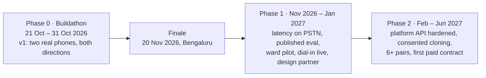

# Phases

This doc splits Convox into three phases: Phase 0 is the Bolna Symphony Buildathon build, which runs to submission on 31 Oct 2026. Phase 1 runs Nov 2026 to Jan 2027 and covers the finale, the first pilots and latency work. Phase 2 runs Feb to Jun 2027 and covers platform hardening and the first paid contract. For each phase it lists the goal, what is in and out of scope, and the exit criteria. It ends with a v1 vs v2 feature table that includes the explicit non-goals. "v1" means what ships in Phase 0. "v2" means what comes after it; most v2 work lands in Phase 1 or Phase 2, and the table says which. The day-by-day Phase 0 schedule is in [buildathon-10-day-plan.md](buildathon-10-day-plan.md).

## Timeline at a glance

The 20 Nov finale falls inside Phase 1. Phase 1 starts by getting ready for the finale: keep the demo stable, rehearse, and avoid risky changes until it is over.

---

## Phase 0: Buildathon (21 Oct to 31 Oct 2026)

**Goal.** Run a live interpreted call between two real phones through Exotel (Plivo as fallback), working in both directions, with the floor controller and the per-turn log. Submit by 31 Oct.

**Starting point.** The repo is empty with no commits. Phase 0 has 10 build days (Day 1 = Wed 21 Oct, Day 10 = Fri 30 Oct). 31 Oct is for submitting, plus a buffer.

### In scope (v1)

- Two-leg bridge: two outbound calls, each on an Exotel voicebot applet pointed at `wss://edge.convox.in/ws/leg?call=…&side=a|b&sample-rate=16000`. Behind the `LegTransport` interface there are four transports: `ExotelLeg`, `PlivoLeg` (fallback), `WebRtcLeg` (dev and fallback demo) and `FakeLeg` (tests). See [leg-transports](../tech-spec/leg-transports.md).
- Interpreter pipeline per direction: Silero VAD v5, plus Sarvam end-of-utterance when it is available (start at `eou_ms = 550`), then Sarvam streaming STT (Saarika/Saaras; Deepgram Nova as the English/Hinglish fallback), then Sarvam Mayura translate, then streaming TTS. TTS uses Sarvam Bulbul for Indic targets and ElevenLabs Flash v2.5 for Hindi/English targets, chosen per language in `config/pairs.yaml`. See [interpreter-pipeline](../tech-spec/interpreter-pipeline.md).
- Mixer: a 120 ms earcon, TTS at 0 dB and the original speaker ducked to −14 dB. See [audio](../tech-spec/audio.md).
- Floor controller with states `IDLE`, `A_SPEAKING`, `B_SPEAKING`, `PLAYING_AB` and `PLAYING_BA`. It has a never-drop queue, the backchannel rule (< 600 ms), barge-in at > 1200 ms, a forced play after 4 s of silence with a queued item, a 10 s "aap line par hain?" prompt, DTMF 1 (replay) and DTMF 0 (bypass). See [floor-controller](../tech-spec/floor-controller.md).
- Voice: **a fixed, gender-matched natural voice** per target language. Gender comes from a pitch heuristic on the first 2 s. No cloning.
- Opening disclosure line in both languages at call start.
- HTTP API (`POST /v1/calls`, `GET /v1/calls/{id}`, `GET /v1/calls/{id}/turns`, hangup), basic provider webhooks, and the per-turn log in Postgres. See [api](../tech-spec/api.md) and [data-model](../tech-spec/data-model.md).
- Live console (server-rendered HTML + SSE via htmx) showing both transcripts, per-stage latency, state badge, queue depth and DTMF/barge-in markers. See [console](../tech-spec/console.md).
- Ward mode web page (push-to-talk, same pipeline, no telephony). This is cut item 2.
- Dial-in IVR on a public number. This is cut item 1.
- Three rehearsed pairs: hi⇄kn, hi⇄ta and mr⇄hi. The third pair is cut item 3.
- v1 latency techniques: warm STT/TTS sockets, streaming TTS to the transport, the earcon (exact timing TBD, see [audio](../tech-spec/audio.md#unresolved-mixer-details)), per-pair EOU tuning, the translation cache, and Mumbai colocation. See [latency-engineering](../engineering/latency-engineering.md).
- Deployment: one ap-south-1 VM running Docker Compose (app, Postgres, Redis, Caddy). See [deployment](../engineering/deployment.md).
- Bench harness (`tools/bench.py`), rater tool (`tools/label.py`), first meaning numbers, chaos tests, demo video and submission.

### Out of scope in Phase 0

Everything in the non-goals list below, plus: the clause-level partial start, LLM idiom repair, entity read-back, the hospital pilot, the platform design partner, SLAs and the trust-review package.

### Exit criteria (all required, by 31 Oct)

| # | Criterion | Measured how |
|---|---|---|
| E0.1 | Two real phones through Exotel (or Plivo if Exotel access slipped) hold a conversation in both directions with zero dropped utterances | PSTN run, turn log shows every utterance played or marked `clipped` |
| E0.2 | Floor controller invariants hold | `tests/test_floor.py` green in CI |
| E0.3 | Per-turn log written for every call, viewable in the console and via `GET /v1/calls/{id}/turns` | Stage call visible in console |
| E0.4 | First-audio latency on real PSTN for hi⇄kn: p95 under 2.0 s (p50 under 1.5 s is the target; report the actual number either way) | `turns` rows from PSTN calls, not loopback |
| E0.5 | 3-minute demo run-through clean twice | Rehearsal log, see [demo-script](demo-script.md) |
| E0.6 | Demo video, README and submission form submitted | Submission confirmation |

The 31 Oct definition of done is in [buildathon-10-day-plan.md](buildathon-10-day-plan.md#definition-of-done-for-31-oct).

---

## Phase 1: Nov 2026 to Jan 2027

**Goal.** Turn the demo into something that holds up on real calls. That means measured latency and meaning quality per pair, published; one hospital using ward mode; anyone able to use the dial-in number; and one platform design partner lined up.

### Scope

- **Finale (20 Nov, Bengaluru).** Demo stability, rehearsals with native speakers, and a fix-only branch until the finale.
- **Latency on real PSTN.** Clause-level partial-start TTS (the v2 technique: translate and start TTS when an STT partial ends at a clause boundary and has been stable for 400 ms). Per-pair endpoint tuning (false-EOU rate vs latency). This is where "the next 500 ms" is expected to come from.
- **Meaning-preservation eval.** 300 turns per pair rated kept / partly / lost by bilingual raters, published per pair. See [evaluation-and-metrics](../engineering/evaluation-and-metrics.md).
- **Ward mode pilot** at one hospital (Mumbai or Pune, through a doctor in the network), including the "save to chart" bilingual transcript.
- **Dial-in number live** with a free tier (first 10 minutes a month free, then ₹2/min via UPI).
- **Exotel co-sell conversation.** One gig or logistics platform as design partner for a city pilot (Bengaluru is the obvious first city).

### Exit criteria

| # | Criterion |
|---|---|
| E1.1 | First-audio latency on real PSTN: p50 under 1.5 s and p95 under 2.0 s on hi⇄kn, hi⇄ta and mr⇄hi |
| E1.2 | Meaning preservation over 90% "kept" on 300 rated turns per pair for hi⇄kn, hi⇄ta and mr⇄hi, published |
| E1.3 | Entity accuracy over 95%, false clears under 3% of turns, dropped utterances 0 |
| E1.4 | Task completion over 85% on scripted scenarios, against an under-40% plain-bridge baseline |
| E1.5 | Ward mode in use at one hospital |
| E1.6 | Dial-in number publicly live with the free tier |
| E1.7 | One platform design partner agreed for a city pilot. Exact form (LOI, pilot agreement) TBD; see [open questions](open-questions.md) |

---

## Phase 2: Feb to Jun 2027

**Goal.** Make Convox something a platform or hospital will pay for, and get the first paid contract.

### Scope

- **Platform API hardened.** Production-grade webhooks, plus a trust-review package: audit log, DPDP consent flow, data residency, and an SLA.
- **Voice cloning with explicit consent** at call start. Cloning uses the first 30 s of a speaker, and ElevenLabs is the cloning engine.
- **6+ language pairs.** Only add pairs whose STT has been measured on PSTN.
- **Telemedicine integration** for phone consults.
- **First paid contract.** Either a platform contract or a hospital annual.
- Optional: Rust port of the hot path (resample, mixer, VAD) if CPU profiling justifies it, and LLM repair of low-confidence translations.

### Exit criteria

| # | Criterion |
|---|---|
| E2.1 | Trust-review package (audit log, DPDP consent flow, data residency statement, SLA) passes a real platform or hospital review |
| E2.2 | Voice cloning live behind an explicit consent prompt; calls without consent fall back to the fixed gender-matched voice |
| E2.3 | At least 6 language pairs with published per-pair latency and meaning numbers |
| E2.4 | First signed paid contract (platform per-minute or hospital annual) |
| E2.5 | Escape (DTMF 0) rate under 5% across live traffic, and every escape reviewed |

---

## v1 vs v2 features

| Feature | v1 (Phase 0) | v2 (when) | Notes |
|---|---|---|---|
| Two-leg Exotel voicebot bridge | Yes | Hardened in Phase 2 | Never-cut item |
| Plivo audio-stream fallback | Yes | Yes | Same `LegTransport` interface |
| WebRTC browser legs | Yes (dev and fallback demo) | Dev only | |
| Silero VAD v5 + Sarvam EOU, per-pair `eou_ms` | Yes, start 550 ms | Tuned per pair on PSTN data, Phase 1 | |
| Sarvam streaming STT, Deepgram Nova fallback | Yes | Yes | |
| Sarvam Mayura sentence-level translate | Yes | Yes | |
| LLM repair for low-confidence translations | No | Phase 2 (optional) | Overview lists it in the stack; spec puts it in v2 |
| TTS: Bulbul for Indic targets, ElevenLabs Flash v2.5 for hi/en | Yes, per-language config | Yes | |
| Voice | Fixed gender-matched natural voice per target language | Consented voice cloning, Phase 2 | v1 does **not** sound like the speaker |
| Gender detection | Pitch heuristic on first 2 s | Platform passes gender in API; consumer flow asks (TBD) | See [open questions](open-questions.md) Q5 |
| Ducked original (−14 dB) and earcon (120 ms) | Yes (ducking is cut item 4) | Yes | |
| Opening disclosure line | Yes | Becomes part of DPDP consent flow, Phase 2 | |
| Floor controller: queue, backchannel, barge-in, DTMF 1/0, 4 s / 10 s rules | Yes | Yes | Never-cut item |
| Clause-level partial-start TTS | No | Phase 1 | Worth about 500 ms |
| Warm sockets, streaming TTS, translation cache | Yes | Yes | |
| Per-turn log in Postgres, `GET /turns` | Yes | Audit log in trust package, Phase 2 | Never-cut item |
| Live console (HTML + SSE) | Yes | Yes | |
| Webhooks (`call.started`, `turn`, `call.ended`) | Basic | Hardened, Phase 2 | |
| Ward mode web app | Yes (cut item 2) | Hospital pilot, Phase 1; "save to chart" | |
| Dial-in IVR | Yes (cut item 1) | Public with free tier, Phase 1 | |
| Entity read-back for numbers and doses | No | TBD (Phase 1 or 2) | Mitigation from the risk register; not scheduled in the sources |
| Language pairs | 3 (hi⇄kn, hi⇄ta, mr⇄hi) | 6+, Phase 2 | |
| Telemedicine phone-consult integration | No | Phase 2 | |
| Rust hot path | No | Only if profiling says so | |

### Non-goals for v1

These are taken from the tech spec and will not be built in Phase 0:

- Voice cloning.
- Simultaneous (overlapping) interpretation.
- More than two legs.
- Recording by default. Text is stored only with `record: true` or platform opt-in, and audio is never stored by default.
- Any language whose STT we have not measured on PSTN. Low-resource languages (Santali, Bhojpuri, Tulu, the Northeast) are unsupported in v1.
- A React or SPA console.
- Kubernetes.

## Related

- [buildathon-10-day-plan.md](buildathon-10-day-plan.md)
- [roles-and-ownership.md](roles-and-ownership.md)
- [risks.md](risks.md)
- [open-questions.md](open-questions.md)
- [demo-script.md](demo-script.md)
- [../product/overview.md](../product/overview.md)
- [../product/business-model.md](../product/business-model.md)
- [../architecture/system-overview.md](../architecture/system-overview.md)
- [../engineering/evaluation-and-metrics.md](../engineering/evaluation-and-metrics.md)
