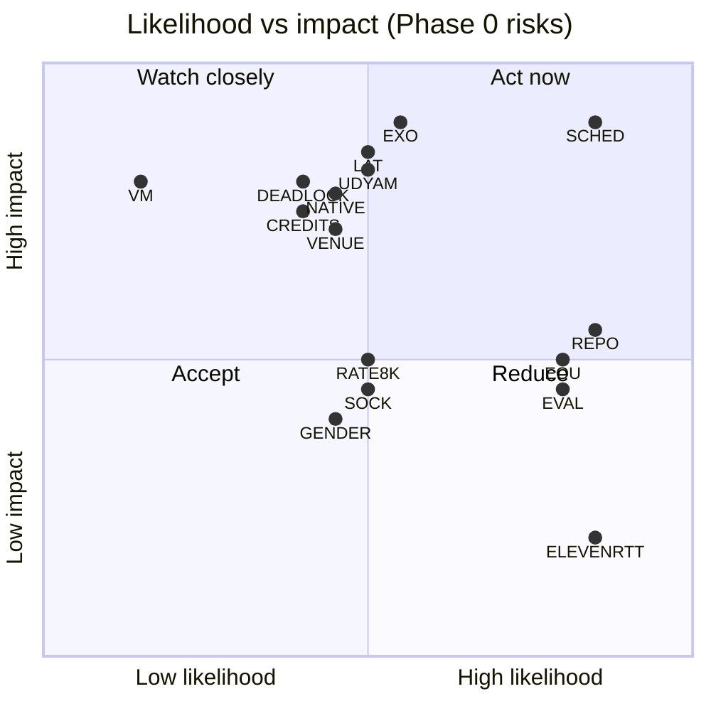

# Risk Register

This is the risk register for dubhash. It covers every risk named in the product overview, the risks implied by the tech spec's open questions and testing plan, and two that come from the current situation: the schedule compressed from 13 to 10 days, and a repo that starts empty. Each risk has a likelihood, an impact, a mitigation, an owner, and a **trigger**: the observable event that means the risk is happening and the mitigation should start now. Likelihood and impact are H / M / L. The register is reviewed at standup on Day 2, at CP1, and at CP2.

## Register

### Buildathon (Phase 0) risks

| ID | Risk | L | I | Mitigation | Owner | Trigger |
|---|---|---|---|---|---|---|
| R-SCHED | **Schedule compression.** 13 days of planned work done in 10. CP1 moves to a weekend (Sat 24 / Sun 25 Oct) and CP2 to D8 | H | H | Parallel tracks ([10-day plan](buildathon-10-day-plan.md#parallel-tracks-per-person)); cut list with trigger dates; fake-first rule so no track waits on telephony; buffer kept to the second half of 31 Oct | Rohan | Any day's proof-of-done missed by the next morning's standup; CP1 not met by D5 morning |
| R-REPO | **Empty repo.** No commits, no CI, no shared conventions on Day 1; five people starting at once will collide on layout and interfaces | H | M | Rohan pushes the skeleton, protocols and fakes before anyone writes provider code (D1 morning); [conventions](../engineering/conventions.md) and [repo-structure](../engineering/repo-structure.md) fixed D1; CI with `pytest` on every PR from D1; small PRs, one owner per module | Rohan | No first commit by D1 midday; two PRs touching the same interface on D1 or D2 |
| R-EXO | **Exotel streaming access slips** (voicebot applet not enabled in time). Without it there is no demo through the sponsor | M | H | Ask on Day 1 via the sponsor channel (Bolna Slack). Plivo audio streaming as fallback (Udyam filed D1). WebRTC browser legs as the last resort, with the applet config on screen | P5 (ask), P3 (legs) | No Exotel reply by end of D2; applet not enabled by D4 |
| R-UDYAM | **Udyam / Plivo account verification slow**, so the Plivo fallback is not available either | M | H | File D1; if both Exotel and Plivo are blocked by D5, run on `WebRtcLeg` and escalate the Exotel ask through the sponsor | P5 | Udyam not confirmed by D3 |
| R-8K | **Exotel or Plivo delivers 8 kHz** despite asking for 16 kHz (open questions Q1, Q6). Worse STT and a resampler on the hot path | M | M | Check `media_format` on `start`; resample both directions with soxr and log it; tune EOU on the real rate | P3 | `start.media_format` reports 8000 |
| R-SOCK | **Sarvam STT socket dies after about 60 s of silence** (Pipecat issue; open question Q4). Reconnect cost of 150–300 ms on the critical path | M | M | Keepalive / reset between utterances; reconnect on error; chaos test kills the socket mid-utterance | P2 | Socket close events in logs during a call |
| R-LAT | **Latency feels broken, not interpreted.** The product depends on whether a 1.5 s pause feels OK | M | H | Ducked original, earcon, opening line, short-sentence prompt; warm sockets, streaming TTS, translation cache; partial-start TTS in v2. Measure on real PSTN, not browser | P2 (numbers), Rohan (feel) | PSTN p95 first-audio over 2.0 s on hi⇄kn at D6 |
| R-ELEVEN-RTT | **ElevenLabs is not in India.** 150–250 ms RTT from Mumbai adds to Hindi/English targets | H | L | Bulbul is primary for Indic targets; warm sockets; test Bulbul for Hindi too if the hi-target p95 is over budget | P3 | hi-target `t_tts_ttfb` p95 noticeably above kn/ta targets |
| R-EOU | **Wrong EOU threshold.** 550 ms is a guess; too short splits sentences, too long feels dead; Tamil speakers pause differently from Hindi speakers | H | M | Per-pair `eou_ms` tuned on the bench set and PSTN; measure false-EOU rate vs latency | P2 | False-EOU (split sentence) rate visible in turn log at D6 |
| R-GENDER | **Pitch heuristic picks the wrong gender** (open question Q5). A male speaker heard in a female voice, which is jarring on stage | M | M | Accept for v1 if bench accuracy is acceptable; allow gender in the API; on stage, set gender explicitly for the demo call | P2 (detector), P3 (voice) | Wrong-gender voice on more than 1 in 10 bench speakers |
| R-NATIVE | **No native Kannada or Tamil speaker** for rehearsal and the stage phone | M | H | P5 confirms a teammate or friend by D3; Marathi⇄Hindi as backup pair | P5 | Nobody confirmed by D3 |
| R-EVAL | **300 rated turns per pair not reached**, so no defensible meaning number for the deck | H | M | Corpus from D1; rater tool by D4; label numbers "preliminary, n = …" or leave them out; never claim unmeasured pairs | P5 | Fewer than 150 rated turns on hi⇄kn by D7 |
| R-CREDITS | **Vendor credits or rate limits** run out during tuning or on stage | M | H | Track usage per day; ask sponsors (Exotel, Sarvam, ElevenLabs, Deepgram) for buildathon credits D1; fakes for all non-latency work | P5 | Any vendor returns quota or rate-limit errors |
| R-VENUE | **Stage conditions.** Hall network, phone signal, speaker feedback, judge speaks an unsupported language | M | H | Wired network for the server laptop (server runs on the VM anyway); phones tested in the hall; offer only rehearsed pairs; recorded backup video. See [demo-script](demo-script.md#fallback-plans) | Rohan, P5 | Rehearsal at venue fails; judge's language not in `pairs.yaml` |
| R-VM | **Single VM is a single point of failure** (one ap-south-1 box) | L | H | Compose up from scratch scripted; snapshot after CP2; second VM image ready before the finale | Rohan | VM unreachable or Caddy TLS failure |
| R-DEADLOCK | **Controller deadlock or garbage audio** on provider errors or gaps | M | H | Chaos tests (socket killed mid-utterance; 2 s Exotel gap); `test_floor.py` invariants | Rohan, P5 | Chaos test failure; stuck state in console |

### Product and company risks (Phase 1+)

| ID | Risk | L | I | Mitigation | Owner | Trigger |
|---|---|---|---|---|---|---|
| R-SARVAM | **Sarvam ships this as a feature** (engine vendor goes vertical) | M | H | Get into a platform's call path before they decide to. Sarvam has no reason to run a bridge or a hospital sales motion, so make them a partner early | Rohan | Sarvam announces call interpretation or a bridge product |
| R-MISTRANS | **Mistranslation in a medical or money context.** One bad discharge instruction is a disaster | M | H | Ward mode shows both texts on screen for confirmation; entity read-back for numbers and doses (v2); publish per-pair accuracy; do not claim pairs we have not measured; entity accuracy target over 95% | P2, P5 | Entity error in eval or pilot logs |
| R-DPDP | **Consent and DPDP.** Both parties are processed by a third party | M | H | Opening line discloses in both languages; platform T&C already covers masked calls; no cloning in v1; India-region hosting; transcripts kept only if the platform opts in (`record: true`), otherwise text nulled after metrics; audio never stored by default. Note: ElevenLabs (hi/en TTS) is not India-hosted. See [open questions](open-questions.md) | Rohan | Platform or hospital trust review raises a data residency or consent issue |
| R-PROCURE | **Platform procurement is slow** (six months to a yes) | H | M | Hospital ward mode and the dial-in consumer number bring in revenue and data while the platform deal runs | Rohan | No design-partner commitment by end of Jan 2027 |
| R-RHYTHM | **People hate the 1.5 s rhythm** | M | M | Escape hatch (DTMF 0 → plain bridge); review every escape; escape-rate target under 5% | P5 | Escape rate over 5% in pilots |
| R-LOWRES | **Low-resource languages asked for** (Santali, Bhojpuri, Tulu, the Northeast) that the engines can't handle | H | L | Say which pairs we trust and publish per-pair numbers; route via a second language when the user has one (e.g. Santali speaker with Hindi) | P5 | Pilot requests for unsupported languages |
| R-COST | **Unit economics wrong.** The overview assumed ElevenLabs for all TTS (₹1.5–2.5/min); Bulbul pricing has not been checked | M | M | Re-check Bulbul pricing; treat the TTS cost line as an estimate; see [business model](../product/business-model.md) | P5 | Real per-minute cost from Phase 1 traffic over ₹5 |

## Heat map

Points are labelled with the risk ID without the `R-` prefix (RATE8K = R-8K).

## Related

- [buildathon-10-day-plan.md](buildathon-10-day-plan.md)
- [open-questions.md](open-questions.md)
- [demo-script.md](demo-script.md)
- [phases.md](phases.md)
- [../tech-spec/security-privacy.md](../tech-spec/security-privacy.md)
- [../engineering/latency-engineering.md](../engineering/latency-engineering.md)
- [../engineering/testing-strategy.md](../engineering/testing-strategy.md)
- [../product/business-model.md](../product/business-model.md)
