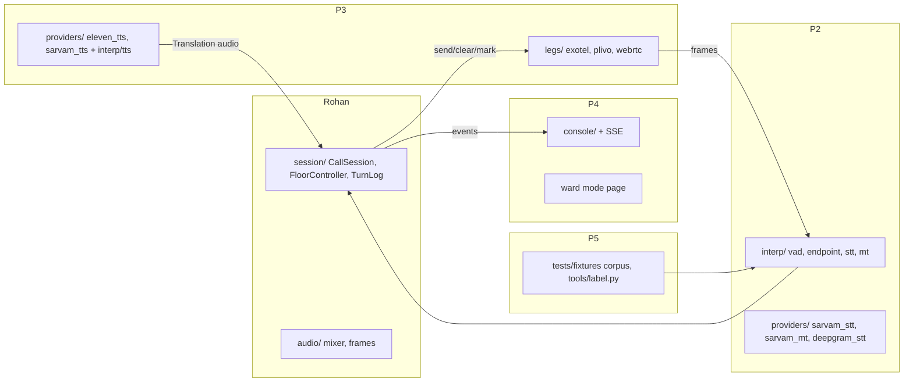

# Roles and Ownership

This doc says who owns what during the buildathon. For each of the five people it gives what they own, the modules in the repo they are responsible for, what "done" means for them, and what they need from others. The split follows the tech spec's ownership: Rohan owns session, controller, mixer, provider swap and the demo; P2 owns VAD/endpoint, Sarvam STT/MT, pair tuning and the bench; P3 owns ElevenLabs/Bulbul TTS, the legs and dial-in; P4 owns the console, ward mode and SSE; P5 owns the corpus, rater, chaos tests, video and submission. The "done means" lines come from the product overview. Where the spec does not assign a module, this doc proposes an owner and marks it **(proposed)**. "Owner" means the person who makes the call and merges. Anyone can contribute.

## Summary

| Person | Lane | Owns | Done means (31 Oct) |
|---|---|---|---|
| **Rohan** | Architecture | Architecture, `CallSession`, `FloorController`, mixer, provider swap, demo and pitch | Two real phones, both directions, no drops, under 2 s |
| **P2** | Audio/ML | VAD + endpointing per language, Sarvam STT/MT, backchannel detection, pair tuning, bench | p95 first-audio under 2 s on PSTN for 3 pairs |
| **P3** | Backend | ElevenLabs/Bulbul TTS, voice selection, legs (Exotel, Plivo, WebRTC), dial-in | Dial-in number works for anyone in the hall |
| **P4** | Frontend | Live console with per-turn log and latency, SSE, ward mode | Ward demo runs on one phone; console shows the stage call |
| **P5** | Product/eval | Eval corpus, rater tool, chaos tests, demo script, failed-call recording, video, submission | Published numbers per pair; video by 30 Oct |

---

## Rohan: architecture, session, floor controller, mixer, pitch

**Owns.** The overall architecture and the interfaces, the per-call `CallSession`, the `FloorController` (the only code allowed to call `send()`, `clear()` and `mark()` on a leg), the mixer (ducking at −14 dB, the 120 ms earcon, clipping safety), provider swap by config, the demo, and the on-stage pitch.

**Modules.**

| Path | Notes |
|---|---|
| `dubhash/session/` | `CallSession`, `FloorController`, `TurnLog` |
| `dubhash/audio/mixer.py`, `frames.py` | Duck + earcon; `FrameClock`, 20 ms PCM16 @ 16 kHz frames |
| `dubhash/legs/base.py`, `legs/fake.py` | `LegTransport` protocol and `FakeLeg` (Day 1, then handed to P3 for upkeep) |
| `dubhash/providers/` interfaces + `fakes.py` | Provider protocols and fakes (Day 1) |
| `dubhash/config/settings.py` | Provider selection by config |
| `tests/test_floor.py`, `tests/test_mixer.py` | Controller invariants, ducking math |
| Deploy (Compose, Caddy, ap-south-1 VM) | **(proposed)**, with P3 |

**Done means.** Two real phones, both directions, no drops, under 2 s. `test_floor.py` green on all invariants.

**Depends on.**
- P2 for working VAD/EOU events (`on_speech_start` / `on_speech_end`) and finished `Translation` text.
- P3 for TTS audio iterators inside `Translation` and for a real leg that emits marks and DTMF.
- P5 for the demo script and a native Kannada or Tamil speaker for rehearsal.

---

## P2: audio/ML

**Owns.** Silero VAD v5 per leg, endpointing (EOU when silence ≥ `eou_ms`, starting at 550, and utterance ≥ 300 ms; or Sarvam's EOU/final event if it comes earlier), backchannel tagging (< 600 ms and ≤ 2 words, not translated), Sarvam streaming STT (Saarika/Saaras), Deepgram Nova as the English/Hinglish fallback, Sarvam Mayura translate with the translation cache, per-pair tuning (EOU, false-EOU rate), and the bench harness.

**Modules.**

| Path | Notes |
|---|---|
| `dubhash/interp/vad.py`, `endpoint.py`, `stt.py`, `mt.py`, `pipeline.py` | One direction of the interpreter |
| `dubhash/providers/sarvam_stt.py`, `sarvam_mt.py`, `deepgram_stt.py` | Vendor clients behind interfaces |
| `dubhash/audio/resample.py` | soxr 8k ⇄ 16k **(proposed)**; needed if open question Q1 or Q6 comes back as 8k |
| `dubhash/config/pairs.yaml` | `stt`, `eou_ms`, language codes (shared with P3 for `tts` / voice fields) |
| `tools/bench.py` | Two `FakeLeg`s, real providers, per-stage p50/p95, WER |
| Pitch-based gender detector function | **(proposed)**; P3 consumes it for voice selection |

**Done means.** p95 first-audio under 2 s on PSTN for 3 pairs.

**Depends on.**
- Rohan for the provider interfaces and fakes (Day 1).
- P3 for real telephony audio to tune on (from CP1).
- P5 for the recorded corpus (30 utterances per language, phone quality, with noise variants) and reference transcripts.

---

## P3: backend, legs, TTS

**Owns.** Bulbul and ElevenLabs Flash v2.5 streaming TTS (Bulbul for Indic targets, ElevenLabs for hi/en), warm TTS sockets, voice selection by target language and detected gender, `ExotelLeg`, `PlivoLeg`, `WebRtcLeg` and the signalling page, outbound two-leg call setup, provider webhooks, and the dial-in IVR.

**Modules.**

| Path | Notes |
|---|---|
| `dubhash/providers/eleven_tts.py`, `sarvam_tts.py`; `dubhash/interp/tts.py` | Streaming TTS, first chunk forwarded at once |
| `dubhash/legs/exotel.py`, `plivo.py`, `webrtc.py` | About 120 lines per provider behind `LegTransport` |
| `dubhash/api/` `/v1/calls`, `/ws/leg`, `/webhooks/*`, dial-in endpoints | **(proposed)**: the call setup, webhooks and leg websocket live in `api/` |
| `tools/loopback.py` | Two browser legs |
| `config/pairs.yaml` voice fields | `tts`, `voice_m`, `voice_f` per side |

**Done means.** The dial-in number works for anyone in the hall. Also: the provider swaps by config, and both Exotel and Plivo legs work if both accounts landed.

**Depends on.**
- P5 for sending the Exotel sponsor ask and filing Udyam on Day 1 (needed for Plivo).
- Rohan for `LegTransport` and session attach-by-call-id.
- P2 for the gender detector and the Sarvam language-ID call used by dial-in auto-detect.

---

## P4: frontend console and ward mode

**Owns.** The live console (server-rendered HTML + SSE via htmx; no SPA): the active calls list; two columns (A and B) per call with each turn shown as src → tgt and stage latencies inline; the state badge; queue depth; DTMF and barge-in markers. Also the ward mode page: push-to-talk per side, the same pipeline with no telephony transport, and both texts shown on screen.

**Modules.**

| Path | Notes |
|---|---|
| `dubhash/console/` | Templates + SSE (`GET /console`, `/console/events?call=…`) |
| Ward mode page | Under `console/` or its own route; path TBD in [repo-structure](../engineering/repo-structure.md) |
| `dubhash/store/models.py`, `writer.py` | **(proposed)**: SQLAlchemy models and the async batch writer; P4 reads them for the turns view |

**Done means.** The ward demo runs on one phone, and the console shows the stage call. The console has to look finished because it is both the stage demo surface and the platform trust-review surface.

**Depends on.**
- Rohan for the controller event stream (SSE source) and its event shapes.
- P3 for the turns API (`GET /v1/calls/{id}/turns`).
- P2 for the pipeline entry point that ward mode calls directly.

---

## P5: product and eval

**Owns.** The eval corpus (30 utterances per language recorded by the team, phone quality, with background noise variants, plus reference transcripts), the rater tool (kept / partly / lost; 300 turns per pair before a number goes in the deck), PSTN scripted scenarios (find the building, confirm a dose, agree a time), chaos tests, the demo script, a recording of a real failed call (with consent), the video, the submission, and the Day 1 vendor asks.

**Modules.**

| Path | Notes |
|---|---|
| `tests/fixtures/*.wav` | Corpus |
| `tools/label.py` | Rater UI |
| Chaos tests under `tests/` | Provider socket killed mid-utterance; 2 s Exotel gap |
| `docs/plan/demo-script.md` | Script and form answer |

**Done means.** Published numbers per pair, and the video by 30 Oct.

**Depends on.**
- P2 for `bench.py` output (turn logs to rate).
- P3 for PSTN legs to run scenarios on.
- Rohan for sign-off on the script and the pitch.
- Bilingual raters for kn, ta and mr (TBD; see [open-questions](open-questions.md)).

---

## Handoff contracts

| From → to | Contract | Needed by |
|---|---|---|
| Rohan → all | `LegTransport`, STT/MT/TTS protocols, fakes | D1 |
| P2 → Rohan | `on_speech_start(side)`, `on_speech_end(side)`, backchannel flag | D2 |
| P2 + P3 → Rohan | `Translation` (text + async audio iterator) | D2 |
| Rohan → P4 | Controller event stream schema (state changes, turns, queue depth, DTMF, barge-in) | D3 |
| P3 → Rohan | Real leg emitting `start`, frames, marks, DTMF | D4 (CP1) |
| P5 → P2 | Corpus wavs + reference transcripts | D3 (first batch) |
| P2 → P5 | Turn logs from `bench.py` for rating | D6 |

## Related

- [buildathon-10-day-plan.md](buildathon-10-day-plan.md)
- [phases.md](phases.md)
- [risks.md](risks.md)
- [open-questions.md](open-questions.md)
- [../engineering/repo-structure.md](../engineering/repo-structure.md)
- [../engineering/conventions.md](../engineering/conventions.md)
- [../tech-spec/floor-controller.md](../tech-spec/floor-controller.md)
- [../tech-spec/interpreter-pipeline.md](../tech-spec/interpreter-pipeline.md)
- [../tech-spec/leg-transports.md](../tech-spec/leg-transports.md)
- [../tech-spec/console.md](../tech-spec/console.md)
