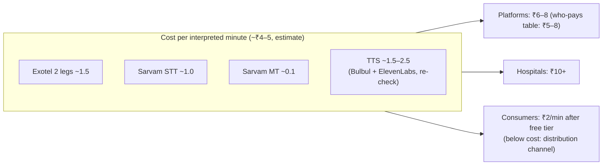

# Business model

This document covers who pays for dubhash, how pricing works for each buyer, what an interpreted minute costs us, what is and is not defensible, the competitors, and how we plan to reach the first paying customer. The cost table carries a known caveat (see [TTS cost caveat](#tts-cost-caveat)). Treat every ₹ figure as an estimate from retail API prices until vendor contracts exist.

## Who pays

| Buyer | What they are buying | Price shape |
|---|---|---|
| **Gig and logistics platforms** | Fewer cancelled orders, fewer tickets about language fights, better ratings in Bengaluru, Chennai, Hyderabad and Pune. A workforce that can work in any city. | Per interpreted minute, about ₹5 to 8, invoked only when the two parties' languages differ. One platform is tens of millions of minutes a year. |
| **Hospitals and telemedicine** | Consent, history and discharge instructions the patient actually understood, plus a bilingual record on the chart. US hospitals are required to provide this and pay LanguageLine for it. | Per ward device per month, plus per minute for phone consults. Enterprise sale. |
| **Sales and support teams expanding across states** | The ability to call any state without hiring for it first. | Per seat + per minute. |
| **Consumers (migrant workers)** | One number that makes any call work. | Free tier (first 10 minutes a month), then ₹2/min via UPI. Mostly a distribution and data channel. Platforms may bundle it for their workforce. |

## Unit economics per interpreted minute

These figures are retail API prices as stated in the product overview.

| Cost line | ₹ / min | Notes |
|---|---|---|
| Exotel, two legs | ~1.5 | Drops with volume contracts. |
| Sarvam STT, both sides | ~1.0 | Only speech time is billed. |
| Sarvam translate (Mayura) | ~0.1 | |
| TTS | ~1.5 to 2.5 (**estimate, see caveat**) | Billed per character. Translations are short. |
| **Total** | **~4 to 5** | Sell at ₹6 to 8 to platforms and ₹10+ to hospitals. A cancelled order costs the platform more than a 10-minute call. |

### TTS cost caveat

The overview's TTS line assumed **ElevenLabs for all TTS**. The tech spec decision, which we follow, splits TTS by target language:

- **Sarvam Bulbul** for Indic targets: kn, ta, mr, te, ml, bn, gu, pa, od.
- **ElevenLabs Flash v2.5** for Hindi and English targets, and for voice cloning in v2.
- The choice is made per language in `config/pairs.yaml` ([configuration](../tech-spec/configuration.md)).

Take a hi ⇄ kn call as an example. The A→B direction (Kannada target) is synthesised by Bulbul, and the B→A direction (Hindi target) by ElevenLabs. Roughly half of TTS characters therefore move to Bulbul, whose price neither PDF states. **Re-check the Bulbul price before quoting margin to anyone.** Until then the ₹1.5 to 2.5 line, and so the ₹4 to 5 total, is an estimate. TBD; see [open questions](../plan/open-questions.md).

Further cost unknowns:

- The fallback STT, Deepgram Nova (English/Hinglish), has no cost line.
- The v2 LLM idiom-repair step has no cost line.
- Hosting is not included: one ap-south-1 VM running Postgres, Redis and Caddy.

TBD; see [open questions](../plan/open-questions.md).

The consumer price of ₹2/min is below the ~₹4 to 5 cost. The dial-in number is a distribution and data channel, not a profit line.

## Moat, honestly

**Things that are a moat:**

- **Floor controller and endpointing tuned per language pair on real PSTN audio.** This is where the product feels good or bad, and only we collect the data it is tuned on. See [floor controller](../tech-spec/floor-controller.md) and [latency engineering](../engineering/latency-engineering.md).
- **Per-turn log across millions of calls.** It is a dataset of what mistranslates in Indian conversation. It improves the product and is valuable to every engine vendor. It is subject to the retention rules in [security and privacy](../tech-spec/security-privacy.md): text is stored only with `record: true` or platform opt-in.
- **Integrations and trust reviews.** Getting inside one gig platform's masked-call path takes a six-month procurement and security process. Once we are in, replacing us takes the same six months.

**What is not a moat:** the pipeline itself. Sarvam could ship it. Our bet is that Sarvam sells models and will not run a bridge with a hospital sales team, and that Exotel sells plumbing and will not build the controller. Each of those vendors thinks the other half is not its job, and dubhash is the product between them.

## Competitive map

| Category | Players | Relation to dubhash |
|---|---|---|
| Translation apps | Google Translate conversation mode, Jio Translate, Sarvam's consumer app | Users talk into one phone. Not inside a call, no telephony, no floor control. |
| Carrier-level call translation | Optus (Australia) trial, Samsung Galaxy live translate (on-device, English-centric) | Proves the category exists. Neither handles Indic pairs on an Indian phone call. |
| Engines | Sarvam, Deepgram, ElevenLabs, Gnani | Suppliers. The risk is Sarvam going vertical; our counter is integrations and the controller. |
| CPaaS | Exotel, Plivo, Ozonetel | Suppliers and channel. Exotel sells into every platform we want, so a co-sell is the fastest route to the first deal. |
| Voice agent platforms | Bolna, Vapi, Retell | Put an AI on one end of the call. They build agents, not bridges between two humans. |
| Medical interpretation | LanguageLine, Voyce (US). Nothing domestic in India. | The model for the hospital business. |

## Go-to-market

Platform procurement takes about six months to a yes. The hospital ward mode and the consumer dial-in number bring in revenue and data while the platform deal runs ([risks](../plan/risks.md)).

| Window | GTM moves |
|---|---|
| **To 31 Oct 2026 (buildathon)** | Live stage demo through an Exotel number (Exotel is a sponsor). Show the applet config and the one-line platform API. Invite the hall to try the dial-in number. |
| **Nov 2026 to Jan 2027** | Ward mode pilot at one hospital (Mumbai or Pune, through a doctor in the network). Dial-in number live with a free tier. Exotel co-sell conversation. One gig or logistics platform as design partner for a city pilot (Bengaluru is the obvious one). Publish meaning-preservation numbers per pair (300 turns per pair). |
| **Feb to Jun 2027** | Harden the platform API: webhooks, a trust-review package (audit log, DPDP consent flow, data residency) and an SLA. Voice cloning with consent. 6+ language pairs. Telemedicine integration (phone consults). First paid platform contract or hospital annual contract. |

Engineering phases behind these windows are in [phases](../plan/phases.md).

**Trust-review package for platforms** (what gets dubhash past a platform's security team):

- DTMF 0 escape into bypass mode (plain bridge).
- A per-turn audit log via `GET /v1/calls/{id}/turns`.
- The opening line, which discloses dubhash in both languages.
- No voice cloning in v1.
- Hosting in the India region (ap-south-1).
- Transcripts retained only if the platform opts in.

See [api](../tech-spec/api.md) and [security and privacy](../tech-spec/security-privacy.md).

## Related

- [Product overview](overview.md)
- [Problem and users](problem-and-users.md)
- [Glossary](glossary.md)
- [Configuration (pairs.yaml)](../tech-spec/configuration.md)
- [API](../tech-spec/api.md)
- [Security and privacy](../tech-spec/security-privacy.md)
- [Phases](../plan/phases.md)
- [Risks](../plan/risks.md)
- [Open questions](../plan/open-questions.md)
