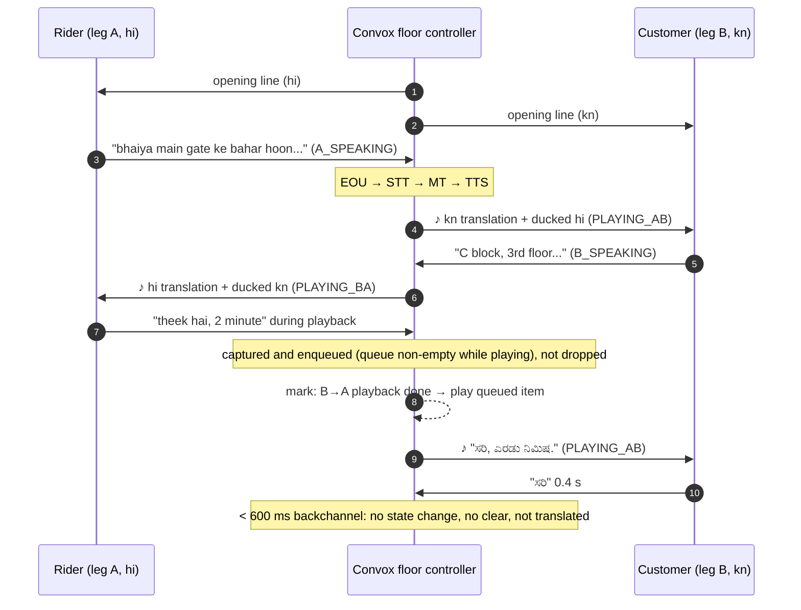
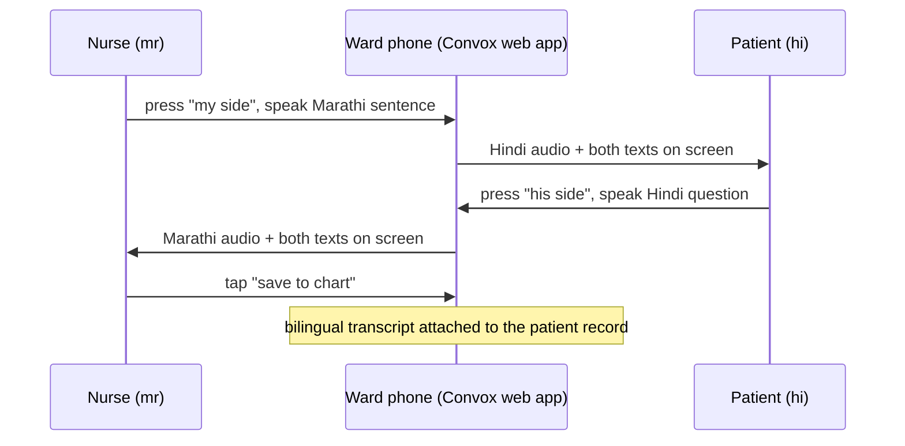

# Problem and users

This document covers who Convox is for, which call fails for each group today, and why no existing product fixes it. It ends with two worked calls (a delivery call through a platform and a hospital ward conversation) that show what the product does from first second to last. Use it to settle "does this feature serve a real user?" questions and as the source for demo scenarios and eval scripts ([evaluation and metrics](../engineering/evaluation-and-metrics.md)).

## The setting

India has 22 official languages, and two people on a phone call often share none of them.

| Number | What it means |
|---|---|
| **450M** | Internal migrants in India (Census-based estimate). Most live and work in a state whose language they do not speak. |
| **Millions per day** | Masked partner-to-customer calls on gig platforms (Swiggy, Zomato, Rapido, Porter, Urban Company). These calls already run through a CPaaS cloud. |
| **$1B+** | Size of the US medical interpretation category (LanguageLine, Voyce). India has more language pairs and no equivalent. |

Each of these conversations fails, shrinks to gestures and numbers, or depends on whoever happens to be nearby.

## The four user groups

| Who | The call that fails | What happens today |
|---|---|---|
| **Gig partner and customer**: Swiggy, Zomato, Rapido, Porter, Urban Company | A rider from Bihar calls a Bengaluru customer to find the building. The customer answers in Kannada; the rider has Hindi. "Left, right, gate number" gets shouted. Sometimes it ends in an argument, sometimes in a cancelled order. | Platforms show a language flag in the app and hope. The result is support tickets, ratings hits and periodic news stories about language fights. Nobody can hire around it, because the rider is who he is. |
| **Patient and clinician**: Tata Memorial, AIIMS, Apollo, Narayana, eSanjeevani | A patient from Jharkhand, Odisha or the Northeast is in a Mumbai or Delhi ward. History, consent, medication instructions and discharge all go through a relative or a ward boy who half-speaks the language. | Ad hoc. The US has a billion-dollar category (LanguageLine, Voyce) for this. India has interpreters only for foreign medical tourists, and that supply is already a reported bottleneck. |
| **Migrant worker and the city**: 450M internal migrants | A Bengali worker in Surat calls a Gujarati landlord, a police station, a hospital or a government office. The call ends in two minutes with nothing understood. | They find a friend who speaks a bit, or they do not make the call. |
| **Sales team and a new region**: D2C brands, insurers, lenders | A Mumbai telesales team wants to call Tamil Nadu leads. It either hires Tamil callers for a pilot or skips the state. | They skip the state, or run a 6-week hiring cycle. |

How each group maps to a way Convox ships:

| User group | Ships as | v1 buildathon scope |
|---|---|---|
| Gig partner and customer | Platform API (`POST /v1/calls`) inside masked calls | Yes. This is the main stage demo. |
| Patient and clinician | Ward mode (one phone, push-to-talk); phone consults later | Yes (cut #2 on the cut list) |
| Migrant worker | Dial-in number | Yes (cut #1 on the cut list) |
| Sales team | Platform API, per seat + per minute | No dedicated work in v1 |

## Why nothing covers it

- **Translation apps are not in the call.** Google Translate conversation mode and Jio Translate need both people around one phone, taking turns. A phone call has two phones and no turn-taking UI.
- **Voice platforms build agents, not bridges.** Bolna, Vapi and Retell put an AI on one end of the call. No product serves two humans with an AI only in the middle.
- **Carriers move in years.** Jio or Airtel could build this into the network. They have not, and they earn from minutes, not from whether callers understand each other.
- **The engines only became good enough this year.** In 2026, Indic STT word error rate on telephony audio dropped below the usability line for the major languages. Before that, the interpreter would have been wrong often enough to be worse than nothing.

## What we will be honest about

- **Low-resource languages are not supported in v1.** That includes Santali, Bhojpuri, Tulu and the languages of the Northeast, because the engines are not good enough for them. We say which pairs we trust and publish numbers for each pair.
- **8 kHz telephony audio with background noise degrades STT.** We publish results from real PSTN calls, not browser audio.
- **Idioms, sarcasm and anger do not translate cleanly.** The ducked original carries the tone, even when the words do not.
- **A pause of 1.5 s changes the rhythm of a conversation.** Some people will hate it, and the DTMF 0 escape exists for them.

## Example call 1: the delivery (platform integration)

A rider speaks Hindi and a customer speaks Kannada. The call takes 15 seconds and runs through the platform's masked-call path, with Convox as the bridge.

| t (s) | Rider (Hindi) hears / says | Customer (Kannada) hears / says |
|---|---|---|
| 0.0 | Opening line: "aap hindi mein boliye, saamne wala kannada sunega." | Opening line in Kannada: "ನೀವು ಕನ್ನಡದಲ್ಲಿ ಮಾತನಾಡಿ, ಅವರು ಹಿಂದಿಯಲ್ಲಿ ಕೇಳುತ್ತಾರೆ." |
| 5.0 | **Says:** "bhaiya main gate ke bahar hoon, kaunsa building?" | |
| 6.6 | | **Hears:** ♪ "ನಾನು ಗೇಟ್ ಹೊರಗೆ ಇದ್ದೇನೆ, ಯಾವ ಬಿಲ್ಡಿಂಗ್?" (male voice) |
| 8.2 | | **Says:** "ಸಿ ಬ್ಲಾಕ್, ಮೂರನೇ ಮಹಡಿ. ಲಿಫ್ಟ್ ಕೆಲಸ ಮಾಡ್ತಿಲ್ಲ." |
| 9.7 | **Hears:** ♪ "C block, teesri manzil. lift kaam nahi kar rahi." (female voice) | |
| 11.0 | **Says:** "theek hai, 2 minute" while B→A is still playing, so it is **queued** | |
| 12.3 | | **Hears:** ♪ "ಸರಿ, ಎರಡು ನಿಮಿಷ." |
| 13.0 | | **Says:** "ಸರಿ" (0.4 s, a **backchannel**, not translated) |

♪ = earcon (120 ms), then the translation, with the original voice ducked underneath. Each voice is a fixed natural voice matched to the speaker's detected gender, not a clone.

**Platform log:** 4 turns, p50 first-audio 1.5 s, 0 clips, escape not used, order delivered.

What the call exercises in the [floor controller](../tech-spec/floor-controller.md):

Rules this call demonstrates:

1. **One translation plays at a time.** The rider's 11.0 s utterance was captured while the customer's translation was still playing. It played as soon as the floor was free. Nothing is dropped.
2. **Backchannels do not interrupt.** "ಸರಿ" was 0.4 s, which is under `backchannel_max_ms` (600 ms), so it was not translated and did not clear any audio.
3. **Opening line.** It runs for about five seconds in each language. It tells each side which language to speak and sets the rhythm. It also serves as the DPDP disclosure ([security and privacy](../tech-spec/security-privacy.md)).

## Example call 2: the ward (no telephony)

Sister Mary works at a Mumbai cancer hospital. Her patient, Birsa, is from Jharkhand. He speaks Santali and some Hindi.

1. She opens Convox on the ward phone and picks **Marathi ⇄ Hindi**. Santali is not supported yet, but Hindi is his second language and that pair works.
2. She holds the phone between them.
3. She presses her side and gives the discharge instructions in Marathi, sentence by sentence. He hears Hindi.
4. He presses his side and asks whether he can eat rice. She hears Marathi.
5. Every turn appears on screen as text in both languages, so she can show him and he can nod. This is also the mitigation for mistranslation in a medical context. Numbers and doses should be read back as entities (see [risks](../plan/risks.md)).
6. At the end she taps **"save to chart"**, and the bilingual transcript attaches to his record.

The conversation takes twenty minutes. Before, it needed a relative who might not have been there.

**Why this ships first for hospitals:** there is no Exotel, no integration and no procurement beyond a phone. The nurse champions it with the buyer, and the chart attachment is what the hospital's compliance team wants. How "save to chart" connects to a hospital record system is TBD; see [open questions](../plan/open-questions.md). The ward mode UI spec is in [console](../tech-spec/console.md).

## Related

- [Product overview](overview.md)
- [Business model](business-model.md)
- [Glossary](glossary.md)
- [Floor controller](../tech-spec/floor-controller.md)
- [Console and ward mode](../tech-spec/console.md)
- [Security and privacy](../tech-spec/security-privacy.md)
- [Evaluation and metrics](../engineering/evaluation-and-metrics.md)
- [Demo script](../plan/demo-script.md)
- [Risks](../plan/risks.md)
- [Open questions](../plan/open-questions.md)
