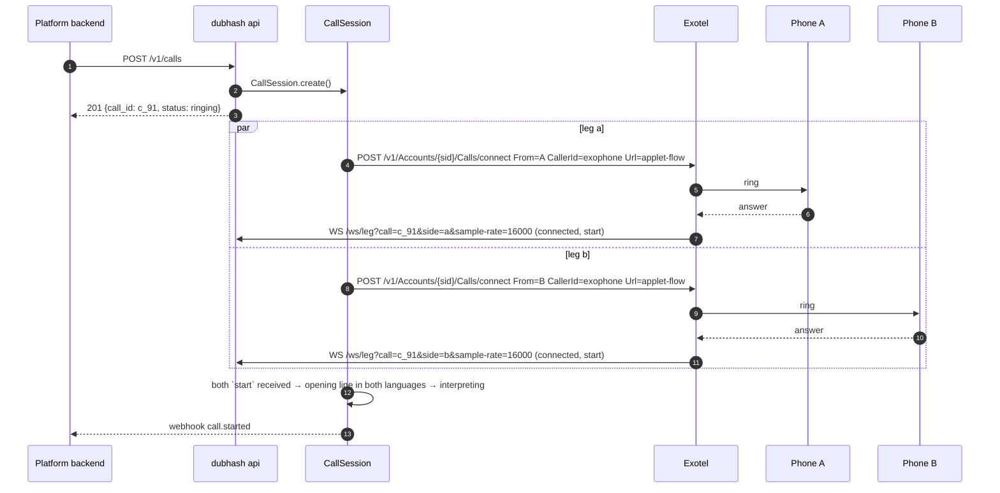
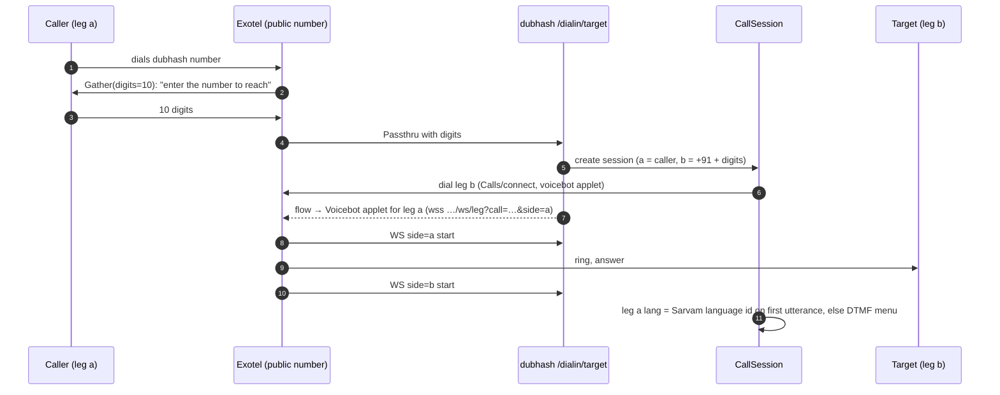

# API

This document defines every HTTP and WebSocket surface the dubhash app exposes: the platform API (`/v1/calls`), the provider media WebSocket (`/ws/leg`), provider status webhooks, the consumer dial-in flow, the console, and the webhook events dubhash sends back to platforms. It is the contract between dubhash and a platform backend, and between dubhash and Exotel/Plivo. Everything listed in the tech spec §6 is normative. Anything marked **proposed** is our own design and was not in the source PDFs. Change it in this doc first, then in code.

All endpoints are served by the single FastAPI process described in [system overview](../architecture/system-overview.md), behind Caddy (TLS) on one ap-south-1 VM.

## Endpoint summary

| Method | Path | Caller | Purpose |
|---|---|---|---|
| `POST` | `/v1/calls` | platform backend | create a two-leg interpreted (or bridged) call |
| `GET` | `/v1/calls/{id}` | platform backend, console | status, legs, latency summary |
| `GET` | `/v1/calls/{id}/turns` | platform backend (support/dispute) | per-turn log |
| `POST` | `/v1/calls/{id}/hangup` | platform backend, console | end the call on both legs |
| `WS` | `/ws/leg?call=…&side=…` | Exotel voicebot applet / Plivo stream | bidirectional media for one leg |
| `GET` | `/console` | operator, judge, platform trust team | live view (HTML) |
| `GET` | `/console/events?call=…` | console page | SSE stream from the floor controller |
| `POST` | `/webhooks/exotel` | Exotel | call status callbacks (answered, completed, failed) |
| `POST` | `/webhooks/plivo` | Plivo | call status callbacks (answered, completed, failed) |
| `POST` | `/dialin/target` | Exotel Passthru applet | consumer dial-in: create session, dial leg b |
| — | platform `webhook` URL | dubhash → platform | `call.started`, `turn`, `call.ended` events |

Hostnames: the source PDFs use `api.dubhash.in` for the platform API and `edge.dubhash.in` for provider WebSockets. In v1 both resolve to the same VM. TBD, see [open questions](../plan/open-questions.md).

## Authentication

| Surface | Mechanism | Status |
|---|---|---|
| `/ws/leg` from Exotel | Basic auth header **or** IP allowlist (ask Exotel to allowlist the VM) | from spec |
| `/ws/leg` from Plivo | TBD, see [open questions](../plan/open-questions.md) | — |
| `/v1/*` platform API | `Authorization: Bearer <api key>`, one key per platform, stored hashed | **proposed** |
| `/console`, `/console/events` | single shared operator password via Caddy basic auth for the buildathon | **proposed** |
| `/webhooks/*` | provider signature check if the provider offers one, otherwise IP allowlist | **proposed**, TBD |
| outbound platform webhooks | `X-Dubhash-Signature: sha256=<HMAC of body with platform secret>` | **proposed** |

See [security and privacy](security-privacy.md) for the full threat and consent model.

---

## `POST /v1/calls`

Creates a `CallSession` and dials both legs at once. This is the "one line that changes" in a platform's backend: instead of calling Exotel's `Calls/connect` to bridge partner and customer, the platform calls dubhash, and dubhash calls Exotel twice with a voicebot applet on each leg.

### Request

```http
POST /v1/calls HTTP/1.1
Host: api.dubhash.in
Authorization: Bearer dk_live_…            # proposed
Content-Type: application/json

{
  "a": { "number": "+919812345678", "lang": "hi-IN" },
  "b": { "number": "+919876543210", "lang": "kn-IN" },
  "provider": "exotel",
  "caller_id": "+918047XXXXXX",
  "mode": "interpret",
  "escape_dtmf": "0",
  "webhook": "https://platform.example/hooks/call-events",
  "record": false
}
```

### Body fields

| Field | Type | Required | Default | Meaning |
|---|---|---|---|---|
| `a.number` | string, E.164 | yes | — | leg A phone number (by convention the caller, e.g. the rider) |
| `a.lang` | string, BCP-47 (`hi-IN`) | yes for platform calls | — | leg A spoken language. Selects STT language and the target for B→A |
| `b.number` | string, E.164 | yes | — | leg B phone number |
| `b.lang` | string | yes for platform calls | — | leg B spoken language |
| `provider` | `"exotel"` \| `"plivo"` | no | `exotel` (proposed default) | which `LegTransport` dials the legs |
| `caller_id` | string, E.164 | yes | — | ExoPhone / Plivo number shown to both parties (masking preserved) |
| `mode` | `"interpret"` \| `"bridge"` | no | `interpret` | `bridge` passes audio through with interpreters off (same as DTMF bypass from t=0) |
| `escape_dtmf` | string, one digit | no | `"0"` | digit that switches to bypass (plain bridge) for the rest of the call |
| `webhook` | URL | no | none | where dubhash POSTs `call.started`, `turn`, `call.ended` |
| `record` | boolean | no | `false` | if `true`, `src_text`/`tgt_text` are retained. Otherwise they are nulled after metrics are computed. See [data model](data-model.md#text-retention) |

The language pair `{a.lang[:2]}-{b.lang[:2]}` (e.g. `hi-kn`) must exist in `config/pairs.yaml`, in either orientation. See [configuration](configuration.md).

### Response

```http
HTTP/1.1 201 Created
Content-Type: application/json

{ "call_id": "c_91", "status": "ringing" }
```

### What happens next



Provider calls, verbatim from the spec:

```text
exotel: POST /v1/Accounts/{sid}/Calls/connect  From=<number>  CallerId=<exophone>  Url=<applet-flow-url>
        the flow has one Voicebot applet pointing at wss://edge.dubhash.in/ws/leg?call=c_91&side=a
plivo:  POST /v1/Account/{id}/Call/  to=<number>  from=<plivo number>  answer_url=<xml with Stream element>
```

Rules:

- Both legs ring at once. The session starts interpreting only when **both** WebSockets have sent `start`.
- If one leg fails to answer within **25 s**, the other leg hears "doosri taraf se jawab nahi aaya" and is hung up. The call ends with `status: "failed"` (see [call status values](#call-status-values)).
- Both legs must land on the same process. The `call` param in the WS URL routes them to the session. See [telephony integration](../architecture/telephony-integration.md).

### Errors (proposed)

Error body shape for all `/v1/*` endpoints:

```json
{ "error": { "code": "unsupported_pair", "message": "no config for pair hi-od", "call_id": null } }
```

| HTTP | `code` | When |
|---|---|---|
| 400 | `invalid_number` | number not E.164 / not an Indian number |
| 400 | `invalid_body` | missing required field, bad enum value for `mode`/`provider`, `escape_dtmf` not a single digit |
| 401 | `unauthorized` | missing or bad API key |
| 404 | `call_not_found` | unknown `{id}` on GET/hangup |
| 409 | `call_ended` | hangup on a call already ended |
| 422 | `unsupported_pair` | language pair not in `pairs.yaml` (v1 non-goal: any language whose STT we have not measured on PSTN) |
| 429 | `capacity` | node at max concurrent calls (limit TBD, see [open questions](../plan/open-questions.md)) |
| 502 | `provider_error` | Exotel/Plivo rejected the dial request. `message` carries the provider error text |
| 503 | `provider_unavailable` | configured provider disabled or credentials missing |

Failures after the `201` (no answer, provider drop) are not HTTP errors. They arrive as `call.ended` with a `close_reason` per leg.

---

## `GET /v1/calls/{id}`

Status, legs and latency summary. The response maps to the `calls` and `legs` tables plus live state while the call is active.

```json
{
  "call_id": "c_91",
  "status": "in_progress",
  "provider": "exotel",
  "mode": "interpret",
  "created_at": "2026-10-28T10:14:03.120Z",
  "started_at": "2026-10-28T10:14:11.904Z",
  "ended_at": null,
  "legs": {
    "a": { "lang": "hi-IN", "provider_call_sid": "…", "stream_sid": "…", "sample_rate": 16000,
           "answered_at": "2026-10-28T10:14:09.010Z", "closed_at": null, "close_reason": null },
    "b": { "lang": "kn-IN", "provider_call_sid": "…", "stream_sid": "…", "sample_rate": 16000,
           "answered_at": "2026-10-28T10:14:11.904Z", "closed_at": null, "close_reason": null }
  },
  "floor": { "state": "PLAYING_AB", "queue_depth": 1 },
  "escape_used": false,
  "latency": { "turns": 4, "p50_first_audio_ms": 1500, "p95_first_audio_ms": 1820 },
  "duration_s": null,
  "interpreted_s": null
}
```

`floor` is present only while the call is live. Its `state` is one of the five code states (`IDLE`, `A_SPEAKING`, `B_SPEAKING`, `PLAYING_AB`, `PLAYING_BA`). See [floor controller](floor-controller.md). Phone numbers are not echoed back (proposed, to limit PII spread).

### Call status values

| `status` | Meaning |
|---|---|
| `ringing` | created, legs dialing |
| `in_progress` | both legs sent `start` |
| `completed` | both legs closed normally |
| `failed` | a leg did not answer within 25 s, or the provider rejected the call |

The source names `ringing` and the provider callbacks (answered, completed, failed). The full enum above is **proposed**.

---

## `GET /v1/calls/{id}/turns`

The per-turn log, "the thing platforms want after a dispute". One object per `turns` row, ordered by `seq`. Timestamps are ms relative to call start (proposed; see [data model](data-model.md)).

```json
{
  "call_id": "c_91",
  "text_retained": true,
  "turns": [
    {
      "seq": 1, "side": "a",
      "src_text": "bhaiya main gate ke bahar hoon, kaunsa building?",
      "tgt_text": "ನಾನು ಗೇಟ್ ಹೊರಗೆ ಇದ್ದೇನೆ, ಯಾವ ಬಿಲ್ಡಿಂಗ್?",
      "t_speech_start": 5000, "t_speech_end": 7450, "t_eou": 8000,
      "t_stt_final": 8290, "t_mt": 8500, "t_tts_ttfb": 8800,
      "t_play_start": 8950, "t_play_end": 11100,
      "first_audio_ms": 1500,
      "backchannel": false, "clipped_ms": null,
      "stt_provider": "sarvam", "mt_provider": "sarvam", "tts_provider": "bulbul",
      "voice": "bulbul:kn-male-1"
    },
    {
      "seq": 4, "side": "b",
      "src_text": "ಸರಿ", "tgt_text": null,
      "backchannel": true, "clipped_ms": null
    }
  ]
}
```

- `first_audio_ms` = `t_play_start − t_speech_end` (speaker stops → listener hears first translated word). It is derived, not stored. The definition is in [evaluation and metrics](../engineering/evaluation-and-metrics.md).
- If the call was not created with `record: true` and the platform has not opted in, `text_retained` is `false` and `src_text`/`tgt_text` are `null` once metrics are computed. Timestamps and flags are always returned.
- Backchannels (< `backchannel_max_ms` with ≤ 2 words) are logged and never translated, so `tgt_text` is `null`.

---

## `POST /v1/calls/{id}/hangup`

Hangs up both legs through the provider and closes the session.

```http
POST /v1/calls/c_91/hangup
→ 200 { "call_id": "c_91", "status": "completed" }
```

Errors: `404 call_not_found`, `409 call_ended`. The call's `call.ended` webhook still fires.

---

## `WS /ws/leg`

Where the provider's media WebSocket lands. One connection per leg, two per call.

```text
wss://edge.dubhash.in/ws/leg?call=c_91&side=a&sample-rate=16000
```

| Query param | Values | Notes |
|---|---|---|
| `call` | call id (`c_91`) | routes the socket to the in-process `CallSession` |
| `side` | `a` \| `b` | which leg |
| `sample-rate` | `16000` | Exotel voicebot applet param. Exotel allows 3 custom params, and `call` and `side` are two of them |

The provider message format (Exotel vs Plivo) is negotiated on `start`. Both use the same event shape:

| Direction | Exotel | Plivo |
|---|---|---|
| in | `connected` → `start` (`stream_sid`, `call_sid`, `from`, `to`, `media_format`) → `media` (base64 PCM, `chunk`, `timestamp`) → `dtmf` → `stop` | `start` / `media` / `dtmf` / `stop` |
| out, audio | `media`, flushed in 100 ms chunks (3,200 bytes at 16 kHz, multiple of 320) | `playAudio` |
| out, barge-in | `clear` | `clearAudio` |
| out, playback marker | `mark` (Exotel echoes it when played) | `checkpoint` |

The leg handler confirms the real sample rate from `start.media_format`. If Exotel sends 8 kHz regardless, it resamples both directions with soxr and logs it. That is open question 1. Unknown `call` ids are rejected and the socket is closed (proposed: close code 4404). Full transport details are in [leg transports](leg-transports.md).

---

## Provider webhooks: `POST /webhooks/exotel`, `POST /webhooks/plivo`

Call status callbacks: **answered**, **completed**, **failed**. They update `legs.answered_at`, `legs.closed_at` and `legs.close_reason`, and drive the 25 s no-answer rule. The payload format is the provider's own. We do not restate it here because the PDFs do not specify it, so read the provider docs when implementing (P3).

Handler rules (proposed):

- Respond `200` fast and do no work inline. Push to the session's event queue.
- Be idempotent. Providers retry, so dedupe on (`provider_call_sid`, status).
- A `failed` or `completed` status for a leg whose WS is still open closes that WS. When both legs close, the session ends and `call.ended` fires.
- Unknown `provider_call_sid` → `200` and log an `events` row with `kind=provider_error`.

---

## Outbound webhook events (dubhash → platform)

Sent to the `webhook` URL from `POST /v1/calls`. The event names and contents come from the product overview §6. The JSON field names are **proposed**.

Common envelope (proposed):

```json
{ "event": "turn", "call_id": "c_91", "ts": "2026-10-28T10:14:20.950Z", "data": { … } }
```

Delivery (proposed): POST with JSON body, HMAC signature header (see [authentication](#authentication)), 5 s timeout, retry with backoff up to 3 times. Delivery is fire-and-forget from a background task, **never on the hot path**. A slow platform endpoint must not delay audio.

### `call.started`

Both legs are up and languages are confirmed, either from the platform profile (`a.lang`/`b.lang`) or auto-detected from the first utterance (dial-in).

```json
{
  "event": "call.started",
  "call_id": "c_91",
  "ts": "2026-10-28T10:14:11.904Z",
  "data": {
    "mode": "interpret",
    "a": { "lang": "hi-IN", "lang_source": "profile" },
    "b": { "lang": "kn-IN", "lang_source": "profile" }
  }
}
```

### `turn` (one per utterance)

Side, source text, translated text, latency to first audio, and whether barge-in clipped it.

```json
{
  "event": "turn",
  "call_id": "c_91",
  "ts": "2026-10-28T10:14:20.950Z",
  "data": {
    "seq": 3,
    "side": "a",
    "src_text": "theek hai, 2 minute",
    "tgt_text": "ಸರಿ, ಎರಡು ನಿಮಿಷ.",
    "first_audio_ms": 1300,
    "clipped": false,
    "clipped_ms": null
  }
}
```

Whether `src_text`/`tgt_text` are included when `record: false` is TBD, see [open questions](../plan/open-questions.md). The proposed default is to send them, because the platform is the data fiduciary for its own call and dubhash then discards its copy. Backchannels do not generate `turn` events (proposed).

### `call.ended`

Duration, interpreted minutes, turns, p50/p95 latency, whether escape was used, and the both-side transcript if the platform opted in.

```json
{
  "event": "call.ended",
  "call_id": "c_91",
  "ts": "2026-10-28T10:14:26.300Z",
  "data": {
    "status": "completed",
    "duration_s": 15,
    "interpreted_s": 15,
    "turns": 4,
    "p50_first_audio_ms": 1500,
    "p95_first_audio_ms": 1600,
    "escape_used": false,
    "legs": {
      "a": { "close_reason": "hangup" },
      "b": { "close_reason": "hangup" }
    },
    "transcript": null
  }
}
```

`transcript` is an array of `{seq, side, src_text, tgt_text}` only when the call had `record: true` or the platform opted in. Otherwise it is `null`.

---

## Dial-in flow (consumer)

The public dubhash number runs an Exotel applet chain. Nobody needs an app.

```text
Gather(digits=10) → Passthru(https://…/dialin/target) → our server creates the session, dials leg b,
and returns the flow that puts leg a on the Voicebot applet.
language for leg a: auto-detect on first utterance via Sarvam language id, fall back to a DTMF menu.
```



Open details: how leg b's language is chosen (DTMF menu on answer? caller selects?), the exact Passthru request/response contract, and UPI billing and the free tier. TBD, see [open questions](../plan/open-questions.md). Dial-in is first on the cut list. If it slips, demo from the console instead.

---

## Console

`GET /console` returns server-rendered HTML. `GET /console/events?call=c_91` is an SSE stream fed by the floor controller's event stream. There is no polling. Event types and layout are in [console](console.md).

```text
GET /console/events?call=c_91
Accept: text/event-stream

event: turn
data: {"seq":1,"side":"a","src_text":"…","tgt_text":"…","t_eou":8000,…}
```

## Ward mode

Ward mode (push-to-talk on one phone, no telephony) reuses the same interpreter pipeline with a WebRTC/browser transport. Its signalling endpoint shares the dev `WebRtcLeg` signalling path. The exact route is TBD, see [leg transports](leg-transports.md) and [open questions](../plan/open-questions.md).

## Related

- [System overview](../architecture/system-overview.md)
- [Telephony integration](../architecture/telephony-integration.md)
- [Leg transports](leg-transports.md)
- [Floor controller](floor-controller.md)
- [Data model](data-model.md)
- [Console](console.md)
- [Configuration](configuration.md)
- [Security and privacy](security-privacy.md)
- [Open questions](../plan/open-questions.md)
