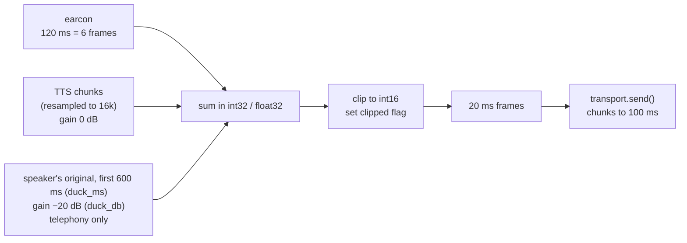

# Audio

This doc fixes the audio format inside dubhash and the code that touches samples on the hot path: frames and `FrameClock`, Silero VAD windowing, resampling between the 8 kHz wire and the 16 kHz pipeline, the mixer (earcon, TTS, ducked original), outbound chunking and gap handling. All of it lives in `dubhash/audio/` (`frames.py`, `resample.py`, `mixer.py`, `wav.py`) and is written in numpy (plus onnx for VAD). Owner: **Rohan** (frames, mixer). P2 owns VAD use in the endpoint, and is the proposed owner of `resample.py` and the pitch-based gender detector (open under PQ9 and PQ20 in [open questions](../plan/open-questions.md)). A Rust port of the hot path happens only if CPU profiling asks for it. The bottleneck is vendor latency, not interpreter CPU.

---

## 1. Internal format

| Property | Value |
|---|---|
| Sample rate | **16 kHz** |
| Encoding | **PCM16** (signed int16, little-endian), **mono** |
| Frame | **20 ms = 320 samples = 640 bytes** |
| Everything above the transport | sees only 640-byte frames |

Why: Sarvam STT wants 16 kHz. On PSTN, 8 kHz on the wire to the ear can't be avoided, but the pipeline stays at 16 kHz so STT gets the best input it can. 20 ms frames match Silero's hop and keep the mixer simple.

```python
SAMPLE_RATE = 16_000
FRAME_MS = 20
FRAME_SAMPLES = SAMPLE_RATE * FRAME_MS // 1000   # 320
FRAME_BYTES = FRAME_SAMPLES * 2                  # 640
```

---

## 2. Frames and FrameClock

The transport decodes provider payloads (for example base64 PCM from Exotel `media` events), resamples if needed, slices into 640-byte frames and pushes them to the leg's frame queue ([leg-transports.md](leg-transports.md)). A trailing partial frame is held until the next payload completes it.

`FrameClock` stamps each frame with **leg-relative ms** (0 = the leg's `start`). That clock is used for jitter and gap detection. Turn-row timestamps (`t_speech_start`, `t_eou`, …, `t_play_start`) must be converted to **call-relative ms** (one monotonic session clock anchored at `calls.started_at`), because first-audio subtracts a speaker-leg time from a listener-leg time. See [data-model.md](data-model.md#turns).

| Measure | How |
|---|---|
| jitter | Arrival time vs. expected (`n × 20 ms`). Track p50/p95 per leg. |
| gaps | A missing span in the provider's sequence/timestamp, or an arrival stall. Logged as `events(kind=gap)` with the duration. Exotel drops show up here. |

Unit tests: frame clock (monotonic, gap detection) in `tests/`.

---

## 3. Gap handling

The spec states only the requirements. Exotel drops are logged as gaps, and in the chaos test an **Exotel gap of 2 s must not make the mixer play garbage**. Proposed policy (Rohan to confirm):

| Path | On gap |
|---|---|
| inbound → VAD/STT | Log `gap`. Advance `FrameClock` by the gap duration so timestamps stay true. Do not synthesise frames into STT. VAD sees the gap as silence for endpointing, so a long gap can trigger EOU. That is acceptable and visible in the log. |
| inbound → ducked original in the mixer | Treat as silence (zeros). |
| outbound (TTS underrun) | Send nothing until the next chunk. Never repeat a stale buffer. The mixer emits only frames it has real samples for (or silence during an explicit earcon/duck window). |
| bypass passthrough | Forward what arrives. No fill. |

---

## 4. Silero VAD windowing

Silero VAD v5 (onnx), one model state per leg.

- Silero's window is **512 samples at 16 kHz ≈ 32 ms**. Frames are 20 ms (320 samples).
- Feed **32 ms windows with a 20 ms hop**: keep a ring buffer of the last 512 samples and run the model once per incoming 20 ms frame on the latest 512 samples.
- **speech prob > 0.5 = speech.**
- The same pass computes frame **RMS**, which is used for ducking decisions and for measuring speech duration (backchannel vs barge-in).

```python
# vad.py sketch (illustrative)
class LegVad:
    def __init__(self, model):                   # Silero v5 onnx session
        self.buf = np.zeros(512, dtype=np.float32)
        self.model = model
    def push(self, frame: bytes) -> tuple[bool, float]:
        x = np.frombuffer(frame, dtype=np.int16).astype(np.float32) / 32768.0   # 320 samples
        self.buf = np.concatenate([self.buf[320:], x])                          # hop 20 ms
        prob = self.model(self.buf)                                             # window 32 ms
        rms = float(np.sqrt(np.mean(x * x)))
        return prob > 0.5, rms
```

Turn-detector models (LiveKit EOU, Smart Turn) were rejected. They are English-tuned and break on 8 kHz Indic audio. Revisit when one works in Hindi.

---

## 5. Resampling 8k ⇄ 16k

Library: **soxr** (python-soxr). Use the streaming resampler per leg and per direction, so filter state carries across chunks and frame edges don't click.

| Situation | Inbound (wire → pipeline) | Outbound (pipeline → wire) |
|---|---|---|
| Exotel delivers 16 kHz as requested | none | none |
| Exotel sends 8 kHz anyway | 8k → 16k | 16k → 8k |
| Plivo `audio/x-l16;rate=16000` accepted | none | none |
| Plivo falls back to `audio/x-mulaw;rate=8000` | μ-law decode → PCM16 8k → 16k | 16k → 8k → μ-law encode |
| TTS output not at 16 kHz | n/a | TTS rate → 16k before the mixer |

- **Confirm the sample rate from the provider's `start` message** (`media_format` on Exotel). Never trust the requested value. If it differs, enable resampling in both directions and log it (`legs.sample_rate`). This is the first thing to test on the first sponsor minute ([leg-transports.md § sample-rate confirmation](leg-transports.md#sample-rate-confirmation)).
- Whether a resampler sits on the hot path at all depends on spec open questions 1 (Exotel 16k) and 6 (Plivo 16k). **TBD — see [open questions](../plan/open-questions.md).**
- μ-law: Python 3.12 still ships `audioop`, but it is deprecated. Prefer a 256-entry numpy lookup table so the 3.13 upgrade doesn't break.
- TTS provider output rates are not stated in the source PDFs. Read them from each provider's stream setup.
- Unit test: **resampler round-trip** (16k → 8k → 16k) keeps length within one frame and stays below a tolerance on a test tone.

---

## 6. Mixer

The mixer builds the **listener's** outbound stream for one playback:

```
listener out = earcon (120 ms) → TTS at 0 dB
             + speaker's original at duck_db (−20 dB) for the first duck_ms (600 ms) of TTS
               (telephony calls only; co-located /join and loopback calls play no original)
```



| Parameter | Value |
|---|---|
| Earcon | 120 ms (1,920 samples, 3,840 bytes, 6 frames), a soft tone |
| TTS gain | 0 dB (unity) |
| Duck gain | `duck_db` per pair, **−20 dB** → linear `10 ** (-20/20) = 0.1` (was −14 dB until 21 Oct) |
| Duck length | `duck_ms` per pair, **600 ms** from the first kept TTS sample; `render_playback(duck_ms=None)` keeps the old "whole translation" behaviour |
| Duck on/off | per call: `CallSession(duck_original=...)`, default **off** when `co_located` (/join, loopback), **on** for telephony |
| Output | 20 ms frames to the transport. The transport groups them into 100 ms provider chunks. |

### Arithmetic and clipping

```python
DUCK = 10 ** (duck_db / 20)          # -20 dB → 0.1

def mix(tts: np.ndarray, orig: np.ndarray) -> tuple[bytes, bool]:
    # tts, orig: int16 arrays of 320 samples (zeros where absent)
    acc = tts.astype(np.int32) + np.rint(orig.astype(np.float32) * DUCK).astype(np.int32)
    clipped = bool((acc > 32767).any() or (acc < -32768).any())
    out = np.clip(acc, -32768, 32767).astype(np.int16)
    return out.tobytes(), clipped
```

- Never let a sum wrap around int16. Always accumulate wider and clip. The `clipped` flag goes into the Turn row. The measure is a **clipping check (never exceed int16)**.
- Unit tests (`tests/test_mixer.py`): ducking math (−14 dB gives the expected amplitude ratio), no clipping on full-scale TTS plus ducked full-scale original (it saturates cleanly, no wrap), earcon length is exactly 6 frames.

### Why: making the pause feel intentional

- **Ducked original.** The listener hears the real speaker at low volume, then the translation at full volume. They know the other person spoke, and the delay reads as interpretation, not failure. The ducked original also carries tone that the words may not (idioms, sarcasm, anger).
- **Not for co-located phones, and only as a short cue (21 Oct).** The first stage test (/join, two phones in one room, Marathi ⇄ Hindi) reported "double sound": the listener heard the original live in the room, then again under the whole translation at −14 dB, then the translation. On /join and loopback calls (`co_located`) the original is not replayed at all: the listener's outbound audio is the earcon and the TTS only (`tests/session/test_duck_original.py` checks the correlation with the source is about 0). On telephony the original stays, but at −20 dB and only for the first 600 ms of the TTS: enough to say "a real person spoke", without two voices talking over each other for the whole translation.
- **Earcon.** A soft tone so silence never runs past about 700 ms without a signal. Perceived latency drops more than it would from any real cut.
- **Cut list:** ducking is item 4 on the cut list (fall back to plain earcon only). Never cut the earcon.

### Unresolved mixer details

Both are **TBD — see [open questions](../plan/open-questions.md)**:

1. **Earcon timing.** The spec's latency table says "earcon at EOU" (listener hears something about 100 ms after the speaker stops). The mix-stage row and the overview say it plays at the start of the translation, immediately before TTS. Playing at EOU hides TTS first-byte time. Playing at translation start adds 120 ms before the first word unless it overlaps the TTS first-byte wait.
2. **Which original frames are ducked.** Decided: (b), the *buffered utterance* replayed under the translation, aligned to the first kept TTS sample, for `duck_ms` (600 ms), on telephony calls only (see "Not for co-located phones" above). The listener never hears the speaker live while they speak.

### Bypass (DTMF 0)

In bypass the mixer is a plain passthrough: each leg's inbound frames are forwarded to the other leg at **0 dB**, with no earcon and no TTS, and interpreters are stopped ([floor-controller.md](floor-controller.md#rule-6-dtmf-1-replay-0-bypass)).

---

## 7. Outbound chunking

| Property | Value |
|---|---|
| Mixer → transport | 20 ms frames (640 bytes @16k) |
| Transport → provider | **100 ms chunks: 3,200 bytes at 16 kHz**, which **must be a multiple of 320 bytes** (Exotel) |
| At 8 kHz on the wire | 100 ms = 800 samples = 1,600 bytes (still a multiple of 320) |
| Why 100 ms | Exotel's minimum chunk is 100 ms. Smaller chunks would make `clear` more responsive, but stay at 100 ms. |

The transport buffers `send()` bytes, flushes whole 100 ms chunks, and pads the final partial chunk of a playback with silence up to the next multiple of 320 bytes before `mark()`. Chunk size is one of the per-pair PSTN tuning knobs (EOU, duck level, chunk size).

---

## 8. Budget and CPU

Per call: 2 × Silero inference per 20 ms frame (one per leg), 1 mixer pass per outbound frame, and up to 4 resampler streams if the wire is 8 kHz. All of it is numpy/onnx on one ap-south-1 VM. Profile before thinking about Rust ([latency-engineering.md](../engineering/latency-engineering.md)).

---

## 9. Pitch heuristic (gender)

v1 selects a **fixed natural voice per target language and detected speaker gender**, so the listener hears a gender-matched natural voice, not the speaker's own voice. Voice cloning is v2 and needs explicit consent.

- Input: the speaker's first **2 s** of voiced frames (VAD speech = 1).
- Method: an F0 estimate (for example autocorrelation on voiced frames), median, compared to a threshold. The threshold value is **TBD**: tune it on the bench corpus.
- Output: `m` or `f`, which picks `voice_m` / `voice_f` from the target side in `pairs.yaml`. Recorded in `turns.voice`.
- The spec calls this crude. The alternative is for the platform to pass gender in the API, or for the consumer flow to ask. **TBD — see [open questions](../plan/open-questions.md)** (spec Q5).

## Related

- [interpreter-pipeline.md](interpreter-pipeline.md): the vad, mix and tts stages
- [floor-controller.md](floor-controller.md): who drives the mixer, and bypass
- [leg-transports.md](leg-transports.md): decoding, sample-rate confirmation, provider chunking
- [configuration.md](configuration.md): `duck_db`, voices
- [../engineering/testing-strategy.md](../engineering/testing-strategy.md): mixer, frame clock and resampler unit tests, the 2 s gap chaos test
- [../engineering/latency-engineering.md](../engineering/latency-engineering.md)
- [../plan/open-questions.md](../plan/open-questions.md)
