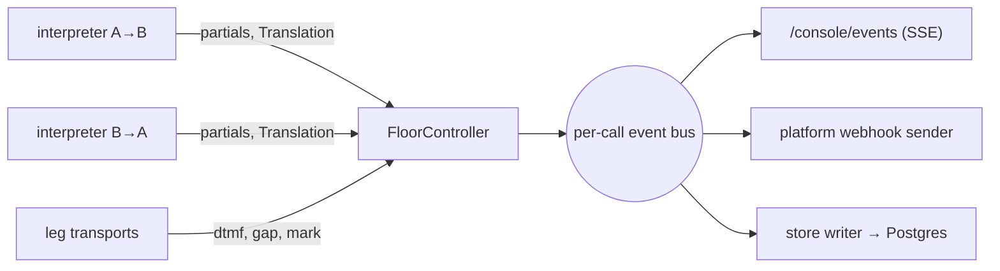

# Console

The console is the live web view of dubhash calls. It serves two audiences with one surface. On stage it is the **demo surface**: the hall watches both transcripts and per-turn latency while two phones talk. For a platform it is the **trust-review surface**: their trust and support team looks at it to see exactly what each side said and heard before signing, and after a dispute. In the spec's words, "it has to look finished." This doc defines what the console shows, the SSE event stream that feeds it from the floor controller, the layout, and the build constraints. Owner: **P4** (console, ward mode, SSE).

## Constraints

| Decision | Choice | Why |
|---|---|---|
| Rendering | server-rendered HTML (Jinja templates in `console/`) | a React build is a day the team does not have |
| Live updates | SSE from the controller's event stream, via htmx (SSE extension) or plain JS `EventSource` | the console only receives. SSE is enough, and there is no polling |
| Hosting | same FastAPI process, same VM, behind Caddy | nothing extra to deploy |
| SPA | **no** (v1 non-goal: "a React console") | — |

Endpoints are defined in [API](api.md#console): `GET /console` and `GET /console/events?call=…`.

## What it shows

From the tech spec §6 and the product overview's demo and trust-review needs.

### Active calls list (`/console`)

| Column | Source |
|---|---|
| call id | `calls.id` |
| pair | `a_lang ⇄ b_lang` (e.g. `hi-IN ⇄ kn-IN`) |
| provider | exotel / plivo / webrtc / fake |
| status | ringing / in_progress / completed / failed |
| floor state badge | live controller state |
| turns, p50 first-audio | running aggregates |
| escape used | yes/no |

It also lists recently ended calls (proposed: last 20) so the stage call can be opened after hangup for demo step 5 ("the per-turn log for the call we just made").

### Per-call view (`/console?call=c_91`)

- **Two columns, A and B.** Each turn appears in its speaker's column as `src → tgt`.
- **Stage latencies inline** on each turn: EOU wait, STT final, MT, TTS first byte, playout, and the total first-audio, colour-coded against targets (p50 < 1.5 s, p95 < 2.0 s).
- **State badge**: `IDLE`, `A_SPEAKING`, `B_SPEAKING`, `PLAYING_AB`, `PLAYING_BA`. When the queue is non-empty during playback, show a **"queued"** indicator. QUEUED is a condition (queue non-empty while playing), not a separate state. See [floor controller](floor-controller.md).
- **Queue depth** as a number.
- **DTMF and barge-in markers** inline in the timeline: replay (DTMF 1), bypass/escape (DTMF 0), barge-in with `clipped_ms`.
- **Backchannels** shown greyed and small ("ಸರಿ · backchannel · not translated"), so reviewers see they were heard and deliberately not translated.
- **Live STT partials** in the speaker's column while they talk, replaced by the final turn. (The spec keeps partials "for console".)
- **Provider ids per turn** (`stt_provider`, `mt_provider`, `tts_provider`, `voice`), collapsed by default and expandable for trust review.
- **Faults**: `gap` and `provider_error` events as thin warning rows.
- **Call summary** footer once ended: duration, interpreted seconds, turns, p50/p95 first-audio, escape used.

### Layout (per call)

```text
┌──────────────────────────────────────────────────────────────────────────────┐
│ c_91 · hi-IN ⇄ kn-IN · exotel · in_progress          [ PLAYING_AB ] queue: 1 │
│ turns 3 · p50 1.50 s · p95 1.82 s · escape: no                               │
├─────────────────────────────────────┬────────────────────────────────────────┤
│ A · Hindi                           │ B · Kannada                            │
├─────────────────────────────────────┼────────────────────────────────────────┤
│ #1 bhaiya main gate ke bahar hoon,  │                                        │
│    kaunsa building?                 │                                        │
│  → ನಾನು ಗೇಟ್ ಹೊರಗೆ ಇದ್ದೇನೆ, ಯಾವ ಬಿಲ್ಡಿಂಗ್? │                                        │
│  eou 550 · stt 290 · mt 210 ·       │                                        │
│  tts 300 · play 150 = 1.50 s        │                                        │
│                                     │ #2 ಸಿ ಬ್ಲಾಕ್, ಮೂರನೇ ಮಹಡಿ. ಲಿಫ್ಟ್ ಕೆಲಸ ಮಾಡ್ತಿಲ್ಲ.  │
│                                     │  → C block, teesri manzil. lift kaam   │
│                                     │    nahi kar rahi.          = 1.50 s    │
│ #3 theek hai, 2 minute   [queued]   │                                        │
│  → ಸರಿ, ಎರಡು ನಿಮಿಷ.        = 1.30 s   │                                        │
│                                     │ ಸರಿ · backchannel · not translated     │
│ ⌁ barge-in · DTMF 1 replay · gap 2s │                                        │
│ … (live partial) "bhaiya woh …"     │                                        │
└─────────────────────────────────────┴────────────────────────────────────────┘
```

Visual rules (proposed): large type for the stage projector, high contrast, Indic scripts rendered with a font that covers Devanagari and Kannada/Tamil (e.g. Noto Sans family from Google Fonts), and no layout shift when a turn's text arrives.

## SSE event stream

The floor controller (and the session for call-level events) publishes to an in-process pub/sub, one channel per call plus one "all calls" channel for the list. `GET /console/events?call=c_91` subscribes to a call. Without `call`, it subscribes to the list (proposed). This is the **same event stream** that feeds outbound platform webhooks (with fewer fields) and the background writer (as rows). The console never reads the database for live data.



### Event types (proposed)

The event names and payload field names are **proposed**. The information carried is what the spec says the console shows.

| `event:` | When | `data` fields |
|---|---|---|
| `call` | created, status change, ended | `call_id, status, provider, a_lang, b_lang, mode` (+ summary on end) |
| `state` | every floor state change | `state, queue_depth, playing_seq` |
| `partial` | STT partial (throttled, proposed ≤ 5/s per side) | `side, text` |
| `turn` | translation finalized (before or at playout) | `seq, side, src_text, tgt_text, backchannel, voice, providers` |
| `turn_timing` | playback finished or clipped | `seq, t_speech_end, t_eou, t_stt_final, t_mt, t_tts_ttfb, t_play_start, t_play_end, clipped_ms` |
| `dtmf` | DTMF received | `side, digit, action` (`replay` / `bypass`) |
| `barge_in` | listener spoke > `barge_in_min_ms` during playback | `listener, clipped_seq, clipped_ms` |
| `fault` | gap or provider error | `kind, side, detail` |

Example stream:

```text
event: state
data: {"state":"A_SPEAKING","queue_depth":0,"playing_seq":null}

event: partial
data: {"side":"a","text":"bhaiya main"}

event: turn
data: {"seq":1,"side":"a","src_text":"bhaiya main gate ke bahar hoon, kaunsa building?","tgt_text":"ನಾನು ಗೇಟ್ ಹೊರಗೆ ಇದ್ದೇನೆ, ಯಾವ ಬಿಲ್ಡಿಂಗ್?","backchannel":false,"voice":"bulbul:kn-male-1"}

event: state
data: {"state":"PLAYING_AB","queue_depth":0,"playing_seq":1}

event: turn_timing
data: {"seq":1,"t_speech_end":7450,"t_eou":8000,"t_stt_final":8290,"t_mt":8500,"t_tts_ttfb":8800,"t_play_start":8950,"t_play_end":11100,"clipped_ms":null}
```

With htmx, each event can be sent as a pre-rendered HTML fragment instead of JSON (`hx-ext="sse"`, `sse-swap="turn"`), which keeps rendering on the server. This is the proposed default. JSON is used only where plain JS needs to compute something.

### Delivery rules (proposed)

- On connect, the server first sends a **snapshot** (current state plus all turns so far for that call from session memory), then live events. Reloading the page mid-demo must not lose history.
- Use the SSE `id:` = event sequence number, and honour `Last-Event-ID` on reconnect.
- Send a heartbeat comment (`: ping`) every 15 s so Caddy and proxies do not close idle streams.
- Each subscriber has a bounded queue. A slow browser is dropped and must reconnect. It must never back-pressure the controller.

## Privacy in the console

- The console shows text live, from memory. For ended calls without `record: true` or platform opt-in, text is gone after metrics are computed ([data model](data-model.md#text-retention)), so the historical view shows timings, flags and providers with `—` for text. Demo calls should be created with `record: true` so step 5 of the demo works.
- Phone numbers are masked in the UI (proposed: `+91 98•••••678`).
- Access is behind auth. See [security and privacy](security-privacy.md).

## Trust-review use

A platform's trust team uses the console (and `GET /v1/calls/{id}/turns`) to answer:

- What exactly did each side say, and what did the other side hear? (`src → tgt` per turn)
- Was anything dropped? (Every utterance is either a translated turn, a clipped turn with `clipped_ms`, or a labelled backchannel.)
- How fast was it per turn, and per stage?
- Did anyone press escape, and when? (Escape rate target < 5%, every one reviewed.)

This is one piece of the trust-review package described in [security and privacy](security-privacy.md#trust-review-package).

## Build order

| When (relative) | Milestone |
|---|---|
| with the WebRtcLeg loopback, before CP1 | console v0 with SSE: the per-call two-column view showing turns |
| with the turn log moving into Postgres, after CP1 | ended-call view |
| after CP2 (feature freeze), during demo rehearsal | console polish, fix list only |

Exact days are in the [10-day plan](../plan/buildathon-10-day-plan.md). The 13-day spec order is compressed there, so it is the source of truth for dates.

## Related

- [API](api.md)
- [Floor controller](floor-controller.md)
- [Data model](data-model.md)
- [Security and privacy](security-privacy.md)
- [Demo script](../plan/demo-script.md)
- [Roles and ownership](../plan/roles-and-ownership.md)
- [Buildathon 10-day plan](../plan/buildathon-10-day-plan.md)
- [Open questions](../plan/open-questions.md)
