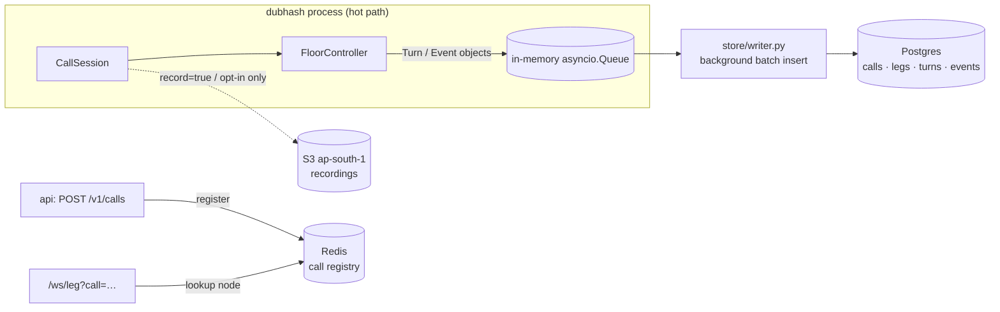
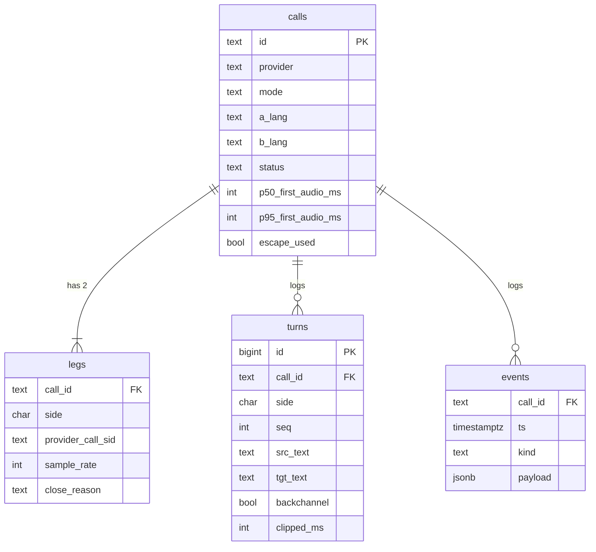
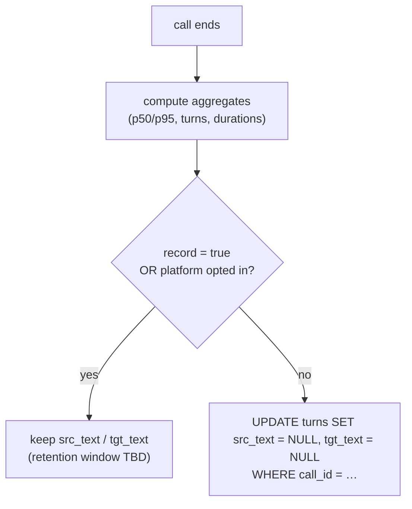

# Data model

This document defines what dubhash persists and where: the Postgres tables (`calls`, `legs`, `turns`, `events`), the Redis call registry, the opt-in S3 recordings, and the retention rules that keep transcripts and audio out of storage by default. It also covers the background writer, which keeps every database write off the audio hot path. The column lists come from tech spec §6. The **types, keys, indexes and constraints are proposed** (inferred by us) and should be settled in `store/models.py` (SQLAlchemy) when the turn log moves into Postgres (see the [10-day plan](../plan/buildathon-10-day-plan.md)).

## Principles

1. **Nothing in the hot path touches Postgres or Redis.** State for a live call lives in-process in its `CallSession` (one asyncio task owns a call). Turn rows go onto an in-memory queue, and a background task batch-inserts them.
2. **Text is not retained by default.** `src_text`/`tgt_text` are nulled after latency metrics are computed, unless the call was created with `record: true` or the platform opted in.
3. **Audio is never stored by default.** Recordings go to S3 only on explicit opt-in.
4. **Every turn is accounted for.** A turn is played to completion, marked clipped with the ms played, or tagged backchannel. Nothing is silently dropped (a floor controller invariant). The `turns` table is the evidence.



## Postgres schema (proposed DDL)

The column names are exactly those in the tech spec. Types, defaults, keys and indexes are proposed.

### `calls`

```sql
-- PROPOSED
CREATE TABLE calls (
    id                  text PRIMARY KEY,                 -- "c_91"
    created_at          timestamptz NOT NULL DEFAULT now(),
    provider            text NOT NULL CHECK (provider IN ('exotel','plivo','webrtc','fake')),
    mode                text NOT NULL CHECK (mode IN ('interpret','bridge')),
    a_number            text,                             -- E.164; PII, see retention
    a_lang              text NOT NULL,                    -- "hi-IN"
    b_number            text,
    b_lang              text NOT NULL,                    -- "kn-IN"
    status              text NOT NULL,                    -- ringing | in_progress | completed | failed
    started_at          timestamptz,                      -- both legs sent `start`
    ended_at            timestamptz,
    duration_s          integer,
    interpreted_s       integer,                          -- billable: time not in bypass
    turns               integer NOT NULL DEFAULT 0,       -- count, excludes backchannels (proposed)
    p50_first_audio_ms  integer,
    p95_first_audio_ms  integer,
    escape_used         boolean NOT NULL DEFAULT false,   -- DTMF escape (bypass) pressed
    webhook             text,                             -- platform callback URL
    -- proposed additions, not in the source schema:
    record              boolean NOT NULL DEFAULT false,   -- from POST /v1/calls
    platform_id         text                              -- which API key created it
);
CREATE INDEX calls_created_at_idx ON calls (created_at DESC);
CREATE INDEX calls_status_idx     ON calls (status) WHERE status IN ('ringing','in_progress');
```

### `legs`

```sql
-- PROPOSED
CREATE TABLE legs (
    call_id            text NOT NULL REFERENCES calls(id) ON DELETE CASCADE,
    side               char(1) NOT NULL CHECK (side IN ('a','b')),
    provider_call_sid  text,                              -- Exotel call_sid / Plivo call uuid
    stream_sid         text,                              -- from the `start` message
    sample_rate        integer,                           -- as confirmed from media_format (16000 or 8000)
    answered_at        timestamptz,
    closed_at          timestamptz,
    close_reason       text,                              -- e.g. hangup | no_answer | provider_error | api_hangup (proposed values)
    PRIMARY KEY (call_id, side)
);
CREATE INDEX legs_provider_call_sid_idx ON legs (provider_call_sid);  -- webhook lookup
```

`sample_rate` records whether Exotel/Plivo actually delivered 16 kHz, which answers open questions 1 and 6 for every call.

### `turns`

One row per utterance per side, including backchannels (which are logged but not translated).

```sql
-- PROPOSED
CREATE TABLE turns (
    id              bigserial PRIMARY KEY,
    call_id         text NOT NULL REFERENCES calls(id) ON DELETE CASCADE,
    side            char(1) NOT NULL CHECK (side IN ('a','b')),   -- the speaker
    seq             integer NOT NULL,                             -- per-call order (arrival order across directions)
    -- timestamps: integer ms relative to call start (session FrameClock), proposed
    t_speech_start  integer,
    t_speech_end    integer,            -- last speech frame
    t_eou           integer,            -- endpoint fired
    t_stt_final     integer,
    t_mt            integer,            -- translation returned
    t_tts_ttfb      integer,            -- first TTS audio byte
    t_play_start    integer,            -- first frame written to listener leg
    t_play_end      integer,            -- mark fired (or clear on barge-in)
    src_text        text,               -- NULLed unless record/opt-in, see below
    tgt_text        text,
    backchannel     boolean NOT NULL DEFAULT false,
    clipped_ms      integer,            -- ms played before barge-in clear; NULL = played fully
    stt_provider    text,               -- sarvam | deepgram | fake
    mt_provider     text,               -- sarvam | fake
    tts_provider    text,               -- bulbul | eleven | fake
    voice           text,               -- e.g. "bulbul:kn-male-1"
    UNIQUE (call_id, seq)
);
CREATE INDEX turns_call_idx ON turns (call_id, seq);
```

Derived metrics, computed when the call ends and in the nightly p50/p95 job (not stored per turn):

| Metric | Formula |
|---|---|
| first audio | `t_play_start − t_speech_end` |
| EOU wait | `t_eou − t_speech_end` |
| STT final | `t_stt_final − t_eou` |
| MT | `t_mt − t_stt_final` |
| TTS first byte | `t_tts_ttfb − t_mt` |
| playout | `t_play_start − t_tts_ttfb` |

Expected total: EOU wait (start at 550 ms) + about 1.2 s, so about 1.4 to 1.8 s. Targets are p50 < 1.5 s and p95 < 2.0 s on real PSTN. See [latency engineering](../engineering/latency-engineering.md).

**Wall-clock vs relative ms.** The source does not say. We propose integer ms relative to the session clock, with `calls.started_at` as the anchor. That makes per-stage subtraction exact and avoids clock skew across tasks. TBD, see [open questions](../plan/open-questions.md).

### `events`

Everything that is not a turn: control signals and faults.

```sql
-- PROPOSED
CREATE TABLE events (
    id        bigserial PRIMARY KEY,                  -- proposed; source lists (call_id, ts, kind, payload)
    call_id   text NOT NULL REFERENCES calls(id) ON DELETE CASCADE,
    ts        timestamptz NOT NULL,
    kind      text NOT NULL,                          -- dtmf | barge_in | gap | provider_error | bypass
    payload   jsonb NOT NULL DEFAULT '{}'
);
CREATE INDEX events_call_idx ON events (call_id, ts);
```

| `kind` | Example `payload` (proposed) |
|---|---|
| `dtmf` | `{"side":"a","digit":"1","action":"replay"}` |
| `barge_in` | `{"listener":"b","clipped_seq":7,"clipped_ms":840}` |
| `gap` | `{"side":"a","gap_ms":2000}` (Exotel drops are logged as gaps) |
| `provider_error` | `{"provider":"sarvam","stage":"stt","error":"socket closed","reconnected":true}` |
| `bypass` | `{"side":"b","digit":"0"}` (escape, sets `calls.escape_used`) |

The `events` table also serves as the per-call **audit log** for trust reviews. See [security and privacy](security-privacy.md#audit-log).

### Entity relationships



## Background writer (`store/writer.py`)

The hot path never awaits a database call. The floor controller and session emit plain `Turn`/`Event` dataclasses onto an `asyncio.Queue`. One writer task per process drains it.

```python
# proposed shape
class Writer:
    def __init__(self, engine, max_batch=200, flush_ms=500): ...
    def put(self, row: Turn | Event | CallUpdate) -> None:   # sync, non-blocking: queue.put_nowait
        ...
    async def run(self) -> None:
        # loop: collect up to max_batch rows or until flush_ms elapses,
        # then one INSERT ... VALUES (...), (...) per table in a single transaction
        ...
```

Rules (proposed):

- `put()` is synchronous and never blocks. If the queue is full (bound e.g. 10,000), log and drop **the DB row**, never audio. The turn still went to the console and webhook. Postgres being down must not degrade a live call.
- On call end the session enqueues a `CallUpdate` with the final aggregates (`duration_s`, `interpreted_s`, `turns`, `p50/p95_first_audio_ms`, `escape_used`), followed by the text-nulling step below.
- Graceful shutdown drains the queue before exit.
- Console SSE and platform webhooks are fed from the controller's event stream directly, not from the database.

## Text retention

From the tech spec: *text is stored only if the call was created with `record: true` or the platform opted in; otherwise `src_text`/`tgt_text` are nulled after latency metrics are computed. Audio is never stored by default.*



Notes:

- Text exists in memory during the call for the console and the `turn` webhook. The nulling applies to what is persisted.
- Because the writer inserts during the call, text briefly exists in Postgres before the end-of-call `UPDATE`. A stricter alternative (proposed, preferred if cheap): when `record=false`, the writer inserts with text already null and keeps text only in the session's memory for the console. Decide when the writer is built.
- How long retained text is kept, how a platform opts in (account flag vs per-call), and how phone numbers (`a_number`, `b_number`) are treated: TBD, see [open questions](../plan/open-questions.md).
- Bench and eval data (`tools/bench.py`, `tools/label.py`) come from team-recorded wav fixtures and consented PSTN test calls, not from production calls.

## Redis call registry

Redis holds only the call registry and cross-node lookup. Postgres stays the record of truth. v1 is one VM, so the registry mostly guards against a stray WS for an unknown call. The key layout is designed so a second node needs no schema change. All keys are **proposed**.

| Key | Type | Value | TTL | Written by |
|---|---|---|---|---|
| `call:{call_id}` | hash | `node`, `status`, `provider`, `a_lang`, `b_lang`, `created_at` | 2 h, refreshed on activity | api on create, session on status change |
| `call:{call_id}:legs` | hash | `a` → `provider_call_sid`, `b` → `provider_call_sid` | same as above | session after dial |
| `sid:{provider_call_sid}` | string | `call_id` | same | session after dial (webhook → call lookup) |
| `node:{node_id}:calls` | set | active call ids | none (cleaned on session end) | session |
| `node:{node_id}:alive` | string | timestamp | 30 s, heartbeat every 10 s | app |

Lookup flow for `/ws/leg?call=c_91&side=a`:

1. If `c_91` is in this process's session map, attach the leg. (This is always the case on one VM.)
2. Otherwise `HGET call:c_91 node`. If it is another node, close with a redirect code. Cross-node routing is out of scope for v1, because both Exotel WebSockets are routed to the same node via the call id in the URL.
3. If the key is missing, reject the socket.

## S3 recordings (opt-in)

- Audio is **never** stored by default.
- When a call opts in to recording, both legs' audio is written to S3 in ap-south-1 (India-region). The proposed key is `recordings/{call_id}/{side}.wav`, written after the call from an in-memory or temp-file buffer, never streamed synchronously from the hot path.
- PSTN test calls for the eval ("record both legs with consent") use this path.
- Whether the per-call `record: true` flag also enables audio recording, or only text retention, is ambiguous in the source. The proposed answer is that `record` controls **text only**, and audio needs a separate opt-in (`record_audio`, proposed). TBD, see [open questions](../plan/open-questions.md).

## Related

- [API](api.md)
- [Floor controller](floor-controller.md)
- [Interpreter pipeline](interpreter-pipeline.md)
- [Security and privacy](security-privacy.md)
- [Configuration](configuration.md)
- [System overview](../architecture/system-overview.md)
- [Evaluation and metrics](../engineering/evaluation-and-metrics.md)
- [Latency engineering](../engineering/latency-engineering.md)
- [Open questions](../plan/open-questions.md)
