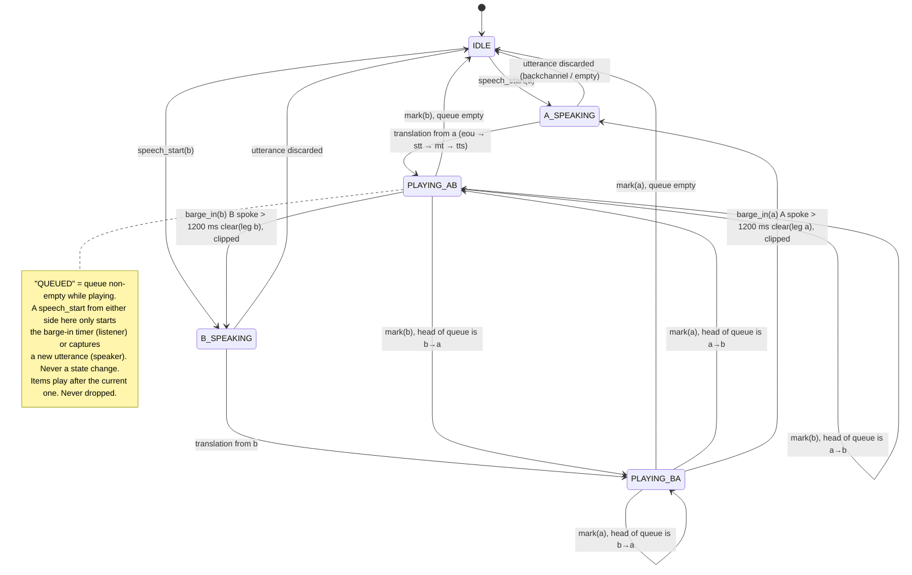
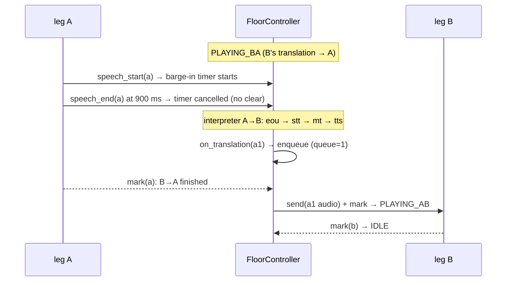

# Floor controller

The floor controller decides who hears what, and when. Two humans and an interpreter make a three-party timing problem. The controller is the part of dubhash that is not a vendor call, and it is what makes the call feel like a conversation rather than a walkie-talkie. There is one controller per call, running as one asyncio task inside the `CallSession`. It owns the state, the queue, and **the only code allowed to call `send()`, `clear()` and `mark()` on either leg**. Interpreters never talk to transports directly. They hand finished `Translation` objects (text plus an async audio iterator) to the controller. Owner: **Rohan** (`dubhash/session/`). Tests: `tests/test_floor.py`.

The two things it must never do: **translate both directions at once into each other**, or **drop something someone said**.

---

## 1. States

The code has exactly five states:

| State | Meaning |
|---|---|
| `IDLE` | Nobody holds the floor, nothing is playing. |
| `A_SPEAKING` | A holds the floor: A is speaking, or A's utterance is between EOU and its translation arriving. |
| `B_SPEAKING` | Same for B. |
| `PLAYING_AB` | A's translation is playing to leg B. |
| `PLAYING_BA` | B's translation is playing to leg A. |

**"QUEUED" is not a state.** The overview's diagram and the spec's architecture figure both show a `QUEUED` box. In code, "queued" is a **condition**: `len(queue) > 0` while in `PLAYING_*` (or while the other side holds the floor). It is shown below as a note, not as a state.



DTMF `0` (bypass) leaves this machine for good. See [§3.6](#rule-6-dtmf-1-replay-0-bypass).

---

## 2. Interface

The class from the spec, unchanged in shape:

```python
class FloorController:
    state: Literal["IDLE","A_SPEAKING","B_SPEAKING","PLAYING_AB","PLAYING_BA"]
    queue: deque[Translation]           # never dropped
    playing: Translation | None

    # events from interpreters / vad
    async def on_speech_start(side): ...   # IDLE→X_SPEAKING; during PLAYING: start barge-in timer for that side
    async def on_speech_end(side): ...     # cancel barge-in timer if < barge_in_min_ms (it was a backchannel)
    async def on_translation(tr): ...      # if IDLE: play now; else enqueue
    async def on_barge_in(side): ...       # listener spoke > barge_in_min_ms during playback:
                                           #   clear(listener leg), mark playing as clipped, state→X_SPEAKING
    async def on_mark(leg, tag): ...       # playback finished: state→IDLE; if queue: play next
    async def on_dtmf(side, digit): ...    # "1": replay last translation to that side; "0": bypass mode
    async def tick(): ...                  # 4 s both-silent with queue → force play; 10 s silence → "aap line par hain?"
```

Event sources:

| Event | Source |
|---|---|
| `on_speech_start`, `on_speech_end` | VAD/endpoint of each interpreter ([interpreter-pipeline.md § vad](interpreter-pipeline.md#32-vad)) |
| `on_translation` | interpreter, after TTS starts streaming |
| `on_barge_in` | the controller's own barge-in timer firing at `barge_in_min_ms` |
| `on_mark` | `LegTransport.on_mark` callback ([leg-transports.md](leg-transports.md)) |
| `on_dtmf` | `LegTransport.on_dtmf` callback |
| `tick` | periodic timer inside the controller task (period TBD, e.g. once per frame or every 100 ms) |

All events are serialised through the controller's single task, so handlers never run concurrently.

Config values (per pair, `config/pairs.yaml`): `backchannel_max_ms: 600`, `barge_in_min_ms: 1200`, `duck_db: -20`, `duck_ms: 600` (the ducked original plays on telephony calls only, [audio.md § mixer](audio.md#6-mixer)). Fixed in the spec: 4 s force-play, 10 s line check.

### 2.1 Interpretation where the spec is terse

The code comments in the spec leave three transitions implicit. These readings keep every invariant and match the overview's diagram. **Rohan to confirm before the first `test_floor.py` cases land.**

1. **`on_translation` plays immediately when nothing is playing and the floor is the source's.** That is `state ∈ {IDLE, src_SPEAKING}`. "If IDLE" in the spec has to include `src_SPEAKING`: the translation arrives about 1.2 s after EOU, while the source side still holds the floor. If the *listener* holds the floor (`dst_SPEAKING`), the translation is enqueued, so we never talk over someone who is speaking.
2. **`X_SPEAKING → IDLE` when X's utterance produces no translation** (tagged backchannel, empty STT final, or shorter than 300 ms). Entering `IDLE` drains the queue as `on_mark` would.
3. **The barge-in timer runs only for the listener.** During `PLAYING_AB`, speech from B (the listener) starts the timer. Speech from A (the speaker, continuing) does not. A's new utterance is translated and enqueued.

---

## 3. Rules

### Rule 1: one translation at a time

At most one `Translation` plays at any time, on exactly one leg. Both directions are never played into each other at once (non-goal: simultaneous/overlapping interpretation).

### Rule 2: never drop

Every `Translation` handed to the controller is either **played to completion** or **marked clipped with the ms played**. None is silently dropped. Target for "dropped utterances": **0. A drop is a bug.**

### Rule 3: backchannels never interrupt

- Speech shorter than `backchannel_max_ms` (**600 ms**) from the listener during playback **never changes state and never clears audio**. `on_speech_end` cancels the barge-in timer.
- Examples: "haan", "hmm", "sari", "ok". These are detected by duration.
- On the interpreter side, utterances under 600 ms with ≤ 2 words are tagged `backchannel` and not translated ([interpreter-pipeline.md](interpreter-pipeline.md#backchannel-tagging-rule)).
- Target "false clears" (translations cut by a backchannel): **under 3% of turns**.

### Rule 4: barge-in only after 1.2 s of listener speech

If the listener speaks for **more than `barge_in_min_ms` (1200 ms)** during playback, the controller:

1. calls `clear()` on the listener's leg (drops queued, not-yet-played audio),
2. marks `playing` as clipped with `clipped_ms` = ms actually played, writing `events(kind=barge_in)`,
3. sets `state → X_SPEAKING` for the listener, whose utterance is then interpreted normally.

Between 600 and 1200 ms the listener's speech neither interrupts nor counts as a backchannel. It is a normal utterance, translated and queued behind the current playback.

### Rule 5: silence ticks (4 s and 10 s)

| Condition | Action |
|---|---|
| **Both legs silent ≥ 4 s and queue non-empty** (nothing playing) | Force-play the head of the queue. This recovers from a held floor, e.g. a stuck `X_SPEAKING`. |
| **Silence ≥ 10 s** | Play a soft **"aap line par hain?"** in both languages. The localised prompt text per language is TBD. |

### Rule 6: DTMF 1 replay, 0 bypass

| Digit | Effect |
|---|---|
| `1` on either leg | Replay the **last translation to that side**. It goes through the queue like any other `Translation`, so it never overlaps current playback. The controller keeps the last played audio per listener side, because the `Translation.audio` iterator can only be consumed once. Whether to buffer the audio or re-synthesise from `tgt_text` is an implementation choice. Buffering avoids a second TTS round-trip. |
| `0` on either leg | **Bypass mode** for the rest of the call. The controller becomes a plain mixer: each leg's frames are forwarded to the other at 0 dB, and interpreters are stopped. Log `events(kind=bypass)` and set `calls.escape_used`. This is the escape hatch that gets platforms through trust review. Target escape rate: **under 5%, every one reviewed.** |

On entering bypass, any `playing` item is cleared and marked clipped, and every queued item is marked clipped with `clipped_ms=0`, so the "never silently dropped" invariant still holds. The API exposes `escape_dtmf` (default `"0"`) per call ([api.md](api.md)). The controller should read the digit from there rather than hard-coding `"0"`. Whether bypass can be undone in-call is **TBD — see [open questions](../plan/open-questions.md)** (the overview says "for the rest of the call").

### Rule 7: order

Order is preserved **per direction**. Cross-direction order is **arrival order** (the order `on_translation` was called).

---

## 4. Invariants (tested in `test_floor.py`)

1. At most one Translation is playing at any time, on exactly one leg.
2. Every Translation handed to the controller is either played to completion or marked `clipped` with the ms played. None is silently dropped.
3. A backchannel (speech < `backchannel_max_ms`) never changes state and never clears audio.
4. Order is preserved per direction. Cross-direction order is arrival order.
5. Bypass mode (DTMF 0) turns the controller into a plain mixer: each leg's frames are forwarded to the other at 0 dB, and interpreters are stopped.

Test approach: drive the controller with **scripted event sequences** against two fake legs that record `send/clear/mark` calls and fire marks on demand. After every event, assert the invariants over the recorded log. Suggested cases:

| Case | Expectation |
|---|---|
| A speaks, translation arrives, mark fires | IDLE → A_SPEAKING → PLAYING_AB → IDLE. One `send` stream to B, one `mark`. |
| A talks during PLAYING_BA for 900 ms | No clear. A's translation is queued and plays to B after mark(a). |
| B 400 ms backchannel during PLAYING_AB | No state change, no `clear`, no Translation. |
| B speaks 1500 ms during PLAYING_AB | `clear(b)` at 1200 ms, `clipped_ms` > 0 recorded, state B_SPEAKING. |
| Translations a1, b1, a2 arrive while busy | a1 plays before a2. b1 sits between them in arrival order. |
| Queue non-empty, both silent 4 s | Head is force-played. |
| 10 s total silence | Line-check prompt to both legs. |
| DTMF 1 on leg A mid-PLAYING_AB | Replay of A's last-heard translation queued. Plays after the current item. |
| DTMF 0 while playing with 2 queued | Playing clipped, 2 queued clipped (0 ms), mixer passthrough, interpreters stopped. |
| Provider socket killed mid-utterance (chaos) | Controller does not deadlock. Later translations still play. |

---

## 5. The speaking-while-playing case

A says something while B→A is still playing. A's interpreter keeps running (vad, stt), because the input side is independent of the output side. The resulting Translation is enqueued. When B→A's `mark` fires, the controller plays A's queued item to B. Meanwhile A heard the whole B→A translation. Nothing was lost. The cost is that B waits a bit longer for A's reply. **This is the correct trade for an interpreter.**

This holds while A's overlapping speech stays under `barge_in_min_ms`. If A keeps talking past 1.2 s, rule 4 applies instead: B→A is cleared and clipped, and A takes the floor.



---

## 6. Worked event traces

### 6.1 The delivery call (from the overview)

Rider (A, Hindi) and customer (B, Kannada). Platform log at the end: 4 turns, p50 first-audio 1.5 s, 0 clips, escape not used.

| t (s) | Event | State after | Queue | Leg output |
|---|---|---|---|---|
| 0.0 | opening line to both | IDLE | 0 | A: "aap hindi mein boliye, saamne wala kannada sunega." / B: Kannada equivalent |
| 5.0 | `speech_start(a)` "bhaiya main gate ke bahar hoon, kaunsa building?" | A_SPEAKING | 0 | |
| ~5.x | EOU(a) after 550 ms silence | A_SPEAKING | 0 | |
| 6.6 | `on_translation(a1)` → play | PLAYING_AB | 0 | B: earcon + Kannada (male voice) + ducked A |
| — | `mark(b)` | IDLE | 0 | |
| 8.2 | `speech_start(b)` "C block, teesri manzil…" (Kannada) | B_SPEAKING | 0 | |
| 9.7 | `on_translation(b1)` → play | PLAYING_BA | 0 | A: earcon + Hindi (female voice) |
| 11.0 | `speech_start(a)` "theek hai, 2 minute": listener timer starts, ends under 1.2 s → cancelled | PLAYING_BA | 0 | (no clear) |
| ~12 | `mark(a)` for b1. `on_translation(a2)` arrives and plays at once (if it arrived before the mark, it was queued and dequeued here) | PLAYING_AB | 0 | |
| 12.3 | | PLAYING_AB | 0 | B hears: earcon + "ಸರಿ, ಎರಡು ನಿಮಿಷ." |
| 13.0 | `speech_start(b)` "ಸರಿ", 0.4 s → backchannel: no state change, not translated | PLAYING_AB | 0 | (no clear) |
| — | `mark(b)` | IDLE | 0 | |

### 6.2 Real barge-in

| Step | Event | State | Effect |
|---|---|---|---|
| 1 | `on_translation(a1)` | PLAYING_AB | B hears a1 |
| 2 | `speech_start(b)` | PLAYING_AB | barge-in timer(b) starts |
| 3 | timer reaches 1200 ms → `on_barge_in(b)` | B_SPEAKING | `clear(leg b)`. a1 `clipped_ms` = ms played. `events(barge_in)` |
| 4 | EOU(b), `on_translation(b1)` | PLAYING_BA | A hears b1 |
| 5 | `mark(a)` | IDLE | |

### 6.3 Cross-direction queueing and order

| Step | Event | State | Queue |
|---|---|---|---|
| 1 | a1 arrives | PLAYING_AB | [] |
| 2 | b1 arrives (B talked < 1.2 s over a1) | PLAYING_AB | [b1] |
| 3 | a2 arrives (A kept talking) | PLAYING_AB | [b1, a2] |
| 4 | `mark(b)` → play b1 | PLAYING_BA | [a2] |
| 5 | `mark(a)` → play a2 | PLAYING_AB | [] |
| 6 | `mark(b)` | IDLE | [] |

### 6.4 Held floor rescued by the 4 s tick

| Step | Event | State | Queue |
|---|---|---|---|
| 1 | B speaks, state B_SPEAKING. a1 arrives → enqueued (the listener holds the floor) | B_SPEAKING | [a1] |
| 2 | B's speech produces nothing translatable, and the discard event is lost (provider error) | B_SPEAKING | [a1] |
| 3 | both legs silent 4 s → `tick` force-plays a1 | PLAYING_AB | [] |

### 6.5 Escape

| Step | Event | State | Effect |
|---|---|---|---|
| 1 | PLAYING_BA, queue [a3] | PLAYING_BA | |
| 2 | `on_dtmf(a, "0")` | bypass | `clear(leg a)`, b-item clipped, a3 clipped (0 ms), `events(bypass)`, `escape_used=true`. Frames A↔B at 0 dB. |

---

## 7. Cross-talk and echo

The controller trusts the speech events it gets. Two kinds of mic speech are not a person talking to dubhash, and the session (`session/crosstalk.py`, wired in `session/call_session.py`) filters them before they become speech events or turns.

**Cross-talk (co-located phones only).** On the stage demo (/join) and loopback calls both phones are in one room, so B's mic also hears A speaking, a few metres away. Without a gate B's interpreter took A's Marathi for B's Hindi: junk turns that queued behind the real ones, played to A (the "double sound" of the 21 Oct stage test), and could barge in on A's own translation. `CallSession(co_located=True)` (set by `create_loopback_call`, so /join and loopback; off for PSTN, where each leg is its own phone line) turns the gate on. It keeps a short level history (RMS dBFS per 20 ms frame and the VAD's voiced flag) for both mics:

| When | Rule | Effect |
|---|---|---|
| each voiced frame on a side with no open utterance | the other side has an open utterance (it started first), is voiced now, and its last 300 ms are at least **6 dB** louder than this side's last 100 ms | the frame goes to the endpointer as silence: no utterance, no STT stream (stage `frame`) |
| speech start while the other side talks | the utterance is **suspect**: its speech start/end and discard are not reported to the floor (no floor grab, no barge-in timer) | cleared, and reported late, as soon as it is within 6 dB of the other mic over 5 matched frames, or voiced for 5 frames while the other mic is not |
| STT `end()` (before the vendor's final is awaited) | the other side had an utterance that started first (300 ms slack for jitter between the phones), at least half of this utterance's voiced frames coincide with voiced frames there (±40 ms), and over those frames the other mic is at least 6 dB louder | empty final, so the interpreter discards the utterance; the vendor stream settles in the background so its socket goes back to the warm pool (stage `eou`) |
| STT final with a language code | the language the vendor reports is the other side's (and not this side's) | discarded (reason `lang`). Sarvam is called with a fixed `language_code`, so this only fires if Sarvam reports a different one |

Two people genuinely talking over each other are each near their own phone, so their levels are within a few dB at both mics and the normal floor rules apply (`tests/session/test_crosstalk_session.py` compares the turns with the gate on and off).

**Echo (every call).** A leg playing a translation can hear it on its own mic: a phone's loudspeaker (`?duplex=1`; the phone page otherwise sends silence while it plays) or line echo on PSTN. While playback to a leg runs, and for 300 ms after its mark, a mic frame more than **10 dB** under the playback's level (power mean of the translation's rendered frames, the earcon left out) goes to the endpointer as silence. Echo then never starts speech or the barge-in timer. Line echo after a network echo canceller is normally 30 dB or more down and browser echo cancellation removes most loudspeaker echo, while a caller talking over a translation (Bulbul plays at about −18 dBFS) is rarely more than 10 dB under it, so a real barge-in still works (`test_quiet_speech_over_the_playback_still_barges_in`: 8 dB under). `ECHO_MARGIN_DB` needs a check on real PSTN levels.

**Measured (live, 21 Oct, `tools/live_loopback.py --join --a-lang mr-IN --b-lang hi-IN --room-db -12`: real Sarvam/Bulbul, two scripted phones whose mics each carry the other's voice 12 dB down and 40 ms late, 7 script lines).** Before the gate: **14 server turns** for 7 lines (every line also became a junk turn on the other side), queue wait p95 **3925 ms**, first-audio p50/p95 1317 / **5256 ms**. With it: **7 turns**, queue p95 1 ms, first-audio p50/p95 1409 / 1557 ms. At `--room-db -6` (the margin itself) still 7 of 7; with no room, 7 of 7 and p50/p95 1444 / 2044 ms, so genuine turns are kept. The junk turns queueing ahead of the real ones are one cause of the "5 seconds" heard on the stage test.

Every drop is published as an event of kind `crosstalk` with `{side, reason: level | lang | echo, stage: frame | eou}` (one per run of gated frames), and logged as `crosstalk.drop`.

## 8. Implementation notes

- The controller is the only writer to legs, so the mixer is driven from here. Each playback is earcon + TTS chunks, with the speaker's original ducked under the first 600 ms on telephony calls ([audio.md § mixer](audio.md#6-mixer)), then `mark(tag)` after the last chunk. `tag` should identify the Translation (for example `f"{side}:{seq}"`) so a stale mark after a `clear()` is ignored.
- Because a Translation's audio is a live async iterator from TTS, "playing" starts at the first chunk. An underrun while TTS is still synthesising must not be treated as "finished". Only the transport mark ends playback.
- Every state change, queue depth change, DTMF and barge-in is emitted on the controller's event stream, which feeds console SSE ([console.md](console.md)) and the turn log.
- Timers (barge-in, 4 s, 10 s) use the call's monotonic clock, not wall time, so `FakeLeg` runs faster than real time in tests.

## Related

- [interpreter-pipeline.md](interpreter-pipeline.md): where Translations and speech events come from
- [audio.md](audio.md): mixer, earcon, ducking, bypass passthrough
- [leg-transports.md](leg-transports.md): `send/clear/mark/on_mark/on_dtmf`
- [configuration.md](configuration.md): `backchannel_max_ms`, `barge_in_min_ms`, `duck_db`
- [api.md](api.md): `escape_dtmf`, `mode: bridge`
- [data-model.md](data-model.md): `turns.clipped_ms`, `events`
- [../engineering/testing-strategy.md](../engineering/testing-strategy.md)
- [../architecture/system-overview.md](../architecture/system-overview.md)
- [../plan/open-questions.md](../plan/open-questions.md)
