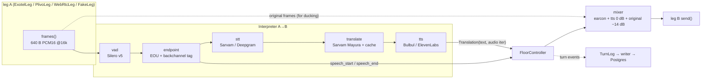
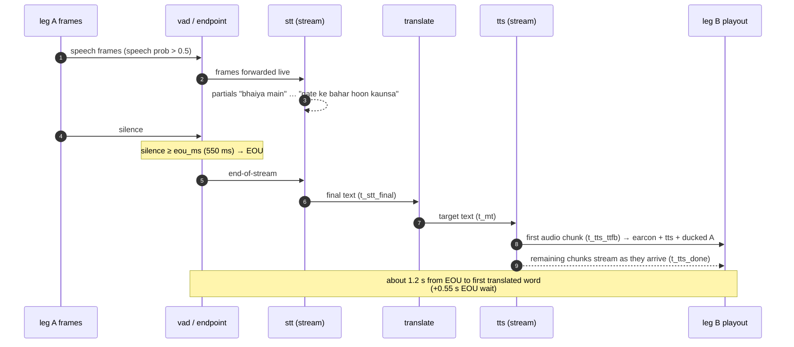

# Interpreter pipeline (one direction)

This doc covers one `Interpreter`: the code that turns one leg's incoming speech into translated audio for the other leg. A call runs two of them, A→B and B→A, as mirror images. Each one goes through the same eight stages: **frames, vad, endpoint, stt, translate, tts, mix, log**. The interpreter does not own playout. It hands a finished `Translation` (text plus an async audio iterator) to the [floor controller](floor-controller.md), and only the controller may call `send()`, `clear()` or `mark()` on a leg. This doc is for whoever works on `dubhash/interp/` (P2 owns vad/endpoint/stt/mt, P3 owns tts) and for anyone reading latency numbers.

---

## 1. Where it sits



The input side (vad, endpoint, stt) keeps running whatever the output side is doing. That is why A can talk while B→A is still playing: A's utterance is captured, translated and queued (see [floor-controller.md § speaking while playing](floor-controller.md#5-the-speaking-while-playing-case)).

Module layout (from the spec):

```
dubhash/interp/
  vad.py        Silero v5 onnx wrapper, RMS
  endpoint.py   EOU decision, backchannel tagging
  stt.py        STT stream interface + selection (SarvamStream, DeepgramStream, FakeSTT)
  mt.py         MT interface + translation cache (SarvamMT, FakeMT)
  tts.py        TTS stream interface + voice selection (BulbulStream, ElevenStream, FakeTTS)
  pipeline.py   Interpreter: wires the stages for one direction
dubhash/providers/
  sarvam_stt.py  deepgram_stt.py  sarvam_mt.py  sarvam_tts.py  eleven_tts.py  fakes.py
```

Every provider sits behind an interface with a fake. The pipeline has to run end to end with `FakeLeg` (wav in, wav out) before any telephony credit exists. See [leg-transports.md § FakeLeg](leg-transports.md#6-fakeleg-test).

---

## 2. Timing of one utterance

Example from the spec: A (Hindi) says *"bhaiya main gate ke bahar hoon, kaunsa building?"* and B hears Kannada.



STT runs during speech, so only the final transcript is on the critical path. MT and the start of TTS are the serial part. TTS audio streams to the leg as it arrives.

### Latency budget (after the speaker stops)

| Stage | Typical | Notes |
|---|---|---|
| End-of-utterance wait | 550 ms to start (400 to 700 ms range) | Silence threshold, cut short by Sarvam's EOU/final signal if it exists. This is the biggest single lever: too short clips sentences, too long feels dead. |
| Sarvam STT final | ~300 ms | Partials stream during speech. Only the final is waited on. |
| Sarvam translate | ~200 ms | Sentence-level. A cache hit skips this stage. |
| TTS first byte | ~300 ms | ElevenLabs Flash figure. Bulbul is quoted as "~similar". From Mumbai, ElevenLabs adds 150 to 250 ms RTT. |
| Provider playout | ~200 ms | 100 ms chunks, plus provider buffering. |
| **First translated word heard** | **EOU + ~1.2 s ≈ 1.4 to 1.8 s** | Targets: **p50 under 1.5 s, p95 under 2.0 s, measured on real PSTN, not loopback.** |

See [latency-engineering.md](../engineering/latency-engineering.md) for the cuts (warm sockets, cache, per-pair EOU tuning, v2 clause-level partial start).

---

## 3. Stages

### 3.1 frames

| | |
|---|---|
| Implementation | The transport yields 640-byte PCM16 mono 16 kHz frames (20 ms). `FrameClock` stamps each frame with leg-relative ms. |
| Measure | Jitter, gaps. Exotel drops are logged as `gap` events. |
| Owner | Rohan (`audio/frames.py`), P3 (transports) |

Frame format, `FrameClock` and gap handling are covered in [audio.md](audio.md).

### 3.2 vad

| | |
|---|---|
| Implementation | Silero VAD v5 (onnx), one instance per leg. It runs on every 20 ms frame: a 512-sample window at 16 kHz (≈32 ms), so it is fed 32 ms windows with a 20 ms hop. **speech prob > 0.5 = speech.** It also computes RMS, which is used for ducking and for measuring backchannel duration. |
| Measure | Speech/silence segments per leg. |
| Owner | P2 |

As built, the VAD is wrapped in `NoiseFloorGate` (`interp/vad.py`, L7): a frame counts as speech only if its RMS is also more than 6 dB above an adaptive noise floor (the level of the room, learned from non-speech frames, reset to the quiet 10th percentile when nearly every frame of the last 5 s is louder, digital silence ignored). Babble, a TV or phone AGC no longer keep Silero above 0.5 between sentences.

The VAD emits `speech_start(side)` and `speech_end(side)` to the floor controller. The controller uses these for the barge-in and backchannel timers, not only for EOU. Windowing details are in [audio.md § Silero windowing](audio.md#4-silero-vad-windowing).

### 3.3 endpoint (EOU)

| | |
|---|---|
| Implementation | EOU fires when **silence ≥ `eou_ms`** (per pair, start at **550 ms**) **AND** the utterance is **≥ 300 ms** long. If Sarvam's stream emits an end-of-utterance or final event earlier, take that instead. |
| Backchannel | Utterances **< 600 ms with ≤ 2 words** are tagged `backchannel` and **not translated**. |
| Max length | After `max_utterance_ms` (7000) an utterance ends at the next low-energy dip (at the latest 1 s later), `forced=True`; speech carrying on starts the next one (L7). |
| Measure | `t_eou` (ms after the last speech frame). |
| Owner | P2 |

```python
# endpoint.py, sketch of the decision (illustrative, not final code)
def should_end(silence_ms: int, utter_ms: int, sarvam_final: bool, eou_ms: int) -> bool:
    if sarvam_final:                      # vendor EOU/final arrived first: take it
        return True
    return silence_ms >= eou_ms and utter_ms >= 300
```

#### Backchannel tagging rule

A backchannel is "haan", "hmm", "sari", "ok": a short acknowledgement that must never interrupt playback and is not worth translating.

| Condition | Result |
|---|---|
| utterance duration < `backchannel_max_ms` (600) **and** STT word count ≤ 2 | tag `backchannel=true`. Do not call MT or TTS. Write a Turn row with the flag. |
| the same, but the final matches the call's phrase pack **and** the floor was free at the utterance's speech start (nothing playing or queued, no other utterance in flight) | an **instant acknowledgement** (L10): a real turn, translated as the pack line's canonical text, normally served from the prefilled MT and TTS caches (no vendor call) |
| otherwise | normal utterance: translate. |

- Duration comes from VAD speech-segment timing (RMS/speech prob). Word count comes from the STT final. So the tag is applied after the STT final arrives. The controller-side rule (speech shorter than `backchannel_max_ms` never changes state or clears audio) uses duration only, because it must act before any transcript exists. See [floor-controller.md](floor-controller.md#rule-3-backchannels-never-interrupt).
- In the overview's delivery call, the customer's "ಸರಿ" (0.4 s) is a backchannel and is not translated.
- Utterances shorter than 300 ms never reach EOU (the minimum-length condition above). What happens to them (dropped as noise, or merged into the next utterance) is **TBD — see [open questions](../plan/open-questions.md)**.

#### EOU tuning

550 ms is a guess. Tune per pair on the bench set by measuring **false-EOU rate** (a sentence split mid-way) against latency. Tamil speakers pause differently from Hindi speakers. The value lives in `config/pairs.yaml` as `eou_ms`. Whether Sarvam streaming emits a usable EOU event at all is open question #2 in the spec, and it decides the EOU latency floor (**TBD — see [open questions](../plan/open-questions.md)**).

### 3.4 stt

| | |
|---|---|
| Implementation | A Sarvam streaming STT websocket (Saarika/Saaras), either opened per utterance or **kept warm per leg** with a reset between utterances. Frames are forwarded live. Partials are kept for the console. On EOU, send end-of-stream and await the final. The language code comes from pair config (`hi-IN`, `kn-IN`). |
| Fallback | Deepgram Nova streaming for English and Hinglish, selectable per leg in `pairs.yaml` (`stt: sarvam` or `stt: deepgram`). |
| Measure | `t_stt_final` after EOU. WER on the bench set. |
| Owner | P2 |

- **Warm sockets.** Sarvam websocket connect plus auth costs 150 to 300 ms, so keep one open per leg. Whether a stream can stay open across utterances with a reset, or must reconnect, is unknown. A Pipecat issue reports SarvamSTT dying after 60 s of silence, which suggests a keepalive is needed (**TBD — see [open questions](../plan/open-questions.md)**).
- Partials go to the console over SSE ([console.md](console.md)). They are never sent to MT in v1 (speculation on partials, `spec_mt`, hit 1/8 live, L1a). Clause-level interpretation is built on STT *finals* instead: see [§3.4.1](#341-chunked-interpretation-l9).
- **Chaos requirement:** if a provider socket is killed mid-utterance, the interpreter must reconnect, and the controller must not deadlock ([testing-strategy.md](../engineering/testing-strategy.md)).

#### 3.4.1 Chunked interpretation (L9)

Latency is felt from when the speaker *starts*: a 5 s sentence translated after EOU is heard about 6.4 s after its first word, while first-audio (from speech end) says 1.4 s. With `chunking: true` on a pair (`interp/chunker.py`, used by `interp/pipeline.py`), an utterance is interpreted clause by clause, on the early-final machinery (L3):

| Step | What happens |
|---|---|
| cut | after `min(early_final_ms, chunk_pause_ms)` of silence inside the utterance, the STT stream is ended (`end()`), as an early final |
| commit request | when the pause reaches `chunk_pause_ms` (300) and the chunk so far has `chunk_min_ms` (1200) of speech, counted from the utterance start or the first speech after the last commit |
| guard | the chunk's STT final must have **at least 4 words** and must **not end with a digit, a number word** (en/hi/mr/gu/kn), **an unclosed quantity** (`OTP`, `flat`, `number`, `₹`, `Rs.`, `pin`, `code`…) or a dangling English function word (`at`, `the`, `to`…) |
| commit | if speech resumes and the guard passed: the chunk is translated, synthesised and handed to the floor (`final_chunk=False`) as soon as it is ready; the utterance continues in a **fresh STT stream fed only from the pause on** (200 ms of it as pre-roll), never the committed audio |
| no commit | guard failed, or the pause was shorter: the early final is discarded and the stream restarted on the whole buffered chunk (replay), as L3 |
| last chunk | delivered at EOU exactly as before (`final_chunk=True`); a pause that ends in EOU is a plain early final |

Each chunk has its own `seq`; the chunks of one utterance share `utterance_id` and count `chunk` 0, 1, …; deliveries keep order through a per-utterance chain (after the previous utterance, then each chunk). A chunk's `t_speech_start`/`t_speech_end` are its own speech, its `t_eou` is its commit time, and `t_utt_start` is the utterance's start (set on unchunked turns too). The backchannel rule applies only to whole utterances. Only chunk 0 gets the earcon. With `early_final_ms: 0` the cut happens at `chunk_pause_ms` (so the last chunk is then an early final too). Off by default; see [L9](../plan/open-questions.md#answer-log) for measurements and which pairs have it on.

### 3.5 translate

| | |
|---|---|
| Implementation | Sarvam translate (Mayura), `source=hi-IN target=kn-IN`, mode **colloquial**, with `numerals_format=native` **off** (keep digits). **One request per utterance.** Exact-text cache hits skip the call. |
| Measure | `t_mt`. Meaning rating on the bench set. |
| Owner | P2 |
| v2 | An LLM used only for low-confidence repair. Not in v1. |

Translation is direct Indic→Indic. There is no English pivot.

#### Translation cache

Greetings, confirmations and numbers repeat. An exact-match cache per pair skips MT entirely, saving about 200 ms.

| Property | Value |
|---|---|
| Key | `(src_lang, tgt_lang, src_text)`. Exact match. |
| Value | target text. |
| Scope | Per pair, in process memory. Nothing in the hot path touches Redis or Postgres. |
| Normalisation | NFC, zero-width joiners, case, repeated whitespace and a final `.`/`।`/`!`; a `?` is kept (L10) |
| Privacy | The per-call cache holds user text in memory only and is never persisted. A second, process-wide store holds only phrase-pack translations, written only by the prefill (L10). Bound: 512 entries per call, LRU |

A cache hit still writes `t_mt` (≈0) and the `mt_provider` on the Turn row, so p50/p95 per stage stays honest. Hits are flagged beside the row (`mt_cache_hit`, `tts_cache_hit`, `phrase_hit`, `ack`, `number_fix`, `stt_open_ms`: `TurnLog.flags`, the turn event's `flags` and `GET /v1/calls/{id}/turns`), not in the `turns` schema.

The TTS stage has the same kind of cache (`providers/tts_cache.py`, L10): PCM by (text, voice, lang), 64 MB LRU shared by the process, phrase-pack audio also on disk. Together with the MT cache and the phrase-pack prefill, a repeated phrase costs only STT. The number read-back (`interp/numbers.py`) runs after MT when the call's pack asks for it.

### 3.6 tts

| | |
|---|---|
| Implementation | Streaming: a Bulbul or ElevenLabs websocket per utterance (kept **warm per leg-direction**). The **first chunk is forwarded to the other leg's `send()` as soon as it arrives** (through the controller and mixer). The voice is chosen from pair config and the detected speaker gender. |
| Provider by target language | **Sarvam Bulbul** for Indic targets: kn, ta, mr, te, ml, bn, gu, pa, od. **ElevenLabs Flash v2.5** for Hindi and English targets (and for voice cloning in v2). The choice is per language in `config/pairs.yaml`. |
| Voice (v1) | A **fixed natural voice per target language and detected speaker gender**, so a male Hindi speaker is heard in Kannada as a gender-matched natural voice. It does **not** sound like the speaker. Voice cloning is v2 and needs explicit consent. |
| Gender detection | Pitch heuristic on the first 2 s of the speaker (detector proposed for P2, consumed here by P3; ownership open as PQ20; see [audio.md § pitch](audio.md#9-pitch-heuristic-gender)). Whether this is acceptable for v1, or whether the platform should pass gender in the API, is open. |
| Measure | `t_tts_ttfb` (turns), `t_tts_done` (bench only: the `turns` schema has no column for it, see [latency-engineering.md](../engineering/latency-engineering.md#timestamps-to-log)). |
| Owner | P3 |

Streaming TTS to the transport before synthesis finishes saves 300 to 800 ms on long sentences. ElevenLabs RTT from Mumbai is 150 to 250 ms, which is why Bulbul is primary for Indic targets. Bulbul vs ElevenLabs per language (kn, ta, mr) still needs a 30-minute listening test for naturalness and first byte from Mumbai, and the result goes into `pairs.yaml` (**TBD — see [open questions](../plan/open-questions.md)**).

The TTS output sample rate must be resampled to 16 kHz PCM16 if it differs ([audio.md § resampling](audio.md#5-resampling-8k--16k)). The provider output formats are not stated in the source PDFs.

### 3.7 mix

| | |
|---|---|
| Implementation | The listener's outbound stream = **earcon (120 ms) + TTS at 0 dB**, with the **speaker's original frames mixed at −14 dB** during the TTS window. The mixer writes 20 ms frames to the transport, and the transport chunks them to 100 ms. |
| Measure | Clipping check: the mix never exceeds int16. Clipping sets the `clipped` flag. |
| Owner | Rohan |

Full mixer math is in [audio.md § mixer](audio.md#6-mixer). `duck_db` is per pair in config (−14).

### 3.8 log

| | |
|---|---|
| Implementation | One `Turn` row per utterance: side, src text, tgt text, every timestamp above, clipped flag, backchannel flag, stt/mt/tts provider ids. |
| Measure | p50/p95 per stage per pair, nightly. |
| Path | The interpreter and controller push turn records onto an in-memory queue. A background task (`store/writer.py`) batch-inserts them into Postgres. **Nothing in the hot path touches Postgres or Redis.** |

Turn row (from the schema in [data-model.md](data-model.md)):

```
turns(id, call_id, side, seq, t_speech_start, t_speech_end, t_eou, t_stt_final, t_mt, t_tts_ttfb,
      t_play_start, t_play_end, src_text, tgt_text, backchannel, clipped_ms,
      stt_provider, mt_provider, tts_provider, voice,
      utterance_id, chunk, t_utt_start)            -- L9, nullable
```

With chunking, one utterance is one row per chunk. A database created before L9 needs `ALTER TABLE turns ADD COLUMN utterance_id integer, ADD COLUMN chunk integer, ADD COLUMN t_utt_start integer` (the dev schema is `create_all`, no migrations).

`src_text`/`tgt_text` are kept only if the call was created with `record: true` or the platform opted in. Otherwise they are nulled after latency metrics are computed.

---

## 4. Per-stage measures (summary)

| Stage | Timestamp / metric | Where it goes |
|---|---|---|
| frames | jitter, gaps | `events(kind=gap)` |
| vad | speech/silence segments, `t_speech_start`, `t_speech_end` | turns |
| endpoint | `t_eou` (ms after last speech frame), false-EOU rate (bench) | turns, bench report |
| stt | `t_stt_final`, WER (bench) | turns, bench report |
| translate | `t_mt`, meaning rating kept/partly/lost (bench, 300 turns per pair) | turns, label tool |
| tts | `t_tts_ttfb` (turns), `t_tts_done` (bench report only) | turns, bench report |
| mix / play | `t_play_start`, `t_play_end`, clipping flag, `clipped_ms` (barge-in) | turns |
| headline | first-audio = `t_play_start − t_speech_end`: p50 under 1.5 s, p95 under 2.0 s on PSTN | `calls.p50_first_audio_ms`, `p95_first_audio_ms` |
| felt (L9) | per utterance: speech start → first heard, ear-voice span, first audio (speech end → last chunk) | `store/timeline.utterance_metrics`: recorder summary, `call_report`, `bench`, `live_loopback` |

Headline latency figures must come from two real phones through Exotel or Plivo. 8 kHz codec audio changes STT latency and accuracy, and provider playout buffering does not show up in loopback. See [evaluation-and-metrics.md](../engineering/evaluation-and-metrics.md).

---

## 5. Per-pair config

Each direction reads its STT engine, TTS engine, voices, `eou_ms`, `backchannel_max_ms`, `barge_in_min_ms` and `duck_db` from `config/pairs.yaml`. The schema and the hi-kn example are in [configuration.md](configuration.md#configpairsyaml).

The `tts`/`voice_*` fields on a side are the voice that side's language is **spoken in**, so they are used when that side is the *target*. In `hi-kn`, A→B speech is synthesised with side `b`'s Bulbul Kannada voice, and B→A with side `a`'s ElevenLabs Hindi voice. The voice IDs in the spec example (`bulbul:kn-male-1` etc.) are placeholders.

---

## 6. Interfaces (sketch)

The spec fixes only `LegTransport` and `FloorController`. The shapes below are the minimum the pipeline needs. They are illustrative, and P2 and P3 own the final signatures.

```python
@dataclass
class Translation:
    side: Literal["a", "b"]          # source side; it plays to the other leg
    seq: int                         # per-direction order
    src_text: str
    tgt_text: str
    audio: AsyncIterator[bytes]      # PCM16 @16k chunks, streamed from TTS
    voice: str
    timings: dict[str, int]          # t_speech_start … t_tts_ttfb (call-relative ms, see data-model.md)

class STTStream(Protocol):           # SarvamStream, DeepgramStream, FakeSTT
    async def push(self, frame: bytes) -> None: ...
    async def end(self) -> str: ...  # end-of-stream → final text
    def partials(self) -> AsyncIterator[str]: ...

class MT(Protocol):                  # SarvamMT, FakeMT
    async def translate(self, text: str, src: str, tgt: str) -> str: ...

class TTSStream(Protocol):           # BulbulStream, ElevenStream, FakeTTS
    def synth(self, text: str, voice: str) -> AsyncIterator[bytes]: ...
```

---

## 7. Open items affecting this doc

- Does Sarvam streaming emit EOU/final-on-silence? (spec Q2)
- Sarvam socket lifetime and keepalive. (spec Q4)
- Bulbul vs ElevenLabs per target language. (spec Q3)
- Is the gender pitch heuristic good enough? (spec Q5)
- What happens to utterances under 300 ms, and the translation cache bounds.

All of these: **TBD — see [open questions](../plan/open-questions.md)**.

## Related

- [floor-controller.md](floor-controller.md): who plays when, queueing, barge-in
- [audio.md](audio.md): frames, VAD windowing, resampling, mixer
- [leg-transports.md](leg-transports.md): where frames come from and go to
- [configuration.md](configuration.md): `pairs.yaml`
- [data-model.md](data-model.md): `turns`, `events`
- [../engineering/latency-engineering.md](../engineering/latency-engineering.md)
- [../engineering/evaluation-and-metrics.md](../engineering/evaluation-and-metrics.md)
- [../architecture/system-overview.md](../architecture/system-overview.md)
- [../plan/open-questions.md](../plan/open-questions.md)
