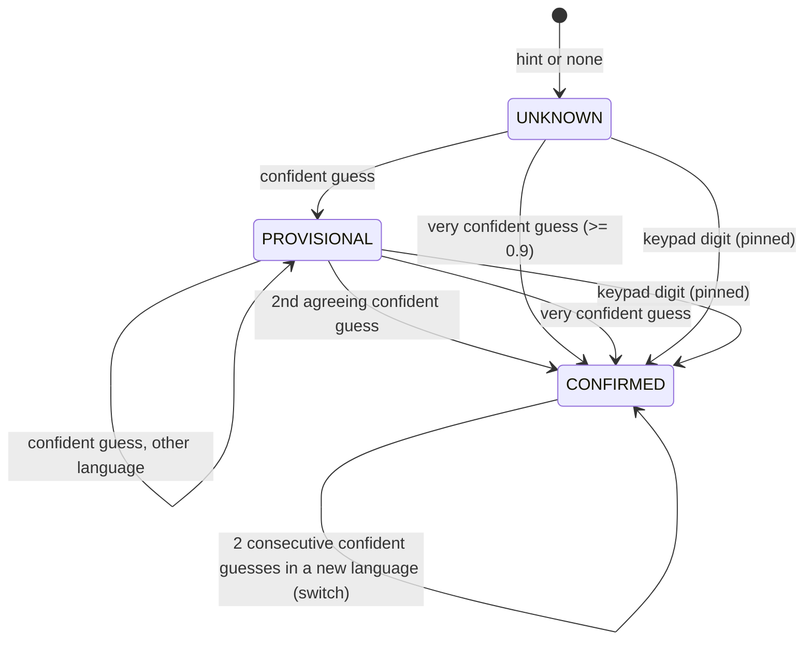

# Language detection (`lang: "auto"`)

On a real phone call we often don't know what language a caller speaks. A side whose `lang` is `"auto"` is detected from its own speech during the call. This document covers the API surface, the per-side resolver, how the pipeline keeps translating before the language is known, the keypad-menu fallback and the same-language bridge. Code: `dubhash/session/language.py` (resolver), `dubhash/session/call_session.py` (wiring), `dubhash/interp/langid.py` (the shared `LanguageID` contract), `dubhash/providers/sarvam_lid.py` (the Sarvam engine, owned by the language-ID engine work, L8).

## What is allowed to go live

Only measured languages are ever claimed: `SUPPORTED_LANGS = hi-IN, mr-IN, gu-IN, kn-IN, ta-IN, en-IN` (`interp/langid.py`). Anything else (Telugu, Bengali, …) is never set as a side's language. It counts as "unsure", and two unsure utterances bring up the keypad menu, whose six digits are exactly these languages.

## API

| Where | Field | Meaning |
|---|---|---|
| `POST /v1/calls` | `a.lang` / `b.lang` = `"auto"` | detect this side's language on the call |
| | `a.lang_hint` / `b.lang_hint` | optional BCP-47 prior, e.g. the platform's profile language. Ignored for a fixed `lang`, and ignored (never claimed) when not supported |
| `POST /loopback/calls`, `POST /join` | `a_lang` / `b_lang` = `"auto"`, `a_lang_hint` / `b_lang_hint` | the same, for the loopback and stage paths |
| `GET /v1/calls/{id}` | `legs.{a,b}.detected` | `{lang, state, auto}` so far |
| `/join` picker | "Or pick each side" | `Auto-detect` per side, or a fixed language |
| `/join` phone page | | an auto side shows "अपनी भाषा में बोलिए / Speak in your language" until its `lang` event confirms a language, then that language's name (`join_phone.js`) |

A fixed side next to an auto side must be a supported language (`422 unsupported_pair` otherwise). Details: [API](api.md#body-fields).

## The resolver (one per auto side)

Per utterance (`LanguageResolver.observe`):

- **Only utterances of at least `min_speech_ms`** (default 2000, `LANG_MIN_SPEECH_MS`; [L8](../plan/open-questions.md#answer-log): decide from 2.0 s, never from 1.0 s) count: speech start to the last voiced frame. Shorter ones ("haan ji", "OTP 4729") are skipped and get no language-ID call.
- **Evidence**: the `LanguageID` guess on the utterance audio (`SarvamLID`: `saaras:v3` and `v4` vote on the first 2.0 s; 0 wrong of 360 in L8), the STT final's language when the vendor reports one (only with `AUTO_STT_OPEN=auto`: Sarvam realtime finals then carry `language` + `language_confidence`; L8 found it `en-IN` on every short clip and wrong at 1.0, so its score is capped at 0.7: alone it is at most PROVISIONAL), and the hint. Per language the scores are combined as a noisy-or; the winner's confidence is multiplied by (1 − the runner-up's), so two engines disagreeing is low confidence. The hint lifts a language that some evidence named (by `hint_prior` 0.15) and never resolves a side on its own.
- **Confident** is ≥ 0.6 (`en-IN`: ≥ 0.95, `lang_confident`), **very confident** ≥ 0.9.
- **English rules** (loanwords): when the side is in an Indic language and the utterance's transcript has ≥ 20 % Indic-script letters, English evidence is dropped. When an Indic guess in the utterance is confident, the STT final's `en-IN` is dropped whatever its score, and a LID `en-IN` must clear 0.95. Live, Sarvam realtime said `en-IN` at 0.98–0.99 on a Hindi speaker's lines with English words while the LID said `hi-IN` at 0.95–0.96 (c_f4h2dho56j).
- **Menu**: `menu_after` (2) consecutive unsure or unsupported utterances on a side that is not CONFIRMED ask once per call for the keypad menu.
- A CONFIRMED side switches only after `switch_after` (2) consecutive confident utterances in one new language; an utterance in its own language, or an unsure one, resets the count.

Each change is published as the CallEvent `lang` `{side, lang, state, confidence, source}` (`source`: `stt_final` | `lid` | `hint` | `dtmf`; a menu request adds `menu: true` with the side's current lang/state). The recorder keeps it (`summary.json` `langs`), `tools/call_report.py` prints a LANGUAGE section, the console shows it as a marker, and the `/join` phone page listens for it. The log line `lang.evidence` (no text) has each utterance's raw evidence, for tuning.

**When**: an utterance is judged once it has both its final and its EOU (after EOU no early-final restart can replace the final), not after its MT/TTS. Language ID runs then, once per utterance (each early-final restart used to start its own call). Live, a side was CONFIRMED 0.8–0.9 s after its speaker stopped (c_iaxjjfwyog).

## Translating before the language is known

- **The auto side's speech** goes through the English pivot (`stt: sarvam-translate`, `mt_src: en-IN`), so translating it never needs its language. By default (`AUTO_STT_OPEN=guess`) STT opens in the side's best language so far (resolved, else hint, else Hindi) and reopens once that changes (the warm pool is keyed by language; prewarm warms the same one). Measured 21 Oct (one Bulbul line per language): `mode=translate` opened in `hi-IN` gave the same English as opened in the speaker's own language for all of hi, mr, gu, kn, ta, en, te; finals 114–281 ms. The switch `auto` opens it with `language_code=auto` instead (Sarvam rejects `unknown`).
- **The target for a listener** is that listener's resolved language; while it is UNKNOWN, its hint, else Hindi. When it resolves, later translations use it (MT target, Bulbul voice per language from pairs.yaml, and MT is skipped when the speaker's pivot English already is the target). A translation already through MT keeps the language it was made in.
- **The effective pair** is rebuilt on every change (`config.pairs.effective_pair`) from the per-language side defaults in pairs.yaml (`language_sides`, shared with ward mode). Each side's STT provider and the pair-level knobs (`eou_ms`, `early_final_ms`, …) stay those the call started with (`auto_pair`).
- The co-located cross-talk language check (a final in the other side's language is cross-talk) only runs once both sides' languages are known.

## Opening line

An auto side hears a neutral line in its hint language (Hindi without one) plus English: "Namaste, apni bhasha mein boliye. Please speak in your language." (`prompts.auto_opening_text`, about 3.7–4.1 s of Bulbul live). A fixed side whose partner is still unknown hears only its own language's name and "speak" (`partner_auto_opening_text`), so no language is claimed. TODO(PQ5): native review of every string.

## Keypad menu

When the resolver asks for it, the side's leg hears (Hindi voice): "Hindi ke liye 1 dabaiye, Marathi 2, Gujarati 3, Kannada 4, Tamil 5, English 6. For Hindi press 1, …". The menu is not cut by translations (`play_prompt(cuttable=False)`): a translation for that leg waits until the menu's mark (it ran ~10 s on fakes; on the live gu-hi call that falsely asked, the held translation waited 5.2–5.5 s). The DTMF hook (`FloorController(dtmf_hook=…)`) sees every digit first: from the menu request until `MENU_WINDOW_MS` (15 s) after the menu finished, that side's digits mean language (1–6 pick, others are ignored, including the escape digit); outside the window digits keep their meaning (1 replay, 0 escape). A digit confirms and **pins** the side (`source: dtmf`): detection no longer moves it.

## Same language on both sides

When both sides are resolved (a fixed side counts as resolved) to one language, the session enters the floor's bypass itself (`FloorController.enter_bypass(side, reason="same_lang")`): the `bypass` event carries `reason` instead of `digit`, interpreters stop, frames are forwarded raw, and `escape_used` stays false. Logged as `session.same_lang_bridge`.

## Measured (21 Oct, live loopback, `tools/live_loopback.py --auto`)

| Call | Setup | Heard first-audio p50 / p95 (n=6) | Language |
|---|---|---|---|
| c_g4y5ifrczp | `mr-hi` fixed (baseline) | 1460 / 1760 | — |
| c_bulistxoyc | A (Marathi) auto, no hint | 1500 / 1860 | A CONFIRMED mr-IN on its 1st line (STT final 0.99) before B's first reply, which was already in Marathi |
| c_zx7uu2n3n6 | `clinic-mr-en`, B (English) auto | 1400 / 1440 | A's 1st line went to B in Hindi (fallback); B CONFIRMED en-IN on its 1st line; then A→B skipped MT (heard 700 / 880) |
| c_f4h2dho56j | `delivery-gu-hi`, both auto, before the English rule | 1480 / 6920 | B (Hindi) unsure twice (STT en-IN 0.99 vs LID hi-IN 0.95): keypad menu, a translation held 5.5 s |
| c_iaxjjfwyog | same, with the English rule | 1480 / 1740 | A gu-IN and B hi-IN CONFIRMED on their 1st lines, 0.9 / 0.8 s after speech end; no menu |
| c_hez5stsvje | same, final defaults (`guess`, 2.0 s, LID v3+v4 vote) | 1560 / 1740 | both CONFIRMED on their 1st lines from the LID alone (0.997), 1.5 / 0.8 s after speech end (the first LID call is cold); no menu |

The first four calls ran with `AUTO_STT_OPEN=auto` and `min_speech_ms` 1500, before L8 landed.

Scripted Bulbul speakers on wideband audio: real callers on 8 kHz PSTN, with accents and noise, will be less clean. Fakes (`tests/session/test_lang_auto_session.py`, `tests/test_integration_lang_auto.py`) cover the state machine, retargeting, code-mixing, the menu, DTMF and the bridge.

## Open

- Tune `min_speech_ms`, the thresholds and the English rule on PSTN audio (L8 numbers).
- A wrong CONFIRMED language needs two utterances to undo; a keypad option mid-call ("press 9 to change language") is not built.
- The menu holds the queue head, so a translation for the *other* leg queued behind it waits too.
- LID still runs on every long utterance of a CONFIRMED side (to notice a switch): one REST call per utterance; could stop after N agreeing ones.

## Related

- [API](api.md), [configuration](configuration.md), [floor controller](floor-controller.md), [interpreter pipeline](interpreter-pipeline.md)
