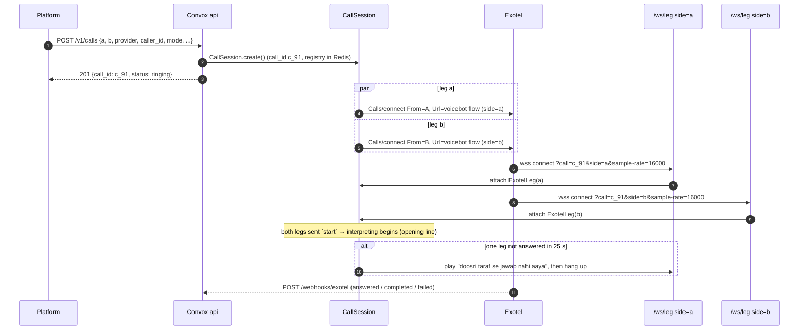
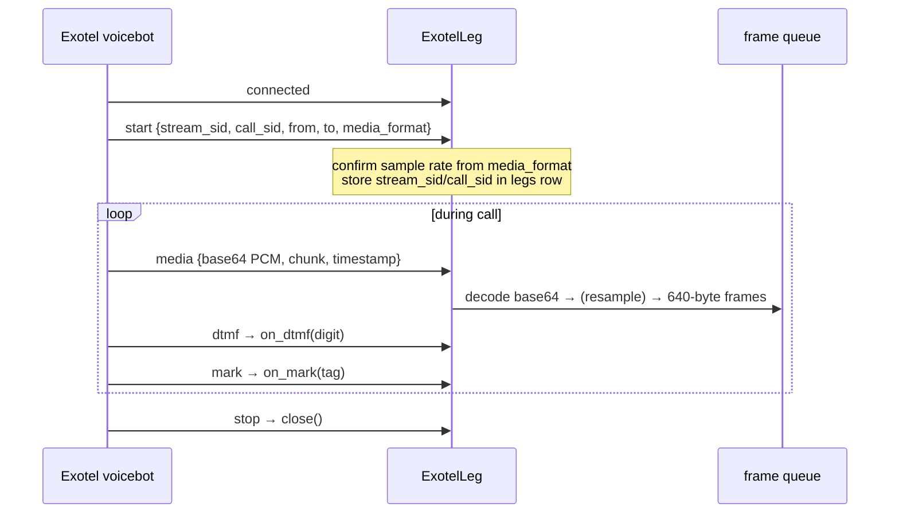

# Leg transports

A leg transport is the one class per provider that turns that provider's websocket protocol into the stream every other part of Convox uses. It provides 20 ms PCM16 frames in, a sink for frames out, and three control signals (clear, mark, DTMF). Exotel and Plivo differ only inside this class, and the interface is about 120 lines per provider. Four implementations exist: `ExotelLeg` (primary), `PlivoLeg` (fallback), `WebRtcLeg` (dev and last-resort demo) and `FakeLeg` (tests and bench). Code: `convox/legs/` (`base.py`, `exotel.py`, `plivo.py`, `webrtc.py`, `fake.py`). Owner: **P3**. The session wiring, and the rule that only the floor controller calls `send/clear/mark`, belong to Rohan.

---

## 1. The interface (verbatim from the spec)

```python
class LegTransport(Protocol):
    leg_id: str                                   # "a" | "b"
    async def frames(self) -> AsyncIterator[bytes]: ...   # 640-byte PCM16@16k frames, as they arrive
    async def send(self, pcm16_16k: bytes) -> None: ...   # queued for playout; chunked by provider rules
    async def clear(self) -> None: ...                    # drop queued, not-yet-played audio (barge-in)
    async def mark(self, tag: str) -> None: ...           # ask for a callback when audio before this point has played
    def on_mark(self, cb: Callable[[str], None]) -> None: ...
    def on_dtmf(self, cb: Callable[[str], None]) -> None: ...
    async def close(self) -> None: ...
```

Contract details every implementation must honour:

| Method | Contract |
|---|---|
| `frames()` | Yields exactly 640-byte frames: PCM16 mono 16 kHz. Resampling and μ-law decoding happen inside the transport. Gaps are reported, not filled with fake speech ([audio.md § gap handling](audio.md#3-gap-handling)). |
| `send()` | Accepts any multiple of 640 bytes at 16 kHz. Buffers it and flushes in provider-sized chunks (100 ms, multiples of 320 bytes). Resamples to the wire rate if needed. |
| `clear()` | Drops everything queued and not yet played, both in our buffer and on the provider side. Pending marks for cleared audio must not fire as "played". The controller ignores stale tags in any case. |
| `mark(tag)` | Inserted after the last byte sent so far. `on_mark` callbacks fire with `tag` when the provider confirms that audio up to that point has played. This is how the controller knows playback ended. |
| `on_dtmf(cb)` | `cb(digit)` per key press (`"0"`–`"9"`, `"*"`, `"#"`). |
| `close()` | Idempotent. Closes the websocket. The `CallSession` dies when both legs close. |

---

## 2. Where legs come from

One `CallSession` per call, with both legs on the **same process** because they share a controller. The API creates the session. Each provider websocket lands on `/ws/leg` and attaches to the session by the **call id in the URL**. Redis holds only the call registry for cross-node lookup. Nothing in the hot path touches Redis or Postgres.

### Outbound call setup (two legs)

The provider REST calls (`Calls/connect` for Exotel, `Call/` for Plivo), the "both legs sent `start`" rule and the 25 s no-answer rule are specified once in [telephony-integration.md § outbound two-leg setup](../architecture/telephony-integration.md#outbound-two-leg-setup). The transport-side view:



**Exotel never connects A to B.** As far as it knows, it is running two separate voice bots. Convox is the only thing joining them, so it hears and speaks on both sides. The phones, numbers and masking are unchanged.

The dial-in consumer flow (Exotel `Gather(digits=10) → Passthru → our server dials leg b`) also ends on the Voicebot applet for leg a. See [api.md](api.md) and [../architecture/telephony-integration.md](../architecture/telephony-integration.md).

---

## 3. ExotelLeg

Exotel's **voicebot applet** is two-way: Exotel opens a websocket to our server, sends the caller's audio as `media` messages, and plays back the `media` messages we send. (The **stream** applet is one-way and of no use here.)

### URL

```
wss://edge.convox.in/ws/leg?call=c_91&side=a&sample-rate=16000
```

Exotel allows **3 custom params**. `call` and `side` are two of them. The overview's integration example writes the path as `/leg`. The spec's API defines `/ws/leg`. Use **`/ws/leg`**.

### Inbound events



| Event | Fields used (as named in the spec) | Handling |
|---|---|---|
| `connected` | — | Socket accepted. Look up the session by `call` and `side`. |
| `start` | `stream_sid`, `call_sid`, `from`, `to`, `media_format` | Confirm the sample rate. Persist to `legs(provider_call_sid, stream_sid, sample_rate, answered_at)`. |
| `media` | base64 PCM, `chunk`, `timestamp` | Decode, resample if 8k, slice into 640-byte frames, push to the frame queue. Use `chunk`/`timestamp` for gap detection. |
| `dtmf` | digit | `on_dtmf` callbacks. |
| `stop` | — | Close and record `closed_at`, `close_reason`. |

### Outbound

- Buffer `send()` bytes and flush them as `media` events of **100 ms (3,200 bytes at 16 kHz, which must be a multiple of 320)**. Smaller chunks would make `clear` more responsive, but stay at 100 ms.
- `clear()` → Exotel `clear` (drops queued audio on Exotel's side) plus flushing our local buffer.
- `mark(tag)` → Exotel `mark`. Exotel reports back when audio sent before it has finished playing.
- The exact JSON shape of outbound `media`/`clear`/`mark` messages is not in the source PDFs. Take it from Exotel's voicebot docs or the Pipecat Exotel serializer, which the spec lets us borrow as a library.

### Auth

**Basic auth header or IP allowlist.** Ask Exotel to allowlist the VM's IP. Reject any `/ws/leg` connection that does neither, or that names an unknown `call`.

---

## 4. PlivoLeg

Plivo's audio stream element, configured as:

| Attribute | Value |
|---|---|
| `bidirectional` | `true` |
| `audioTrack` | `inbound` |
| `contentType` | `audio/x-l16;rate=16000` **if accepted**, else `audio/x-mulaw;rate=8000` and decode/resample |

- Same event shape as Exotel: `start` / `media` / `dtmf` / `stop`.
- Outbound uses **`playAudio`**, barge-in uses **`clearAudio`**, and marks use **`checkpoint`**.
- The call is created with `POST /v1/Account/{id}/Call/` with `answer_url` returning XML that contains the Stream element.
- Whether the India region supports `audio/x-l16;rate=16000` on bidirectional streams, or only 8 kHz μ-law, is spec open question 6. **TBD — see [open questions](../plan/open-questions.md).**
- Account: Plivo is self-serve with Udyam registration (filed on Day 1, see [buildathon-10-day-plan.md](../plan/buildathon-10-day-plan.md)).
- Auth for Plivo's websocket to us is not specified in the PDFs. **TBD — see [open questions](../plan/open-questions.md).** At minimum, require the unguessable `call` id and validate it against the registry.

### Exotel vs Plivo mapping

| Concept | Exotel voicebot | Plivo audio stream |
|---|---|---|
| inbound audio | `media` (base64 PCM16; 16k requested, 8k possible, Q1) | `media` (l16 16k or μ-law 8k) |
| outbound audio | `media` | `playAudio` |
| drop queued audio | `clear` | `clearAudio` |
| playback-done callback | `mark` | `checkpoint` |
| keypad | `dtmf` | `dtmf` |
| end | `stop` | `stop` |

---

## 5. WebRtcLeg (dev)

- A page with a mic. Audio travels as Opus over a data channel or as plain websocket PCM. **Two tabs = two legs.**
- A tiny signalling endpoint pairs the two tabs into one `CallSession` (same `call` id, `side=a|b`).
- This is how the team develops **without a single telephony minute**, and it is the **fallback demo if credits fail** (WebRTC browser legs as the last resort, with the Exotel applet config on screen).
- Emulating `mark`: the browser reports playback position (or the server estimates it from bytes sent and real time) and fires `on_mark`. `clear` drops the browser's playout queue. DTMF can be on-page buttons `0`/`1` so the controller rules stay testable.
- Not valid for latency claims: loopback hides 8 kHz codec effects and provider playout buffering. Use it for correctness only.
- Ward mode (push-to-talk, one phone) uses the same pipeline with **no transport** ([console.md](console.md)).

---

## 6. FakeLeg (test)

- Plays a **wav as the inbound frames at real time** (or faster for tests) and **captures outbound frames to a wav**.
- `mark` fires once the captured output reaches the marked byte offset, either in simulated real time or immediately in fast mode. `clear` truncates the pending outbound buffer. DTMF can be scripted at timestamps.
- `tools/bench.py` runs **two FakeLegs with scripted utterances** (team-recorded, 30 per language, phone quality, with background-noise variants) through the real providers and measures every latency stage.
- The rule for the build: the pipeline must run end to end with `FakeLeg` (wav in, wav out) before any telephony credit exists, so STT, translate, TTS and the controller can be built and measured early.

---

## Sample-rate confirmation

Requesting 16 kHz is not proof of getting it.

1. Request 16 kHz (`sample-rate=16000` for Exotel, `audio/x-l16;rate=16000` for Plivo).
2. On `start`, read the actual rate (Exotel: `media_format`).
3. If it is 8 kHz, **enable resampling in both directions** (8k→16k in, 16k→8k out), write `legs.sample_rate=8000`, and emit an event/log line.
4. Never assume. Exotel's docs are ambiguous on whether the voicebot applet honours 16k, and **this is the first thing to test** with the first sponsor minute (spec Q1). Its answer decides whether a resampler sits on the hot path.

```python
# inside ExotelLeg.on_start (illustrative)
wire_rate = parse_rate(msg["start"]["media_format"])   # field name per spec; parse format TBD
if wire_rate != 16_000:
    self.rx = soxr_stream(wire_rate, 16_000)
    self.tx = soxr_stream(16_000, wire_rate)
    log.warning("exotel sent %d Hz despite sample-rate=16000; resampling", wire_rate)
```

---

## Auth summary

| Transport | Inbound auth |
|---|---|
| ExotelLeg | Basic auth header or IP allowlist of the VM (ask Exotel) |
| PlivoLeg | TBD (validate `call` id against the registry at minimum) |
| WebRtcLeg | dev only. Keep behind console auth or local network. Details TBD. |
| FakeLeg | in-process, none |

TLS for everything is terminated by Caddy on the ap-south-1 VM ([deployment.md](../engineering/deployment.md), [security-privacy.md](security-privacy.md)).

## Related

- [audio.md](audio.md): frame format, resampling, chunking, gaps
- [floor-controller.md](floor-controller.md): the only caller of `send/clear/mark`
- [interpreter-pipeline.md](interpreter-pipeline.md): the consumer of `frames()`
- [api.md](api.md): `POST /v1/calls`, `WS /ws/leg`, webhooks, dial-in
- [data-model.md](data-model.md): `legs` table
- [../architecture/telephony-integration.md](../architecture/telephony-integration.md)
- [../architecture/system-overview.md](../architecture/system-overview.md)
- [../plan/open-questions.md](../plan/open-questions.md)
